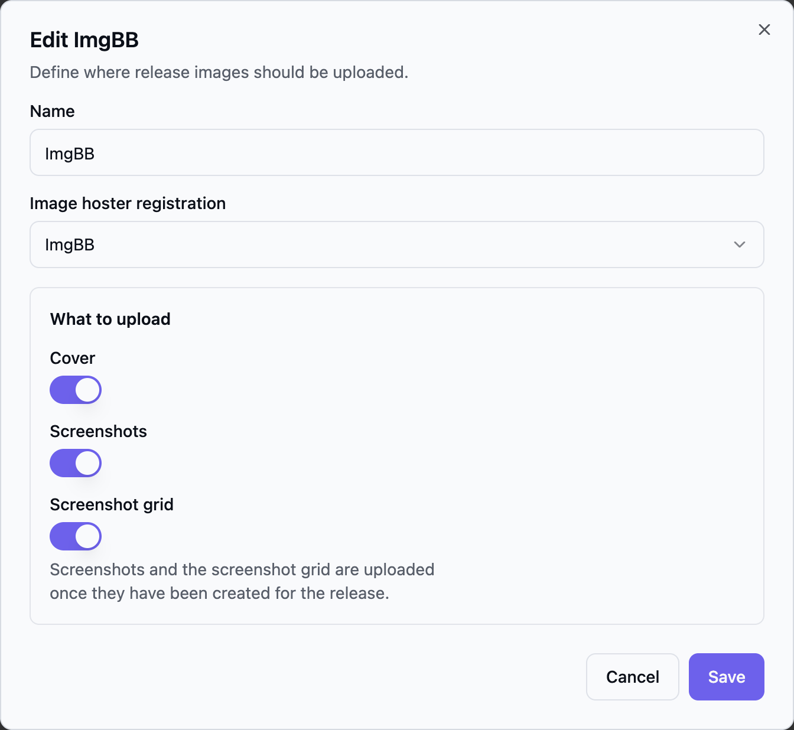
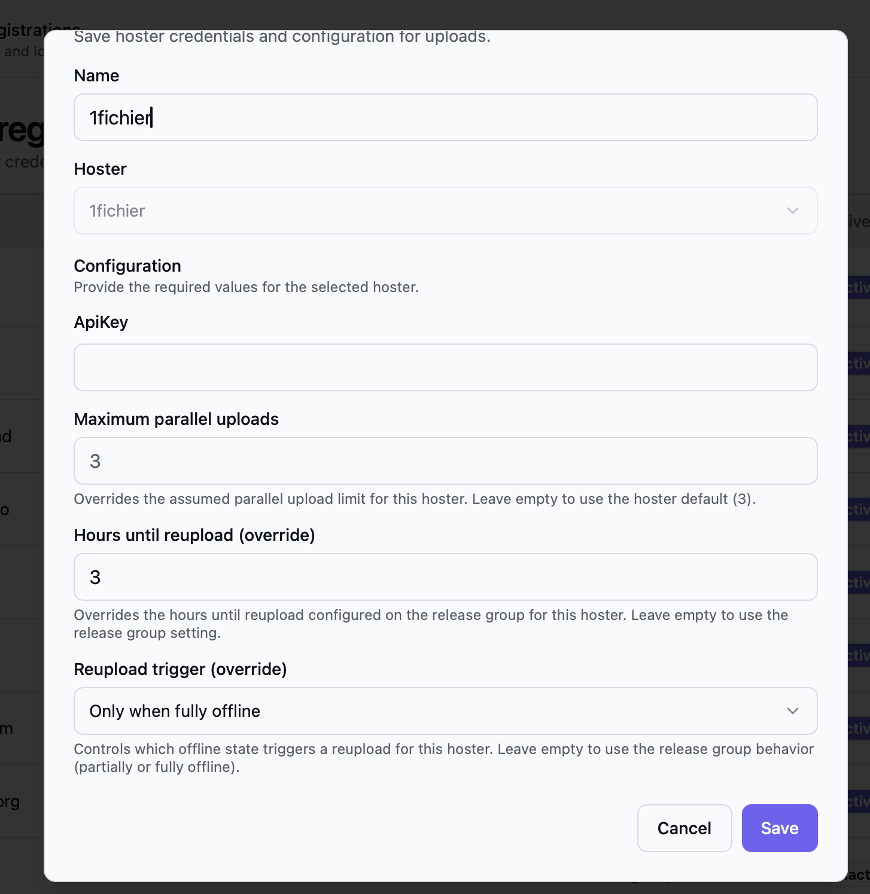

Find hoster accounts under **Registrations > Hosters > Hoster registrations**.
See [Your first upload](/post-installation/#set-up-manually) to add your first account.
This page covers other services, reuploads, and upload limits.

## Setting up link crypters and metadata sources

- Open **Registrations > Crypters > Crypter registrations** and add your account.
  Then open a release, go to **Uploads > Configuration**, and expand the saved upload configuration.
  Add the link crypter there, with a container password if needed.
- Open **Registrations > NFO database registrations** to enable sources for scene release information and NFOs.
- Open **Registrations > Metadata sources** to add providers for titles, descriptions, genres, and cover images.

See [Release Information and Metadata](/release-information-and-metadata/) for details.

## Setting up image hoster accounts

Open **Registrations > Image hoster registrations** and click **New image hoster**. Choose the hoster and enter
the required credentials.

## Image upload configuration

On a release's **Images** tab, click **Add** under **Image upload configurations**. Choose a name and an
image hoster registration. Then choose which images Bearcat should upload:

| Option | Default | Uploads |
| --- | --- | --- |
| **Cover** | On | The cover, once a cover URL is available. |
| **Screenshots** | Off | The release's individual [screenshots](/release-templates-and-automations/#screenshots). |
| **Screenshot grid** | Off | The screenshot grid of the release. |

Enable at least one option. Screenshots are uploaded once they have been created.
Image upload configurations for collections only upload the cover.

The name is also used in [post templates](/forum-post-templates/).
For a configuration named `ImgBB Cover`, use `imagelinks.imgbb_cover.full` to access the cover.

Releases and collections enter the [post queue](/post-queue/) once no image uploads are pending
or running. Failed image uploads do not block posting. Delete a failed upload on the **Images** tab to retry it.

## Automatic reuploads

Open **Release settings > Release groups** and edit the group.
Enable automatic reuploads and set **Hours until reupload**.
With `24`, Bearcat waits at least 24 hours after detecting offline files before scheduling a reupload.
With `0`, it can schedule one immediately.

Choose the release group when creating or editing a release. To change several releases at once, select them
in the release list and choose **Change release group**.
See [Automatic reuploads](/upload-lifecycle/#7-automatic-reuploads) for details.

## Reupload overrides per hoster

In **Hoster registrations**, open **New hoster** or **Edit** to override reupload settings for one
account. Leave the override fields empty to use the release group's settings.

| Setting | Effect |
| --- | --- |
| **Hours until reupload (override)** | Replaces the release group's waiting time for this hoster. |
| **Reupload trigger: Partially or fully offline** | Starts the waiting time when any file goes offline. |
| **Reupload trigger: Only when fully offline** | Waits until every file is offline. The waiting time starts when the last file goes offline. |
| **Always reupload all files** | Uploads every file again, including those still online. |

The release group must have automatic reuploads enabled for these overrides to apply.
See [Per-hoster overrides](/upload-lifecycle/#per-hoster-overrides) for when to use each option.

The **Reupload** column shows the overrides or **Release group defaults** when none are set.
**Full reuploads** indicates that **Always reupload all files** is enabled.

## Parallel uploads per hoster

Some hosters set their upload limit through the API. Bearcat shows **Via API**; you cannot change this limit.
For other hosters, **New hoster** and **Edit** offer a **Maximum parallel uploads**
field. Leave it empty to use the default shown in the field, or enter your own limit.

The **Parallel uploads** column shows the effective limit and an **Override** badge for custom values.
The [global upload limit](/advanced-configuration/#upload-concurrency) also applies:
Uploads must stay within both limits.

## Upload speed limit per hoster

Set **Maximum upload speed (MB/s)** in **New hoster** or **Edit** to limit the combined upload speed
for this account. Decimal values such as `0.5` or `0,5` are allowed. Leave it empty for no limit.

The [global speed limit](/advanced-configuration/#upload-concurrency) also applies.
Uploads must stay within both limits. The **Parallel uploads** column shows the account's limit.

## Delete empty folders

Bearcat creates a folder on the hoster for each archive or upload. Files in it can later be moved
or expire, which leaves the folder empty. **Delete empty folders automatically** in **New hoster**
or **Edit** deletes such folders. It only deletes folders that Bearcat created and that no running
upload uses. Folders that still contain files or subfolders are kept.

The option is on by default and is currently available for Rapidgator, Alfafile, DDownload,
FileQ, Turbobit, Hitfile and 1fichier. Switch it off to keep the folders of this account. The [Empty hoster folder cleanup](/advanced-configuration/#available-background-tasks)
task runs at startup and then daily, checking up to 200 folders per account.

## Use a proxy

See [Proxy Servers](/proxy-servers/) to set up HTTP or SOCKS5 proxies for uploads and mirror
downloads. You can choose a default per category or a proxy for individual accounts.
