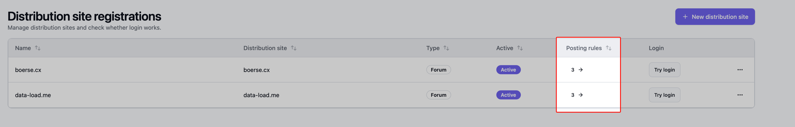
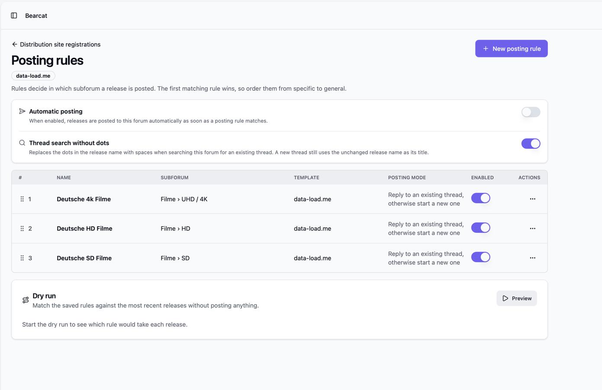
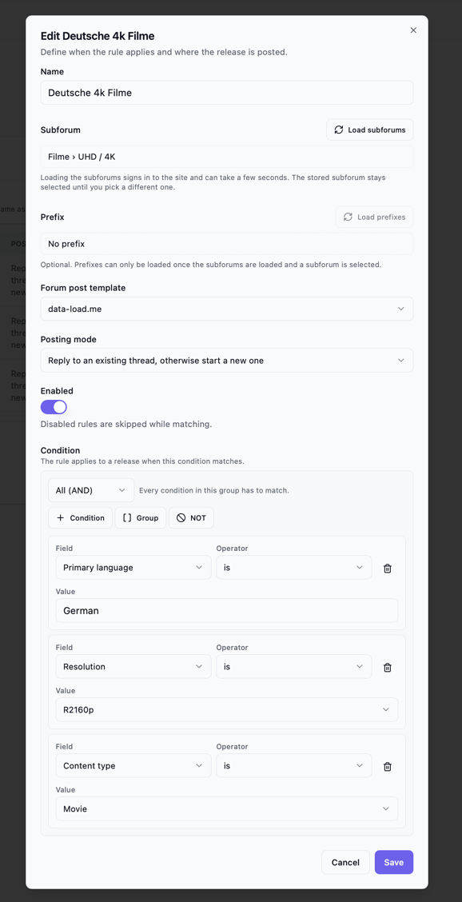
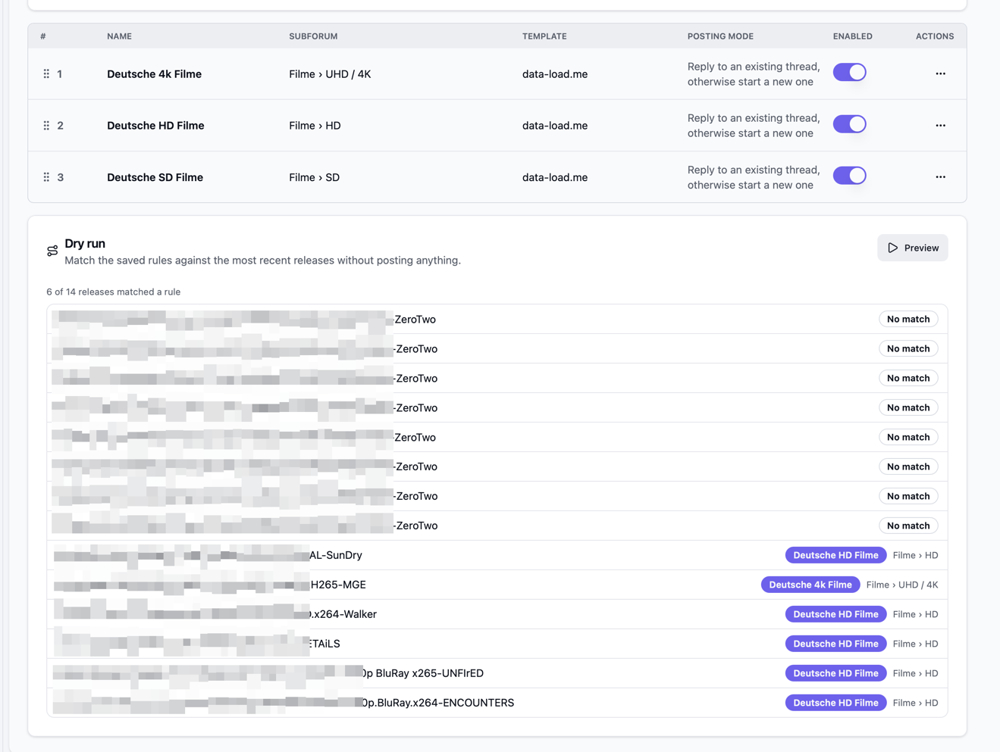
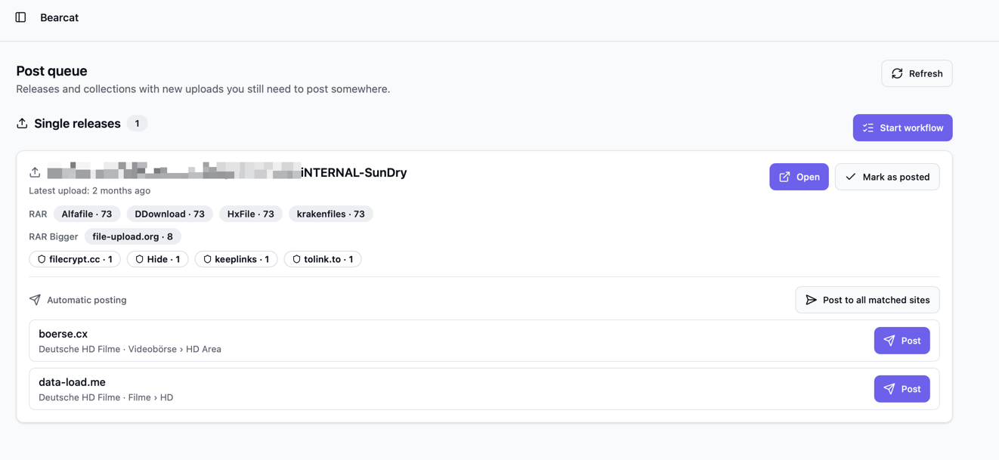

Posting rules let Bearcat choose a subforum, fill in a template and submit the post.
Click **Post** in the [post queue](/Bearcat/post-queue/) or enable automatic posting.
To review and submit drafts yourself, use [Posting to Forums](/Bearcat/posting-to-forums/).

Each forum has its own rules. Bearcat skips forums with no matching rule.

## What you need first

- A forum added under **Distribution sites**, with a working login.
- A suitable [forum post template](/Bearcat/forum-post-templates/).
- Releases in the [post queue](/Bearcat/post-queue/) with a classification and a passed or manually approved
  [quality gate](/Bearcat/quality-gates/). Groups without a quality profile pass the gate.
  For collections, every member release must pass or be manually approved, and at least one must be classified.

## Opening the posting rules page

Open **Distribution sites** in the sidebar. The table has a **Posting rules** column that shows how
many rules a forum has.

Click the number to open the page, or use **Posting rules** in the row menu.

## Site-wide settings

**Automatic posting** is off by default. You can still preview rules and use **Post** in the post queue.
When enabled, the "Automatic forum posting" background task runs every 15 minutes by default.
It posts matching releases from the queue first, then collections.
Change the interval under [Background tasks](/Bearcat/advanced-configuration/#background-tasks).

**Thread search without dots** is on by default. Bearcat replaces dots with spaces when searching
for threads and naming new ones. For collections, it uses the collection name.
Turn it off to keep dots in searches and new thread titles.

## Adding a rule

Click **New posting rule** and fill in these fields:

- **Applies to**: choose **Release** or **Release collection** at the top of the dialog.
  Each rule applies to one type.
- **Name**: your own name for that rule
- **Subforum**: the destination for the post. Click **Load subforums** and select one.
  Loading can take a few seconds.
- **Prefix**: some subforums allow you to set prefixes on new threads
- **Forum post template**: the template for the post body. Release rules use release templates;
  collection rules use release collection templates. The template determines the rule type.
- **Posting mode**: either *Reply to an existing thread, otherwise start a new one*, or *Always start
  a new thread*.
- **Enabled**: disabled rules are skipped while matching

## Conditions

Conditions define which releases or collections a rule applies to. Collection rules use the same fields
except **Episode**. Switching a rule to **Release collection** removes Episode conditions.
You can group comparisons:

- **All (AND)**: every entry in the group has to match.
- **Any (OR)**: at least one entry has to match.
- **NOT**: matches when the single condition inside does not match.

Groups can be nested, so you can build something like "German and (1080p or 2160p) and not from
group X". Use **Condition**, **Group** and **NOT** inside a group to add entries.

Each comparison row picks a field, an operator and a value:

| Field | Values |
| --- | --- |
| Release name | Release or collection name, free text |
| Resolution | From the classification, for example `R1080p` or `R2160p` |
| Primary language | Language of the release or collection, for example `German` |
| Multi-language | Yes or no |
| Content type | `Movie`, `TvShowEpisode` or `Other` |
| Source | For example `BluRay` or `WebDl` |
| Platform | From the classification |
| Release group | The Bearcat release group the release or collection belongs to |
| Release group tag | The group tag from the release name, for example `FLAME` |
| Year | Number |
| Season | Number |
| Episode | Number, releases only |

The available operators depend on the field:

| Field | Operators |
| --- | --- |
| Release name | *is*, *is not*, pattern matching and *matches regex* |
| Release group, release group tag | *is*, *is not*, pattern matching, *is one of*, *is none of*, *is set*, *is not set* |
| Primary language | *is*, *is not*, *is one of*, *is none of*, *is set*, *is not set* |
| Resolution, year, season, episode | Include *is at least* and *is at most* |

With *matches pattern (%)*, `%` stands for any text. The pattern must match the whole value:

- `%German%` matches names containing `German`.
- `%-FLAME` matches names ending in `-FLAME`.

Patterns and regular expressions ignore case. An invalid regular expression or a match that times out
is treated as no match.

Most fields come from the classification, based on the release name and available media info.
Release rules require a release classification.

For collections, the name, content type, release group and language come from the collection itself.
If language or content type is not set, Bearcat falls back to the member releases.
Resolution, source, platform, year, season, multi-language and release group tag come from the classifications
of the releases in the collection. Bearcat uses a value only when it is the same across all classified releases.
Otherwise, it is unknown or not set. Releases without a classification do not count into these values.

## Ordering the rules

Bearcat uses the first matching rule for the relevant type: release or collection.
Both rule types appear in the same list. A badge under the template name shows the type.
Drag rules by the handle on the left to reorder them. Put specific rules before general ones.

## Dry run

Save your rules. Under **Dry run** at the bottom of the page, select **Releases** or **Collections**
and click **Preview**. The preview shows the matching rule and subforum, or **No match**, for recent entries.
It does not post anything.

Run a preview after changing conditions or rule order, before enabling automatic posting.

## Posting from the post queue

Every entry under **Single releases** and **Collections** in the [post queue](/Bearcat/post-queue/) has
an **Automatic posting** section that shows, per forum, what the rules would do:

- the matched rule and its subforum, with a **Post** button,
- **Posted** with a link, if the release or collection was already posted to that forum,
- **No matching posting rule**, if no rule matches the release or collection.

The **Auto** badge shows that Bearcat posts to this forum automatically.

**Post** submits the template as a reply or new thread, depending on the rule. Bearcat saves the
post URL under **Posted locations**. **Post to all matched sites** posts to the remaining matching forums
one after another.

Once Bearcat has posted to all matching forums, it marks the release or collection as posted and removes it from the queue.
If you post manually, use **Mark as posted**.

## When a release or collection cannot be posted

Instead of the forum list, the entry shows a short reason:

- **Automatic posting is blocked: the quality gate has not passed.** The release must
  [pass its quality checks or be manually approved](/Bearcat/quality-gates/).
  Bearcat checks unevaluated releases on the next background run.
- **Automatic posting is blocked: the release has no classification.** Bearcat classifies releases
  every 30 minutes and after extracting media data. Wait for the next run or click
  **Extract media data** on the release.
- **Automatic posting is blocked: not every release in this collection has passed the quality gate.**
  Every member release must pass or be manually approved.
- **Automatic posting is blocked: no release in this collection has a classification.**
  At least one member release must be classified.
- **No forum has posting rules yet.** No forum registration has an enabled rule.

The background task retries blocked releases and collections once they meet these requirements.

## Updating a post after a reupload

After a reupload, Bearcat can update existing posts with the new download links.
This also applies when you upload a new episode to a collection. Bearcat updates the existing post
instead of adding a new reply.
It fills the template with the current data and **replaces the entire post, including any edits you made in the forum**.
Use this for posts with direct download links instead of a link crypter container.

### Updating from the queue

A reupload or a newly uploaded episode puts the release or collection back in the post queue.
Previously used forums show **Post content is outdated** next to the stored link.
Click **Update post** to replace the post.
The template and update time are saved with the URL under **Posted locations**.

For forums with **Automatic posting** enabled, the background task updates posts automatically
if a template is available. The release or collection leaves the queue once all posts and updates are complete.

### Choosing a template

Bearcat uses the first available template in this order:

1. The template you pick in the dialog.
2. The template the post was created with.
3. The template of the rule that currently matches the release or collection.

Older posts may have no stored template. Choose one in the dialog or make sure a posting rule matches.

### Updating from posted locations

You can also update a post from **Posted locations** on a release or collection. Click the update button and confirm the replacement.
The entry must be linked to a distribution site; posts you confirmed by hand also qualify.

## Notifications

Bearcat notifies you of successful and failed posts. You can disable notifications for successful
and failed updates separately.

## Posted locations and duplicates

Bearcat records each forum in **Posted locations** and shows **Posted** instead of offering to post again.
The background task only updates outdated posts in those forums. Changing the rules does not trigger a new post.
