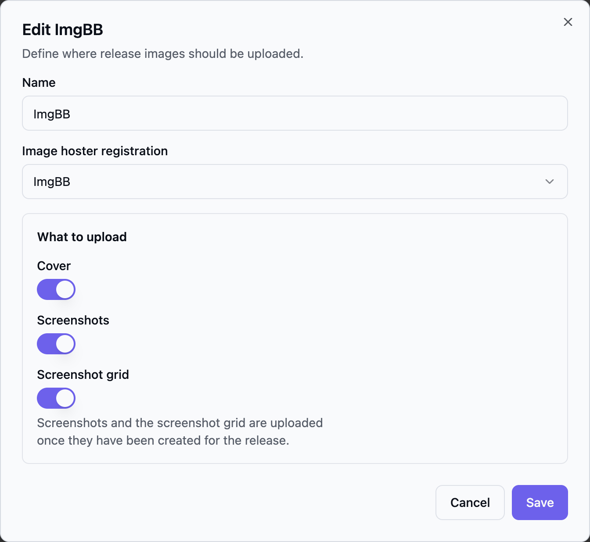
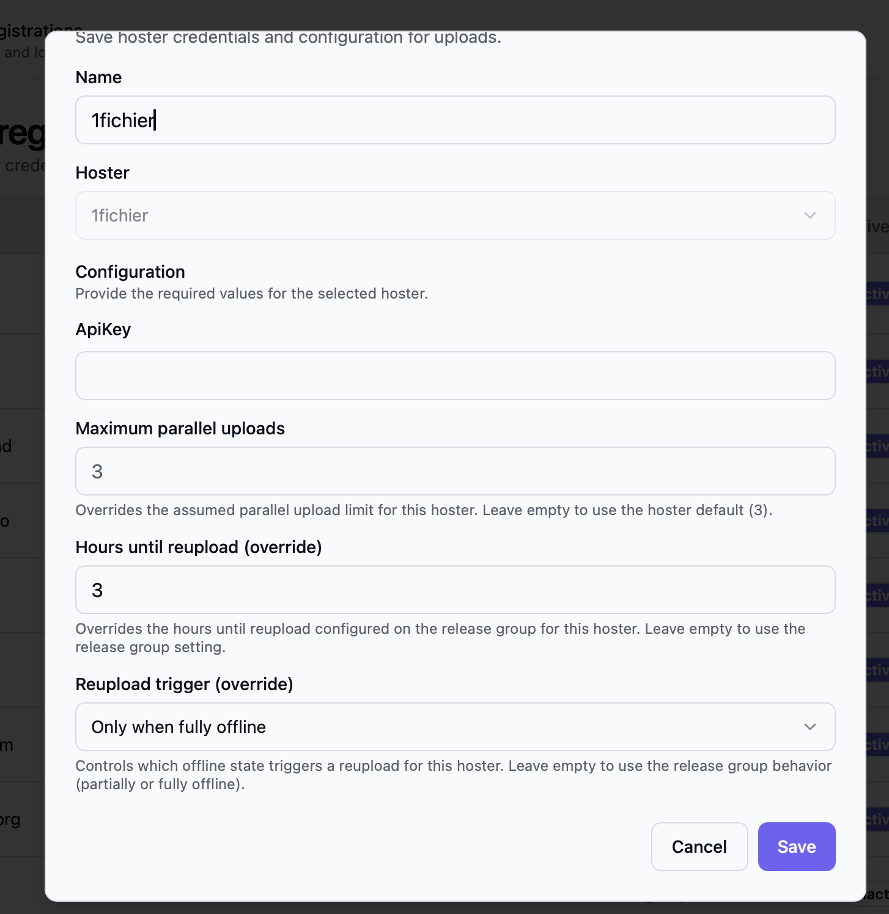

Hosterkonten findest du unter **Registrierungen > Hoster > Hosterregistrierungen**.
Wie du dein erstes Konto hinzufügst, steht unter [Dein erster Upload](/de/post-installation/#manuell-einrichten).
Hier richtest du weitere Dienste, Reuploads und Uploadlimits ein.

## Linkcrypter und Metadatenquellen einrichten

- Öffne **Registrierungen > Crypter > Crypterregistrierungen** und füge deinen Account hinzu.
  Öffne danach ein Release, gehe zu **Uploads > Konfiguration** und klappe die gespeicherte
  Uploadkonfiguration auf. Füge dort den Linkcrypter hinzu, bei Bedarf mit einem Containerpasswort.
- Öffne **Registrierungen > NFO-Datenbankregistrierungen**, um NFOs automatisch abzurufen.
- Öffne **Registrierungen > Metadatenquellen**, um Quellen für Titel, Beschreibungen, Genres und Coverbilder hinzuzufügen.

Details findest du unter [Releaseinformationen und Metadaten](/de/release-information-and-metadata/).

## Bildhosteraccounts einrichten

Öffne **Registrierungen > Bildhosterregistrierungen** und klicke auf **Neuer Bildhoster**.
Wähle den Hoster und gib die nötigen Zugangsdaten ein.

## Bilduploadkonfiguration

Klicke im Tab **Bilder** eines Releases unter **Bilduploadkonfigurationen** auf **Hinzufügen**. Wähle einen
Namen und eine Bildhosterregistrierung. Wähle dann, welche Bilder Bearcat hochladen soll:

| Option | Standard | Lädt hoch |
| --- | --- | --- |
| **Cover** | An | Das Cover, sobald eine Cover-URL vorhanden ist. |
| **Screenshots** | Aus | Die einzelnen [Screenshots](/de/release-templates-and-automations/#screenshots) des Releases. |
| **Screenshotraster** | Aus | Das Screenshotraster des Releases. |

Mindestens eine Option muss aktiv sein. Screenshots werden hochgeladen, sobald sie erstellt wurden.
Bilduploadkonfigurationen von Collections laden immer nur das Cover hoch.

Der Name wird auch in [Postvorlagen](/de/forum-post-templates/) verwendet.
Heisst die Konfiguration `ImgBB Cover`, greifst du über `imagelinks.imgbb_cover.full` auf das Cover zu.

Releases und Collections kommen erst in die [Postwarteschlange](/de/post-queue/), wenn kein Bildupload
mehr wartet oder läuft. Fehlgeschlagene Bilduploads blockieren das Posten nicht. Lösche einen fehlgeschlagenen
Upload im Tab **Bilder**, um ihn erneut zu starten.

## Automatische Reuploads

Öffne **Releaseeinstellungen > Releasegruppen** und bearbeite die Gruppe.
Aktiviere automatische Reuploads und setze **Stunden bis Reupload**.
Mit `24` wartet Bearcat mindestens 24 Stunden, nachdem es die Links als offline erkannt hat.
Mit `0` kann es sofort einen Reupload einplanen.

Wähle die Releasegruppe beim Erstellen oder Bearbeiten eines Releases. Um mehrere Releases gemeinsam zu ändern,
wähle sie in der Releaseliste aus und ändere dort die **Releasegruppe**.
Details findest du unter [Automatische Reuploads](/de/upload-lifecycle/#7-automatische-reuploads).

## Reuploadoverrides pro Hoster

Öffne in **Hosterregistrierungen** den Dialog **Neuer Hoster** oder **Bearbeiten**, um die
Reuploadeinstellungen für einen Account zu überschreiben. Lass die Felder für abweichende Werte leer, um die Einstellungen
der Releasegruppe zu verwenden.

| Einstellung | Wirkung |
| --- | --- |
| **Stunden bis Reupload (Override)** | Überschreibt die Wartezeit der Releasegruppe für diesen Hoster. |
| **Reuploadauslöser: Teilweise oder komplett offline** | Startet die Wartezeit, sobald irgendein Link offline geht. |
| **Reuploadauslöser: Erst wenn komplett offline** | Wartet, bis alle Links offline sind. Die Wartezeit startet, wenn der letzte Link offline geht. |
| **Immer alle Dateien neu hochladen** | Lädt alle Dateien erneut hoch, auch diejenigen, die noch online sind. |

Diese Einstellungen gelten nur, wenn automatische Reuploads in der Releasegruppe aktiviert sind.
Unter [Overrides pro Hoster](/de/upload-lifecycle/#overrides-pro-hoster) siehst du, wann welche Option sinnvoll ist.

Die Spalte **Reupload** zeigt die Overrides oder **Standard der Releasegruppe**, wenn keine gesetzt sind.
**Volle Reuploads** zeigt an, dass **Immer alle Dateien neu hochladen** aktiviert ist.

## Parallele Uploads pro Hoster

Manche Hoster geben ihr Uploadlimit über die API vor. Bearcat zeigt dann **Über API** an; das Limit
lässt sich nicht ändern. Bei anderen Hostern setzt du unter **Neuer Hoster** oder **Bearbeiten** ein
eigenes Limit im Feld **Maximale parallele Uploads**. Ein leeres Feld verwendet den angezeigten Standard.

Die Spalte **Parallele Uploads** zeigt das aktive Limit und bei eigenen Werten ein Badge **Override**.
Das [globale Uploadlimit](/de/advanced-configuration/#parallele-uploads) gilt zusätzlich.
Uploads müssen beide Limits einhalten.

## Uploadgeschwindigkeit pro Hoster begrenzen

Setze unter **Neuer Hoster** oder **Bearbeiten** die **Maximale Uploadgeschwindigkeit (MB/s)**, um die
gesamte Uploadgeschwindigkeit für diesen Account zu begrenzen. Kommazahlen wie `0.5` oder `0,5` sind
erlaubt. Ein leeres Feld bedeutet kein Limit.

Das [globale Limit für die Uploadgeschwindigkeit](/de/advanced-configuration/#parallele-uploads)
gilt zusätzlich. Uploads müssen beide Limits einhalten. Die Spalte **Parallele Uploads** zeigt
das konfigurierte Limit an.

## Leere Ordner löschen

Bearcat legt auf dem Hoster für jedes Archiv oder jeden Upload einen Ordner an. Dateien darin
können später verschoben werden oder ablaufen, dann bleibt der Ordner leer. **Leere Ordner automatisch
löschen** unter **Neuer Hoster** oder **Bearbeiten** löscht solche Ordner. Gelöscht werden nur Ordner,
die Bearcat angelegt hat und die kein laufender Upload verwendet. Ordner, die noch Dateien oder
Unterordner enthalten, bleiben erhalten.

Die Option ist standardmässig aktiviert und derzeit für Rapidgator, Alfafile, DDownload, FileQ,
Turbobit, Hitfile, 1fichier, KrakenFiles, CloudFam.io, UploadG.com, Filer.net und FileFactory verfügbar.
Bei UploadG.com landen gelöschte Ordner im Papierkorb. Bei FileFactory wird kein Ordner gelöscht,
solange der Account Unterordner enthält. Schalte die Option aus, um die Ordner dieses Accounts zu behalten. Die Aufgabe [Empty hoster folder cleanup](/de/advanced-configuration/#verfügbare-hintergrundaufgaben)
läuft beim Start und danach täglich und prüft bis zu 200 Ordner pro Account.

## Einen Proxy verwenden

Unter [Proxyserver](/de/proxy-servers/) richtest du HTTP- oder SOCKS5-Proxys für Uploads und
Mirrordownloads ein. Du kannst einen Standard pro Kategorie festlegen oder einen Proxy für einzelne Accounts wählen.
