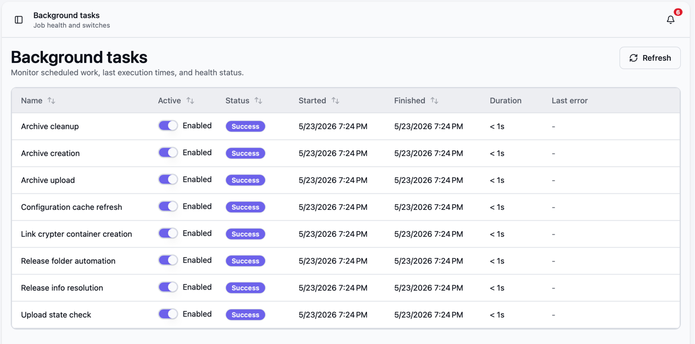
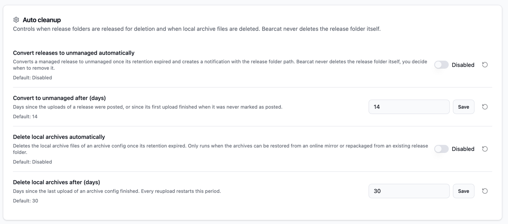
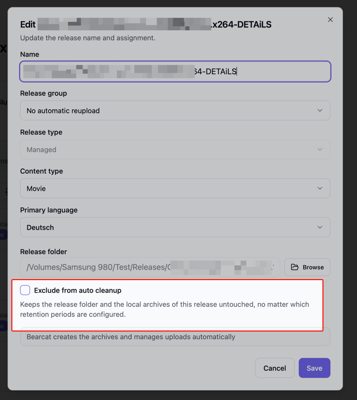
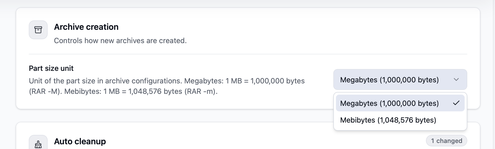
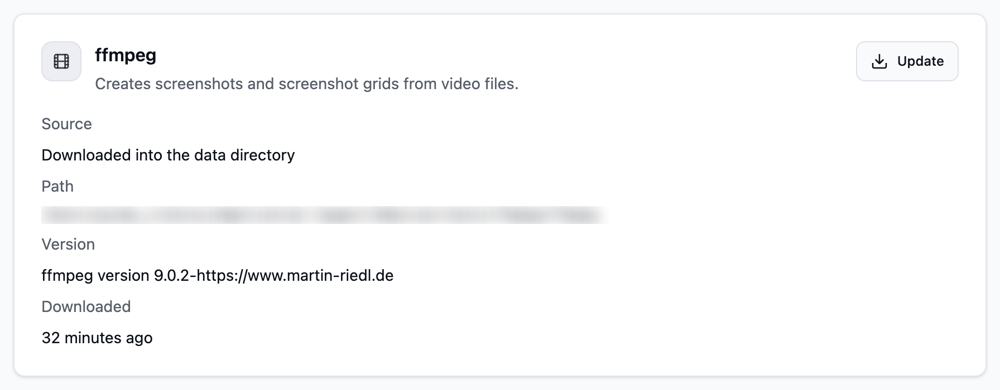

Bearcat packt, prüft und lädt Dateien im Hintergrund hoch. Die Aufgaben findest du unter
**Aktivität > Hintergrundaufgaben**, ihre Einstellungen unter **System > Konfigurationen**.

## Hintergrundaufgaben

Jede Aufgabe läuft nach ihrem eigenen Zeitplan.

Die Tabelle zeigt Status, Start, Ende, Dauer und den letzten Fehler jeder Aufgabe.
Mit **Aktiv** schaltest du künftige Ausführungen ein oder aus. Laufende Aufgaben werden dabei nicht abgebrochen.
Standardmässig sind alle Aufgaben aktiv.

### Verfügbare Hintergrundaufgaben

| Aufgabe | Läuft | Funktion |
| --- | ---: | --- |
| Configuration cache refresh | Alle 5 Minuten | Lädt zwischengespeicherte Einstellungen neu. Änderungen in der Oberfläche gelten sofort. |
| Release folder automation | Alle 2 Minuten | Scannt Ordner und erstellt Releases mit dem gewählten Template, sobald die [Ordnerprüfungen](#ordnerautomatisierung) bestanden sind. |
| Remote source scan | Alle 2 Minuten | Findet passende FTP-/FTPS-Ordner und plant sie ein, sobald die [Prüfungen für Remoteordner](#remotedownloads) bestanden sind. |
| Remote source download | Alle 20 Sekunden | Lädt geplante Remoteordner herunter. |
| Remote download verification and extraction | Alle 20 Sekunden | Prüft abgeschlossene Downloads anhand ihrer SFV-Dateien und entpackt Archive, falls konfiguriert. |
| Remote download release creation | Alle 20 Sekunden | Erstellt Releases aus abgeschlossenen Downloads mit den jeweils gewählten Templates. |
| Remote download raw file cleanup | Alle 2 Minuten | Wandelt heruntergeladene Releases in Unmanaged um und entfernt ihre Rohdateien, wenn [Rohdateien behalten](/de/remote-downloads/#rohdateien-nach-dem-upload-löschen) ausgeschaltet ist und die Bedingungen für das Löschen erfüllt sind. |
| Release info resolution | Alle 10 Minuten | Ergänzt fehlende Sceneinfos, NFOs, externe IDs und Metadaten aus den aktiven Quellen. |
| Archive creation & restore | Alle 20 Sekunden | Erstellt Archive für wartende Uploads, stellt sie wieder her oder verwendet bestehende wieder. |
| Auto cleanup | Alle 30 Minuten | Wendet aktivierte [Aufräumregeln](#automatisches-aufräumen) nach Ablauf ihrer Aufbewahrungsfristen an. Löscht [lokale Arbeitskopien](/de/archive-storage-folders/#reuploads) gespeicherter Archive, sobald ihre Uploads abgeschlossen sind. |
| Archive upload | Alle 20 Sekunden | Lädt Archive zu den konfigurierten Hostern hoch. |
| Image upload | Alle 30 Sekunden | Lädt Coverbilder von Releases zu konfigurierten Bildhostern hoch, wenn eine Cover-URL vorhanden ist. |
| Screenshot creation | Jede Minute | Erstellt [Screenshots und Screenshotraster](/de/release-templates-and-automations/#screenshots) für Managed Releases, wenn diese Optionen aktiv sind. |
| Upload state check | Alle 20 Sekunden | Prüft Links und plant erste Uploads sowie automatische Reuploads. |
| Empty hoster folder cleanup | Beim Start, dann täglich | Löscht [leere Hosterordner](/de/account-settings/#leere-ordner-löschen) für Konten mit aktivierter Option **Leere Ordner automatisch löschen**. |
| Link crypter container creation | Alle 20 Sekunden | Erstellt Linkcryptercontainer für abgeschlossene Uploads. |
| SQLite query planner statistics | Beim Start, dann täglich | Nur mit SQLite. Aktualisiert die Statistiken, mit denen SQLite Indizes auswählt. Der erste Lauf kann bei grossen Datenbanken mehrere Sekunden dauern. Verkleinert ausserdem die Datenbankdatei (`VACUUM`), wenn mindestens 20 % davon ungenutzt sind, zum Beispiel nach dem Löschen vieler Releases. Schreibzugriffe warten währenddessen. |

## Konfigurationen

Öffne **System > Konfigurationen**, um Einstellungen für die gesamte Anwendung zu ändern.

Schalter und Auswahlfelder speichern sofort. Zahlenfelder speicherst oder verwirfst du über die Buttons.
Du kannst auch Enter zum Speichern oder Escape zum Abbrechen drücken.

Geänderte Einstellungen sind mit einem Punkt markiert. Der Standardwert wird daneben angezeigt.
Mit **Zurücksetzen** stellst du ihn wieder her.

### Automatisches Aufräumen

Automatisches Aufräumen ist standardmässig ausgeschaltet. Unter **Konfigurationen > Automatisches Aufräumen**
kannst du zwei unabhängige Regeln aktivieren:

- **Releases automatisch in Unmanaged umwandeln**: den Releaseordner nach einer Frist nicht mehr
  verwenden (Standard: `14` Tage). Optional aktivierst du **Releaseordner beim Umwandeln löschen**.
- **Lokale Archive nach Aufbewahrung**: **Behalten** (Standard), **Löschen** oder **In Speicherordner verschieben**
  nach der **Aufbewahrung lokaler Archive** (Standard: `30` Tage).

#### Releases automatisch in Unmanaged umwandeln

Nach der Umwandlung lädt Bearcat vorhandene Archive erneut hoch, statt die Releasedateien neu zu packen.
Die Frist beginnt mit dem Postingdatum oder dem ersten abgeschlossenen Upload, wenn das Release nie
als gepostet markiert wurde. Fehlen beide Zeitpunkte, bleibt es Managed.

Bearcat wandelt das Release nur um, wenn kein Upload läuft und jede Archivkonfiguration ein lokales
Archiv oder einen vollständig verfügbaren [Mirror](/de/mirror-downloads/) hat. Releases mit einer
[Videouploadkonfiguration](/de/video-hosters/#releaseordner) bleiben Managed.

Standardmässig bleibt der Releaseordner erhalten. Eine Benachrichtigung enthält seinen Pfad.
Du kannst die Releasedateien selbst löschen. Liegen dort auch Archive, behalte diese Dateien.

Mit **Releaseordner beim Umwandeln löschen** löscht Bearcat auch den Ordner, aber nur wenn:

- Jede Archivkonfiguration ein vollständiges Archiv auf der Festplatte hat. Ein Mirror allein reicht nicht.
- Kein Archiv im Releaseordner liegt.
- Der Ordner weder das Stammverzeichnis eines Laufwerks noch ein Arbeitsverzeichnis ist und kein Arbeitsverzeichnis enthält.

Sind diese Bedingungen nicht erfüllt oder schlägt das Löschen fehl, wird das Release trotzdem Unmanaged.
Der Ordner bleibt erhalten und die Benachrichtigung nennt den Grund.

#### Lokale Archive nach Aufbewahrung

Die Frist beginnt mit dem letzten abgeschlossenen Upload der Archivkonfiguration. Jeder Reupload startet sie neu.
Mit `0` Tagen kann die Aktion beim nächsten Aufräumen nach dem Upload laufen.
Bearcat überspringt Archive, solange ein Upload dieser Archivkonfiguration wartet, ansteht oder läuft.

| Aktion | Wirkung |
| --- | --- |
| **Behalten** | Archivdateien bleiben an ihrem Speicherort. |
| **Löschen** | Löscht Archivdateien nur, wenn Bearcat sie von einem vollständig verfügbaren Mirror wiederherstellen oder aus dem Ordner eines Managed Releases neu packen kann. |
| **In Speicherordner verschieben** | Verschiebt Archive in einen aktiven [Speicherordner](/de/archive-storage-folders/#archive-verschieben). Ein Mirror ist dafür nicht nötig. |

Beim Löschen entfernt Bearcat den Archivordner nur, wenn er leer ist. Dateien auf dem Hoster bleiben erhalten.
Archive in Speicherordnern werden nie automatisch gelöscht.

War die automatische Archivlöschung bereits aktiviert, bleibt nach dem Update die Aktion **Löschen** ausgewählt.

#### Maximale Grösse lokaler Archive

Mit **Maximale Grösse lokaler Archive** legst du fest, wie viel Speicherplatz lokale Archive insgesamt belegen dürfen (in GB).
Standardmässig ist die Grenze ausgeschaltet (`0`). Sie gilt unabhängig von der Aufbewahrungsfrist.

Bevor Bearcat ein lokales Archiv schreibt, löscht es bei Bedarf andere lokale Archive, um Platz innerhalb der Grenze zu schaffen.
Das gilt beim Packen, beim Wiederherstellen von einem Mirror und beim Erstellen einer
[lokalen Arbeitskopie](/de/archive-storage-folders/#reuploads).
Bearcat beginnt mit den Archiven, bei denen der letzte Upload der Archivkonfiguration am längsten zurückliegt.

Dabei gelten dieselben Bedingungen wie bei der Aktion **Löschen**:

- Das Archiv lässt sich von einem vollständig verfügbaren Mirror wiederherstellen oder aus dem Ordner eines Managed Releases neu packen.
- Kein Upload der Archivkonfiguration wartet, steht an oder läuft.
- Das Release ist nicht vom automatischen Aufräumen ausgeschlossen.

Archive in Speicherordnern bleiben erhalten und zählen nicht zur Gesamtgrösse.
Reicht der freigegebene Platz nicht aus, schreibt Bearcat das Archiv trotzdem und benachrichtigt dich.
Die Grenze gilt nicht, wenn **Lokale Archive nach Aufbewahrung** auf **In Speicherordner verschieben** steht.

Plane zusätzlichen freien Speicherplatz ein: Bearcat prüft die Grenze nur vor dem Schreiben und kann sie überschreiten.

#### Einzelne Releases ausschliessen

Aktiviere beim Erstellen oder Bearbeiten eines Releases **Vom automatischen Aufräumen ausschliessen**,
damit beide Aufräumregeln und die Grössengrenze für dieses Release nicht gelten.

[Remotedownloads](/de/remote-downloads/#rohdateien-nach-dem-upload-löschen) haben eine eigene Aufräumoption.
Lass **Rohdateien behalten** in der Automatisierung aktiviert, wenn du den heruntergeladenen Releaseordner behalten willst.

### Einheit der Partgrösse

Wähle **Einheit der Partgrösse** unter **Konfigurationen > Archiverstellung**.
Die Einstellung gilt für alle Archivkonfigurationen (RAR und 7-Zip).
**Megabytes** (Standard) bedeutet 1 MB = `1.000.000` Bytes, **Mebibytes** bedeutet 1 MB = `1.048.576` Bytes.
Um die Partgrösse vieler Archivkonfigurationen auf einmal zu ändern, siehe [Partgrösse ändern](/de/change-archive-part-size/).

### Dateien vom Packen ausschliessen

Unter **Konfigurationen > Archiverstellung** legst du im Feld **Beim Packen ausschliessen** fest, welche Dateien und Ordner Bearcat bei neuen Archiven überspringt.
Leere das Feld, um den ganzen Releaseordner zu packen.

Trenne mehrere Muster mit Kommas. Leerzeichen um die Kommas sind optional.
Bearcat prüft die Namen auch in Unterordnern. Gross- und Kleinschreibung spielt keine Rolle.
`*` steht für beliebig viele Zeichen, `?` für genau eines.
Mit `/` am Ende gilt ein Muster nur für Ordner, ohne `/` nur für Dateien.

| Muster | Was Bearcat überspringt |
| --- | --- |
| `*.sfv, *.txt` | Alle Dateien mit der Endung `.sfv` oder `.txt`, auch `Sub/CHECK.SFV`. |
| `part?.rar` | Dateien mit genau einem Zeichen zwischen `part` und `.rar`, etwa `part1.rar`. |
| `sample*/` | Ordner wie `Sample` oder `Samples` samt Inhalt. |

Die Muster gelten nur für Dateien und Ordner aus dem Releaseordner. Zusätzliche Archivinhalte und die Noncedatei packt Bearcat wie gewohnt.
Bleibt im Releaseordner keine Datei zum Packen übrig, schlägt die Archiverstellung fehl.

### Archivrepackaging

Hoster erkennen Dateien an ihrem MD5-Hash. Vor einem Reupload zum selben Hostertyp gibt Bearcat den
hochzuladenden Dateien neue Hashes. Nicht erneut hochgeladene Parts behalten ihre Hashes und Links.

- **RAR:** Bearcat hängt Nullbytes an, bis der Hash jeder Datei neu ist. Die Hashhistorie bleibt auch
  nach dem Löschen lokaler Dateien erhalten. Archive lassen sich weiterhin normal entpacken und die
  eingestellte Partgrösse bleibt normalerweise gleich. Kompression und Solidmodus folgen der gewählten Strategie.
- **7-Zip:** Bearcat packt das Release mit der **Repackagingstrategie** unter **Konfigurationen** neu:

| Strategie | Wirkung auf 7-Zip-Archive |
| --- | --- |
| **Archivdateigrösse um 1 MB verändern** (Standard) | Jedes neue Archiv hat `1` MB grössere Parts als das vorherige. Das erste verwendet die eingestellte Grösse. Keine Kompression, kein Solidmodus. |
| **Nur Nonce, keine Kompression** | Ändert die zufällige `__nonce.txt`. Braucht wenig CPU, aber einige Parts behalten eventuell ihren alten Hash. |
| **Solidarchive mit Kompression** | Verteilt die Nonceänderung zuverlässiger auf die Parts, braucht aber mehr CPU. |

**Noncedatei erstellen** ist in der Archivkonfiguration standardmässig aktiviert.
Ohne sie erhöht 7-Zip die Partgrösse bei jedem Neupacken um `1` MB, unabhängig von der Strategie.
RAR verwendet weiterhin Nullbytes für neue Hashes.

Bei älteren RAR-Archiven mit fehlenden Hashes bestimmt die Strategie auch die Partgrösse.
Die Standardstrategie erhöht sie beim Neupacken um `1` MB.

### Ordnerautomatisierung

Unter **Konfigurationen > Ordnerautomation** stellst du ein, wann Bearcat einen Ordner als Release übernimmt.
Beide Bedingungen müssen erfüllt sein:

- Anzahl und Gesamtgrösse der Dateien bleiben für die Dauer von **Ordnerstabilität** unverändert (Standard: `5` Minuten).
- Der Ordner erreicht die **Minimale Ordnergrösse** (Standard: `1` MB).

Das verringert das Risiko, dass Bearcat noch unvollständige Ordner als Release übernimmt.

Erhöhe die Stabilitätsdauer bei langsamen Kopiervorgängen. Setze die Mindestgrösse auf `0`, um leere Ordner zuzulassen.
Manuelles Erstellen von Releases und die Metadatenabfrage unter **Releaseinfo** sind davon unabhängig.

### Remotedownloads

Die Einstellungen für [FTP-/FTPS-Downloads](/de/remote-downloads/) findest du unter
**Konfigurationen > Remotedownloads**. Sie gelten unabhängig von der lokalen Ordnerautomatisierung.

| Einstellung | Standard | Wirkung |
| --- | --- | --- |
| Ordnerstabilität | `5` min | Wartet, bis Dateianzahl und Gesamtgrösse des Remoteordners so lange unverändert bleiben. |
| Minimale Ordnergrösse | `1` MB | Kleinere Ordner bleiben in **Wird beobachtet**. Setze `0`, um die Grössenprüfung zu deaktivieren. |
| Maximale parallele Dateidownloads | `4` | Begrenzt, wie viele Dateien gleichzeitig heruntergeladen werden. **Maximale Verbindungen** der Quelle gilt zusätzlich. |
| Wiederholungsverzögerung | `30` s | Wartet so lange, bevor ein fehlgeschlagener Downloadversuch wiederholt wird. |

Erhöhe die Stabilitätsdauer, wenn Dateien langsam eintreffen oder Uploads auf den FTP-Server oft pausieren.
Bearcat lädt jeweils einen Releaseordner herunter, mit mehreren Dateien parallel. Senke das Verbindungslimit,
wenn der Server gleichzeitige Übertragungen ablehnt.

### Cooldown für initiale Uploads

Unter **Konfigurationen > Initiale Uploads** findest du **Cooldown für initiale Uploads** (Standard: `5` Minuten). So hast du Zeit, ein Release fertig einzurichten, bevor Bearcat es packt und hochlädt.

Sobald eine Uploadkonfiguration existiert und das Release älter als der Cooldown ist, plant der nächste Lauf von **Upload state check** den initialen Upload ein.
Die Wartezeit beginnt mit der Erstellung des Releases. Setze sie auf `0`, damit der erste Upload direkt bei der nächsten Prüfung geplant wird.

Änderungen betreffen nur Uploadkonfigurationen ohne Upload. Bestehende Uploads werden weder abgebrochen noch verzögert.

### Parallele Uploads

Unter **Konfigurationen > Uploadparallelität** begrenzt du mit **Maximale parallele Uploads**
die gleichzeitig laufenden Dateiuploads über alle Hoster hinweg (Standard: `10`).
Das Limit jedes Hosters gilt zusätzlich.

Auf der Seite **Hosterregistrierungen** siehst du die einzelnen Limits und kannst sie, wo möglich, überschreiben. Siehe [Parallele Uploads pro Hoster](/de/account-settings/#parallele-uploads-pro-hoster).

**Maximale Uploadgeschwindigkeit** (MB/s) ist standardmässig leer, also ohne Limit. Der Wert begrenzt die gesamte
Uploadgeschwindigkeit aller laufenden Uploads über alle Hoster hinweg. Kommazahlen wie `0.5` oder `0,5` sind erlaubt.
Jede Hosterregistrierung kann zusätzlich ein eigenes Limit setzen. Siehe
[Uploadgeschwindigkeit pro Hoster begrenzen](/de/account-settings/#uploadgeschwindigkeit-pro-hoster-begrenzen).

Bei sehr niedrigen Geschwindigkeitslimits können Uploads wegen Zeitüberschreitungen scheitern.

Unter **Startreihenfolge der Uploads** wählst du, welche wartenden Uploads zuerst starten: **Älteste zuerst**
(Standard) oder **Initiale Uploads vor Reuploads**. Siehe [Startreihenfolge](/de/upload-lifecycle/#startreihenfolge).

### ffmpeg

Bearcat erstellt mit ffmpeg Screenshots und Screenshotraster aus Videodateien. ffmpeg wird nicht mitgeliefert,
sondern bei Bedarf heruntergeladen und unter `tools/ffmpeg` im [Datenverzeichnis](#datenbank) gespeichert.
Die Karte **ffmpeg** unten auf der Seite **Konfigurationen** zeigt die installierte Version; dort kannst du ffmpeg auch herunterladen oder aktualisieren.

| Plattform | Downloadquelle |
| --- | --- |
| Windows x64, Linux x64 (auch Docker) | [BtbN FFmpeg Builds](https://github.com/BtbN/FFmpeg-Builds) |
| macOS mit Apple Silicon | [martin-riedl.de](https://ffmpeg.martin-riedl.de) |

Wenn du deine eigene Installation von ffmpeg verwenden möchtest, gib ihren Pfad unter `Media:FfmpegPath`
(Umgebungsvariable `Media__FfmpegPath`) an. Auf anderen Plattformen, etwa Linux ARM64,
musst du ffmpeg selbst installieren und diesen Pfad setzen.

## Datenbank

Neue Installationen (Desktopanwendung, Windows-Dienst und Docker) verwenden SQLite. Bestehende PostgreSQL-Installationen verwenden weiterhin PostgreSQL.

Die Datenbankeinstellungen werden beim Start aus Umgebungsvariablen oder einer Einstellungsdatei gelesen:

| Installation | Wo du sie setzt |
| --- | --- |
| Docker | `docker-compose.yml`, oder `docker-compose.postgres.yml` für PostgreSQL. Siehe [Bearcat in Docker ausführen](/de/use-the-docker-image/#datenbank). |
| Desktopanwendung | **Database type** in den Einstellungen der [Desktopanwendung](/de/use-the-desktop-launcher/#datenbanktyp). |
| Windows-Dienst | Abschnitt `Database` in `%ProgramData%\Bearcat\config.json`, geschrieben von `Bearcat.Cli.exe setup`. |

| Einstellung | Umgebungsvariable | Wert |
| --- | --- | --- |
| `Database:Provider` | `Database__Provider` | `Sqlite` oder `Postgres` (Gross- und Kleinschreibung wird ignoriert). Wenn nicht gesetzt: `Postgres`. |
| `Database:SqliteFilePath` | `Database__SqliteFilePath` | Pfad zur SQLite-Datenbankdatei. Wenn nicht gesetzt: `bearcat.db` im Datenverzeichnis. |
| `Database:ConnectionString` | `Database__ConnectionString` | PostgreSQL-Verbindungsdaten, zum Beispiel `Host=localhost;Database=bearcat;Username=bearcat;Password=...`. Wird nur mit `Postgres` verwendet. |

Bearcat bestimmt das Datenverzeichnis in dieser Reihenfolge:

1. Umgebungsvariable `BEARCAT_DATA_DIR`
2. Einstellung `Bearcat:DataDirectory` (Umgebungsvariable `Bearcat__DataDirectory`)
3. `/data` innerhalb eines Containers
4. Der Anwendungsdatenordner des Benutzers plus `Bearcat`: `%APPDATA%\Bearcat` unter Windows, `~/Library/Application Support/Bearcat` unter macOS

Der Windows-Dienst verwendet `%ProgramData%\Bearcat` als Datenverzeichnis.

Hinweise zu SQLite:

- Lege die SQLite-Datenbank auf ein lokales Laufwerk. Netzwerkfreigaben (NFS/SMB) eignen sich nicht für den verwendeten WAL-Modus.
- Sichere die Datenbank zusammen mit `bearcat.key` aus dem Datenverzeichnis. Stoppe Bearcat vor dem Kopieren.
  Für eine Sicherung bei laufendem Bearcat verwende `sqlite3 bearcat.db ".backup bearcat-backup.db"`.
- Die Aufgabe **SQLite query planner statistics** hält die Abfragestatistiken aktuell. PostgreSQL erledigt das selbst.

Wenn du `Database:Provider` änderst, werden bestehende Daten nicht übernommen. Eine neue Datenbank startet leer.
Ohne `Database:Provider` verwendet Bearcat weiterhin PostgreSQL, damit ältere Konfigurationen funktionieren.

## Zeitzone

Bearcat verwendet die lokale Zeitzone für angezeigte Zeiten und zeitabhängige Regeln.
Standardmässig gilt die Zeitzone des Betriebssystems.

| Installation | Standard | Ändern |
| --- | --- | --- |
| Desktopanwendung | Zeitzone deines Computers | Ändere die Zeitzone deines Computers. |
| Windows-Dienst | Zeitzone des Windows-Servers | Füge `"LocalTimezone": "Europe/Berlin"` zu `%ProgramData%\Bearcat\config.json` hinzu und starte den Dienst neu. |
| Docker | UTC | Setze `BEARCAT_TIMEZONE` in `.env`. Siehe [Dockereinstellungen](/de/use-the-docker-image/#docker-einstellungen). |

Der Wert ist eine IANA-Zeitzonen-ID wie `Europe/Berlin` oder `America/New_York`.
Bei einer unbekannten ID bricht Bearcat den Start ab.
