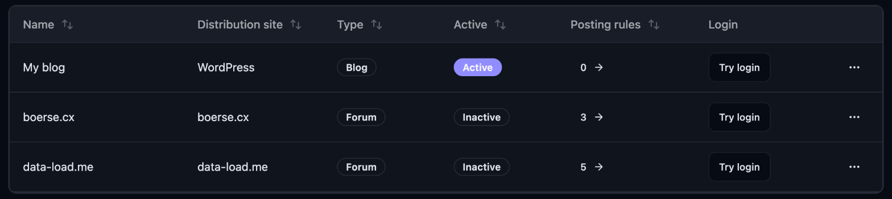
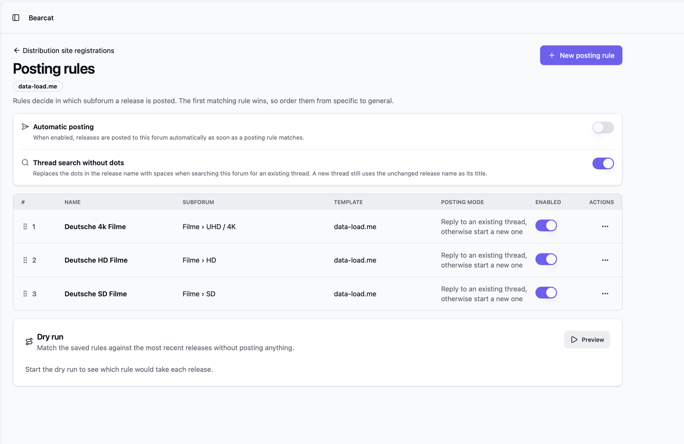
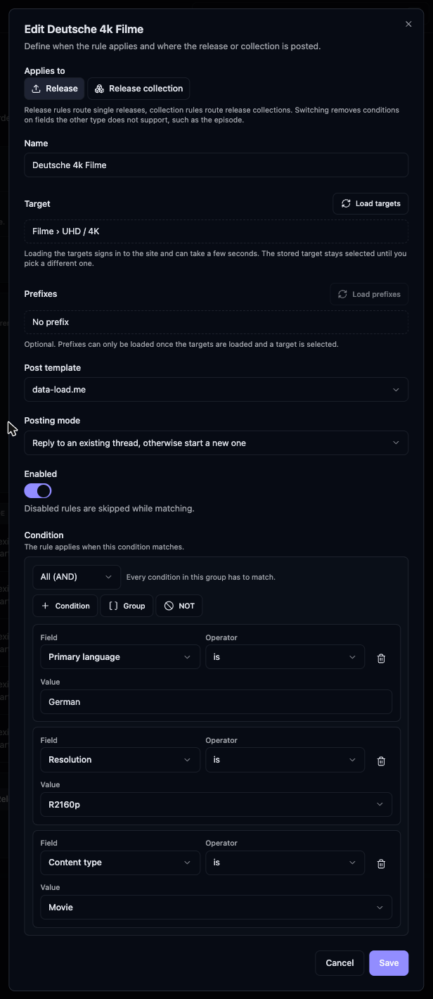
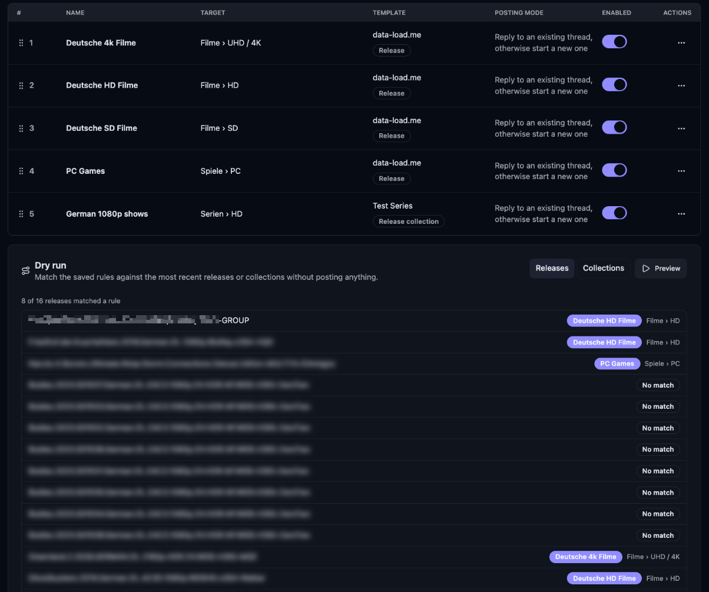
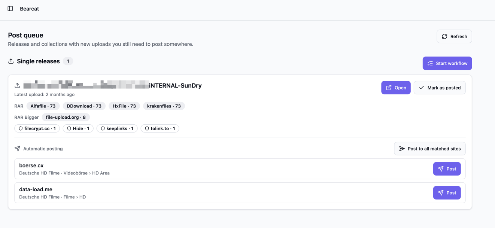

Mit Postingregeln wählt Bearcat ein Unterforum, füllt eine Vorlage aus und sendet den Post ab.
Klicke dafür auf **Posten** in der [Postwarteschlange](/Bearcat/de/post-queue/) oder aktiviere das automatische Posten.
Wenn du Entwürfe selbst prüfen und absenden willst, lies [In Foren posten](/Bearcat/de/posting-to-forums/).

Jedes Forum hat eigene Regeln. Bearcat überspringt Foren ohne passende Regel.

## Voraussetzungen

- Ein Forum unter **Verteilungsseiten** mit funktionierendem Login.
- Eine passende [Forenpostvorlage](/Bearcat/de/forum-post-templates/).
- Releases in der [Postwarteschlange](/Bearcat/de/post-queue/) mit Klassifizierung und bestandener oder manuell freigegebener
  [Qualitätsprüfung](/Bearcat/de/quality-gates/). Gruppen ohne Qualitätsprofil bestehen die Prüfung.
  Bei Collections muss jedes Release die Prüfung bestehen oder manuell freigegeben sein. Mindestens eines muss klassifiziert sein.

## Postingregeln öffnen

Öffne **Verteilungsseiten** in der Seitenleiste. Die Spalte **Postingregeln** zeigt,
wie viele Regeln das jeweilige Forum hat.

Klicke auf die Zahl, um die Seite zu öffnen, oder nutze **Postingregeln** im Zeilenmenü.

## Einstellungen pro Forum

**Automatisches Posten** ist standardmässig aus. Du kannst Regeln trotzdem in der Vorschau prüfen und **Posten** in der Postwarteschlange nutzen.
Ist es aktiviert, läuft die Hintergrundaufgabe "Automatic forum posting" standardmässig alle 15 Minuten.
Sie postet zuerst passende Releases aus der Warteschlange, danach Collections.
Das Intervall änderst du unter [Hintergrundaufgaben](/Bearcat/de/advanced-configuration/#hintergrundaufgaben).

**Themensuche ohne Punkte** ist standardmässig an. Bearcat ersetzt Punkte durch Leerzeichen, wenn es
nach Themen sucht und neue Themen benennt. Bei Collections verwendet es den Collectionnamen.
Schalte die Einstellung aus, um die Punkte bei der Suche und in neuen Themennamen zu behalten.

**Mindestabstand zwischen Posts in Sekunden** ist standardmässig 30. Die Hintergrundaufgabe wartet mindestens so lange
zwischen zwei Posts oder Aktualisierungen im selben Forum, auch nach Fehlversuchen. Posten aus der Postwarteschlange wartet nicht.

## Hoster, Linkcrypter und Bildhoster

Unter den Einstellungen pro Forum wählst du erforderliche und verbotene Hoster, Linkcrypter und Bildhoster für das Forum.
Sie gelten für jeden Post in dieses Forum, automatisch und manuell.

- **Erforderlich**: mindestens einer der gewählten Typen muss im Post sein.
- **Verboten**: Bearcat entfernt diese Uploads, Container und Bilder aus dem Post.
  Blockiert wird der Post nur, wenn es von dieser Art vorher Einträge gab und keiner übrig bleibt.

Bearcat prüft ein Release oder eine Collection als Ganzes: alle Uploads, Uploadslots und enthaltenen Releases zusammen.
Container mit mehreren Hostern (alle Hoster eines Releases, Uploadslots von Collections) werden nur nach den Linkcrypterlisten gefiltert.
Ein verbotener Hoster in einem solchen Container wird ignoriert.

Vorlagen, die `imagelinks.<config>` direkt verwenden, liefern einen leeren Wert, wenn dieser Bildhoster gefiltert wird.
Prüfe den Wert mit `if` oder verwende für dieses Forum eine eigene Vorlage.

Erfüllt der Post diese Einstellungen nicht, überspringt das automatische Posten das Forum ohne Benachrichtigung.
**Posten** in der Postwarteschlange zeigt den Grund an. Ein [manueller Forenentwurf](/Bearcat/de/posting-to-forums/) zeigt ihn als Warnung, posten kannst du trotzdem.

## Regel hinzufügen

Klicke auf **Neue Postingregel**. Fülle die folgenden Felder aus:

- **Gilt für**: wähle oben im Dialog **Release** oder **Collection**. Jede Regel gilt für einen Typ.
- **Name**: dein eigener Name für die Regel
- **Unterforum**: das Ziel des Posts. Klicke auf **Unterforen laden** und wähle eines aus.
  Das Laden kann einige Sekunden dauern.
- **Präfix**: in manchen Unterforen kannst du Präfixe für neue Themen setzen
- **Forenpostvorlage**: die Vorlage für den Posttext. Releaseregeln verwenden Releasevorlagen,
  Collectionregeln verwenden Collectionvorlagen. Die Vorlage bestimmt den Regeltyp.
- **Postingmodus**: entweder *Auf bestehendes Thema antworten, sonst neues Thema* oder *Immer ein neues
  Thema erstellen*.
- **Aktiviert**: deaktivierte Regeln werden beim Abgleich übersprungen

## Bedingungen

Mit Bedingungen legst du fest, für welche Releases oder Collections die Regel gilt. Collectionregeln
verwenden dieselben Felder ausser **Episode**. Wechselst du zu **Collection**, werden Bedingungen für Episoden entfernt.
Du kannst Vergleiche gruppieren:

- **Alle (UND)**: jeder Eintrag der Gruppe muss passen.
- **Mindestens eine (ODER)**: mindestens ein Eintrag muss passen.
- **NICHT**: passt, wenn die einzelne Bedingung darin nicht passt.

Gruppen lassen sich verschachteln, so kannst du etwa "Deutsch und (1080p oder 2160p) und nicht von
Gruppe X" abbilden. Mit **Bedingung**, **Gruppe** und **NICHT** fügst du innerhalb einer Gruppe Einträge hinzu.

Jede Vergleichszeile hat ein Feld, einen Operator und einen Wert:

| Feld | Werte |
| --- | --- |
| Releasename | Release- oder Collectionname, Freitext |
| Auflösung | Aus der Klassifizierung, zum Beispiel `R1080p` oder `R2160p` |
| Hauptsprache | Sprache des Releases oder der Collection, zum Beispiel `German` |
| Mehrsprachig | Ja oder nein |
| Inhaltstyp | `Movie`, `TvShowEpisode` oder `Other` |
| Quelle | Zum Beispiel `BluRay` oder `WebDl` |
| Plattform | Aus der Klassifizierung |
| Releasegruppe | Die Releasegruppe in Bearcat, zu der das Release oder die Collection gehört |
| Releasegruppenkürzel | Das Gruppenkürzel aus dem Releasenamen, zum Beispiel `FLAME` |
| Jahr | Zahl |
| Staffel | Zahl |
| Episode | Zahl, nur für Releases |

Welche Operatoren verfügbar sind, hängt vom Feld ab:

| Feld | Operatoren |
| --- | --- |
| Releasename | *ist*, *ist nicht*, Mustervergleich und *passt auf Regex* |
| Releasegruppe, Releasegruppenkürzel | *ist*, *ist nicht*, Mustervergleich, *ist eines von*, *ist keines von*, *ist gesetzt*, *ist nicht gesetzt* |
| Hauptsprache | *ist*, *ist nicht*, *ist eines von*, *ist keines von*, *ist gesetzt*, *ist nicht gesetzt* |
| Auflösung, Jahr, Staffel, Episode | Zusätzlich *ist mindestens* und *ist höchstens* |

Bei *passt auf Muster (%)* steht `%` für beliebigen Text. Das Muster muss auf den ganzen Wert passen:

- `%German%` passt auf Namen, die `German` enthalten.
- `%-FLAME` passt auf Namen, die auf `-FLAME` enden.

Muster und reguläre Ausdrücke ignorieren Gross- und Kleinschreibung. Ist ein regulärer Ausdruck ungültig
oder überschreitet der Abgleich das Zeitlimit, gilt die Bedingung als nicht erfüllt.

Die meisten Werte stammen aus der Klassifizierung. Bearcat ermittelt sie aus dem Releasenamen und vorhandenen Mediendaten.
Ohne Klassifizierung greifen Releaseregeln nicht.

Bei Collections stammen Name, Inhaltstyp, Releasegruppe und Sprache aus der Collection selbst.
Fehlen Sprache oder Inhaltstyp, übernimmt Bearcat die Angaben aus den enthaltenen Releases.
Auflösung, Quelle, Plattform, Jahr, Staffel, Mehrsprachigkeit und Releasegruppenkürzel stammen aus deren
Klassifizierungen. Bearcat übernimmt einen Wert nur, wenn er bei allen klassifizierten Releases gleich ist.
Sonst gilt er als unbekannt oder nicht gesetzt. Releases ohne Klassifizierung zählen dabei nicht mit.

## Regeln sortieren

Bearcat verwendet die erste passende Regel für den jeweiligen Typ: Release oder Collection.
Beide Regeltypen stehen in derselben Liste. Ein Badge unter dem Vorlagennamen zeigt den Typ.
Ziehe Regeln am Griff links in die gewünschte Reihenfolge. Setze spezifische Regeln vor allgemeine.

## Probelauf

Speichere deine Regeln. Wähle unter **Probelauf** unten auf der Seite **Releases** oder **Collections**
und klicke auf **Vorschau**. Die Vorschau zeigt für aktuelle Einträge die passende Regel und das Unterforum
oder **Kein Treffer**. Dabei wird nichts gepostet.

Prüfe Änderungen an Bedingungen oder der Regelreihenfolge in der Vorschau, bevor du das automatische Posten aktivierst.

## Aus der Postwarteschlange posten

Jeder Eintrag unter **Einzelreleases** und **Collections** in der [Postwarteschlange](/Bearcat/de/post-queue/) hat einen Abschnitt
**Automatisches Posten**, der pro Forum zeigt, was die Regeln tun würden:

- die passende Regel und ihr Unterforum, mit einem Button **Posten**,
- **Gepostet** mit einem Link, wenn das Release oder die Collection bereits in diesem Forum gepostet wurde,
- **Keine passende Postingregel**, wenn keine Regel auf das Release oder die Collection passt.

Das Badge **Auto** zeigt, dass Bearcat in diesem Forum automatisch postet.

**Posten** sendet die ausgefüllte Vorlage je nach Regel als Antwort oder neues Thema ab. Bearcat speichert
die Post-URL unter **Veröffentlichungsorte**. **In alle passenden Foren posten** postet nacheinander in die
übrigen passenden Foren.

Sobald Bearcat in allen passenden Foren gepostet hat, markiert es das Release oder die Collection als gepostet
und entfernt den Eintrag aus der Warteschlange. Wenn du selbst postest, verwende **Als gepostet markieren**.

Den gleichen Abschnitt **Automatisches Posten** findest du auch in der Übersicht eines Releases oder einer Collection,
über **Veröffentlichungsorte**. Damit postest du auch Releases und Collections, die nicht mehr in der Warteschlange sind,
zum Beispiel in ein später hinzugefügtes Forum.

## Wenn ein Release oder eine Collection nicht gepostet werden kann

Statt der Forenliste zeigt der Eintrag einen kurzen Grund:

- **Automatisches Posten blockiert: Das Quality Gate wurde nicht bestanden.** Das Release muss die
  [Qualitätsprüfung bestehen oder manuell freigegeben werden](/Bearcat/de/quality-gates/).
  Noch ungeprüfte Releases prüft Bearcat beim nächsten Hintergrundlauf.
- **Automatisches Posten blockiert: Das Release hat keine Klassifizierung.** Bearcat klassifiziert Releases
  alle 30 Minuten und nach dem Auslesen der Mediendaten. Warte auf den nächsten Lauf oder klicke
  beim Release auf **Mediendaten extrahieren**.
- **Automatisches Posten blockiert: Nicht jedes Release dieser Collection hat das Quality Gate bestanden.**
  Jedes Release in der Collection muss die Qualitätsprüfung bestehen oder manuell freigegeben sein.
- **Automatisches Posten blockiert: Kein Release dieser Collection hat eine Klassifizierung.**
  Mindestens ein enthaltenes Release muss klassifiziert sein.
- **Noch kein Forum mit Postingregeln vorhanden.** Keine Forenregistrierung hat eine aktivierte Regel.

Die Hintergrundaufgabe versucht es erneut, sobald das Release oder die Collection diese Voraussetzungen erfüllt.

## Post nach einem Reupload aktualisieren

Nach einem Reupload kann Bearcat bestehende Posts mit den neuen Downloadlinks aktualisieren.
Das gilt auch, wenn du eine neue Folge einer Collection hochlädst. Bearcat aktualisiert den bestehenden Post,
statt eine neue Antwort zu posten.
Dazu füllt es die Vorlage mit den aktuellen Daten und **ersetzt den gesamten Post, einschliesslich deiner Änderungen im Forum**.
Verwende das für Posts mit direkten Downloadlinks statt eines Linkcryptercontainers.

### Aus der Warteschlange aktualisieren

Nach einem Reupload oder dem Upload einer neuen Folge erscheint das Release oder die Collection wieder in der
Postwarteschlange. Bei bereits genutzten Foren steht **Postinhalt ist veraltet** neben dem gespeicherten Link.
Klicke auf **Post aktualisieren**, um den Post zu ersetzen.
Vorlage und Aktualisierungszeit werden mit der URL unter **Veröffentlichungsorte** gespeichert.

Bei Foren mit aktiviertem **Automatisches Posten** aktualisiert die Hintergrundaufgabe Posts automatisch,
sofern eine Vorlage verfügbar ist. Das Release oder die Collection verlässt die Warteschlange, sobald alle Posts und Aktualisierungen abgeschlossen sind.

### Template wählen

Bearcat verwendet die erste verfügbare Vorlage in dieser Reihenfolge:

1. Die Vorlage, die du im Dialog wählst.
2. Die Vorlage, mit der der Post erstellt wurde.
3. Die Vorlage der Regel, die aktuell auf das Release oder die Collection passt.

Bei älteren Posts fehlt möglicherweise die gespeicherte Vorlage. Wähle eine im Dialog oder richte eine passende Postingregel ein.

### Aus den Veröffentlichungsorten aktualisieren

Du kannst einen Post auch unter **Veröffentlichungsorte** bei einem Release oder einer Collection aktualisieren.
Klicke auf den Button zum Aktualisieren und bestätige das Ersetzen.
Der Eintrag muss mit einer Verteilungsseite verknüpft sein; auch von Hand bestätigte Posts lassen sich aktualisieren.

## Fehlgeschlagene automatische Posts

Schlägt ein automatischer Post oder eine Aktualisierung in einem Forum fehl, pausiert die Hintergrundaufgabe dieses Forum für das Release oder die Collection:

| Fehlversuche | Nächster Versuch nach |
| --- | --- |
| 1 | 15 Minuten |
| 2 | 1 Stunde |
| 3 | 4 Stunden |
| 4 | 12 Stunden |
| 5 | Aufgegeben |

Posts und Aktualisierungen teilen sich den Zähler. Der Abschnitt **Automatisches Posten** zeigt die Pause oder das Aufgeben mit dem letzten Fehler.
**Posten** oder **Post aktualisieren** versucht es sofort erneut. Ein erfolgreicher Post oder eine erfolgreiche Aktualisierung setzt den Zähler zurück, ein Fehlschlag ändert ihn nicht.

## Benachrichtigungen

Bearcat meldet erfolgreiche Posts und Aktualisierungen. Ein fehlschlagender automatischer Post oder eine fehlschlagende Aktualisierung
erzeugt eine Benachrichtigung, wenn Bearcat nach 5 Fehlversuchen aufgibt. Frühere Fehlschläge stehen nur im Log.
Die Benachrichtigungen für Posts und Aktualisierungen kannst du separat deaktivieren.
Posts, die wegen der Einstellungen für Hoster und Linkcrypter übersprungen werden, erzeugen keine Benachrichtigung.

## Veröffentlichungsorte und Duplikate

Bearcat speichert jedes Forum unter **Veröffentlichungsorte** und zeigt **Gepostet**, statt erneutes Posten anzubieten.
Die Hintergrundaufgabe aktualisiert dort nur veraltete Posts. Geänderte Regeln lösen keinen neuen Post aus.
