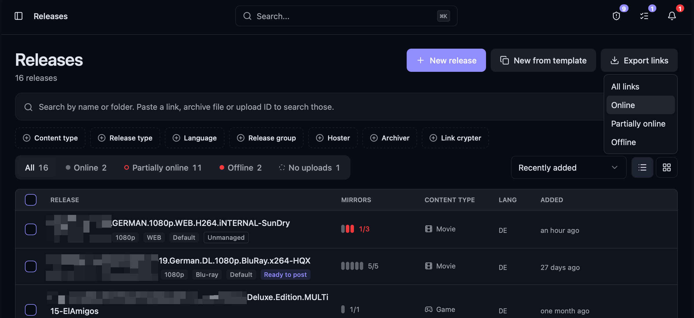
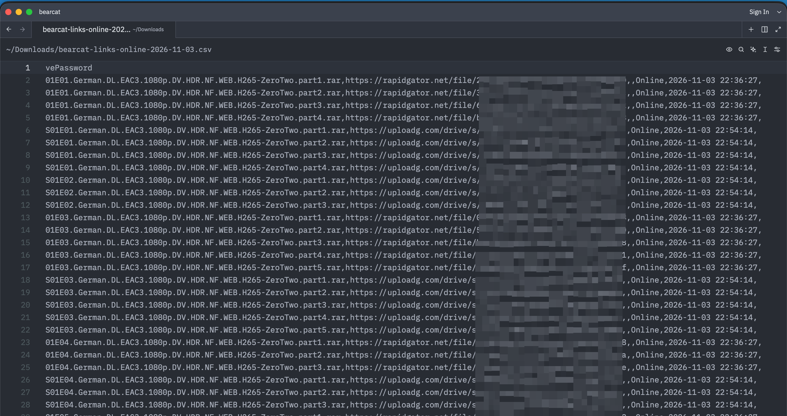

Öffne **Releases**, klicke auf **Links exportieren** und wähle einen Filter. Der Browser lädt eine CSV-Datei mit einer Zeile pro hochgeladener Datei herunter.

:::caution
Die Datei enthält Archivpasswörter im Klartext. Bewahre sie so sicher auf wie deine Passwörter.
:::

## Filter

| Filter | Exportierte Uploads |
| --- | --- |
| **Alle Links** | Alle Uploads, auch Uploads mit unbekanntem Onlinestatus |
| **Online** | Uploads, die vollständig online sind |
| **Teilweise online** | Uploads mit mindestens einem Offlinelink |
| **Offline** | Uploads, die vollständig offline sind |

Der Filter richtet sich nach dem Onlinestatus des gesamten Uploads. Für jeden passenden Upload enthält der Export alle Links, bei **Teilweise online** also auch die Offlinelinks. `LinkOnlineState` zeigt den Status jedes einzelnen Links.

Der Export enthält nur abgeschlossene Uploads. Linkcryptercontainer werden nicht exportiert.

## Format

Die CSV-Datei verwendet UTF-8 ohne BOM und Kommas als Trennzeichen. Werte stehen bei Bedarf in Anführungszeichen. Die Spaltennamen sind immer englisch.

| Spalte | Inhalt |
| --- | --- |
| `Release` | Releasename |
| `ReleaseGroup` | Releasegruppe |
| `Hoster` | Hosterkonto des Uploads, falls nicht vorhanden: Konto oder Accountpool der Uploadkonfiguration |
| `UploadId` | Upload-ID |
| `UploadOnlineState` | Onlinestatus des Uploads |
| `FileName` | Name der Archiv- oder Videodatei ohne Ordnerpfad |
| `Link` | Hosterlink |
| `EmbedLink` | Einbettungslink bei Videohostern |
| `LinkOnlineState` | Onlinestatus des Links |
| `CheckedAt` | Zeitpunkt der letzten Prüfung im Format `yyyy-MM-dd HH:mm:ss`; leer, wenn noch nie geprüft |
| `ArchivePassword` | Archivpasswort; leer, wenn keines gesetzt ist |

Bearcat exportiert die Werte unverändert. Tabellenprogramme können Werte, die mit `=`, `+`, `-` oder `@` beginnen, als Formeln auswerten.
