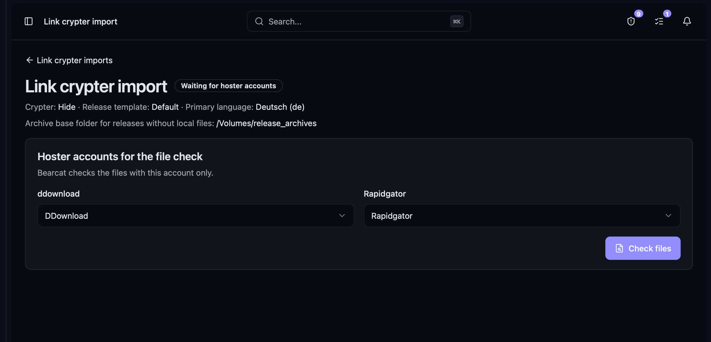

Bearcat liest die Ordner deines Linkcrypteraccounts und legt für jeden Releasenamen ein Release an.
Mirrors mit gültigen Archivlinks übernimmt Bearcat als abgeschlossene Uploads. Zu den übrigen Hostern des Releasetemplates lädt Bearcat die Dateien selbst hoch.

## Unterstützte Linkcrypter

- **FileCrypt**: Der API-Schlüssel braucht das Recht `LIST`, um deine Ordner aufzulisten.
- **Hide.cx**
- **ToLink**: Ein Ordner enthält alle Links in einer Liste. Bearcat bildet daraus pro Hosterdomain einen Mirror.

## Ablauf

1. Öffne **Crypter** > **Linkcrypterimporte** und klicke auf **Neuer Import**.
2. Wähle die Crypterregistrierung und das Releasetemplate. Das Template legt Hoster, Archiveinstellungen und Linkcryptereinstellungen der neuen Releases fest.
3. Optional: Wähle einen **Archivbasisordner für Releases ohne lokale Dateien**. Dort stellt Bearcat die Archive aus den importierten Mirrors wieder her, wenn kein lokaler Releaseordner vorhanden ist.

   

4. Bearcat liest alle Ordner und ihre Links im Hintergrund. Ordner mit bereits bekannter URL überspringt es.

   

5. Wähle pro Hoster einen Hosteraccount und klicke auf **Dateien prüfen**. Bearcat prüft die Dateien nur mit diesem Account.

   

6. Prüfe die Releases, wähle die gewünschten aus und klicke auf **Import starten**.

## Prüfung

Bearcat fasst Ordner mit demselben Releasenamen zu einem Eintrag zusammen. Du wählst sie gemeinsam aus.
Als Releasename dient der Ordnername. Stimmt er nicht, korrigiere ihn vor dem Import mit dem Button zum Bearbeiten.
Gibst du zwei Releases denselben Namen, führt Bearcat sie zusammen.

## Welche Mirrors Bearcat übernimmt

Bearcat ordnet jeden Mirror einer Uploadkonfiguration mit demselben Hoster zu.
Bei neuen Releases stammen die Konfigurationen aus dem Template. Bei bestehenden Releases gelten deren Konfigurationen.

| Entscheidung | Wann |
| --- | --- |
| **Wird übernommen** | Alle Dateien sind online und haben ein unterstütztes Archivformat (`.rar`, `.r00`, `.7z`, `.7z.001`). Weitere Mirrors müssen dieselben Dateinamen wie der erste übernommene Mirror haben. |
| **Bearcat lädt diesen Hoster selbst hoch** | Der Hoster ist im Release konfiguriert, aber der Mirror erfüllt nicht alle Bedingungen oben. |
| **Nicht unterstützter Hoster** | Bearcat kennt den Hoster der Links nicht. |
| **Hoster nicht im Release** | Das Release hat keine weitere Uploadkonfiguration für diesen Hoster. |

Bei einem verwalteten Template sucht Bearcat in den Arbeitsverzeichnissen und den Basispfaden der
Ordnerautomatisierungen nach einem noch nicht verwendeten Ordner mit dem Releasenamen. Findet es einen,
verwendet es ihn als Releaseordner und verwaltet das Release. Sonst bleibt das Release unverwaltet.
Bearcat stellt sein Archiv dann bei Bedarf aus den Mirrors wieder her.

Bearcat sucht ausserdem nach einem vorhandenen Archiv in den Archivspeicherordnern, Arbeitsverzeichnissen,
dem Archivbasisordner und deren direkten Unterordnern. Die Dateinamen müssen genau mit denen des ersten
übernommenen Mirrors übereinstimmen. Findet Bearcat ein passendes Archiv, verwendet es dieses unverändert
und lädt nichts herunter. Ohne Releaseordner bleibt das Release auch mit vorhandenem Archiv unverwaltet.

## Ordner, die sich nicht importieren lassen

- Kein Mirror gehört zu einem Hoster des Releases.
- Kein Mirror kann übernommen werden und es gibt keinen Releaseordner.
- Es gibt keinen Releaseordner, kein vorhandenes Archiv und du hast keinen Archivbasisordner gewählt.

Die letzten beiden Bedingungen gelten nur, wenn beim Import ein neues Release entsteht.

Bei [Staffelordnern](#staffelordner) scheitert der Import auch in diesen Fällen:

- Das Releasetemplate hat keine Collectionerkennung.
- Die Folgen gehören nicht zur selben Collection.

## Bestehende Releases

Bearcat erkennt bestehende Releases am Namen, unabhängig von der Gross- und Kleinschreibung.
Es verwendet den Ordnernamen oder den Namen, den du bei der Prüfung eingegeben hast.

- Ordner mit demselben Releasenamen gehören zu einem Release. Du kannst also pro Hoster einen eigenen Ordner importieren.
- Gibt es das Release bereits, fügt Bearcat den Ordner diesem Release hinzu, zum Beispiel den Ordner eines zweiten Crypters.
- Ein Mirror mit denselben Links wie ein bestehender Upload wird mit diesem Upload verknüpft.
- Gibt es für einen Hoster schon einen neueren Upload, übernimmt der Container dessen Links beim nächsten Update.
- Der Import eines Ordners schlägt fehl, wenn das Release für einen seiner Hoster schon einen Container desselben Crypteraccounts hat.

## Staffelordner

Ein Ordner kann mehrere Folgen enthalten, zum Beispiel eine ganze Staffel. Bearcat erkennt sie an den
Archivdateinamen, etwa `Show.S01E01...part1.rar` und `Show.S01E02...part1.rar`. Enthält ein Mirror mehrere
Archive, legt Bearcat für jedes ein Release an. Als Name dient der Archivname ohne Partnummer.
Bei der Prüfung siehst du die Folgen unter dem Ordner.

- Im Releasetemplate muss die [Collectionerkennung](/Bearcat/de/release-collections/#wie-eine-collection-entsteht) eingerichtet sein. Alle Folgen müssen derselben Collection zugeordnet werden.
- Bearcat sucht die lokalen Dateien jeder Folge einzeln. Ein Ordner, der genau die Parts einer Folge enthält, wird unverändert verwendet.
- Liegen alle Folgen in einem Ordner, verschiebt Bearcat die Parts jeder Folge in einen Unterordner mit dem Namen der Folge. Die Prüfung und die Benachrichtigung am Ende zeigen das an.
- Bearcat übernimmt den Ordner als Container des [Uploadslots](/Bearcat/de/release-collections/#uploadslots) der Collection. Alle Mirrors des Ordners müssen zu diesem Slot gehören, sonst schlägt der Import fehl.
- Mirrors mit unbekannten Dateinamen oder ohne Archivparts lassen sich keiner Folge zuordnen und werden übersprungen.
- Der Import schlägt fehl, wenn der Uploadslot schon einen anderen Container desselben Crypteraccounts hat oder ein Release der Collection diesen Crypteraccount für eigene Container nutzt.

Importierst du einen Ordner mit nur einer Folge und nutzt ihr Uploadslot bereits denselben Crypteraccount,
übernimmt Bearcat den Ordner ohne seinen Container. Die Links der Folge kommen in den Container der Collection.

## Linkcryptercontainer

- Ein Ordner mit einem einzelnen Mirror für einen Hoster des Releases wird zum Container der passenden Uploadkonfiguration (**Jedes Release einzeln**).
- Ein Ordner mit mehreren Mirrors wird zum Container **Release (alle Hoster als Mirrors)**. Entsteht beim Import ein neues Release, ergänzt Bearcat die Links der übrigen Hoster nach deren Upload.

Siehe [Linkcryptercontainer](/Bearcat/de/upload-lifecycle/#5-linkcryptercontainer).

## Nach dem Import

- Neue Releases übernehmen die **Primärsprache** des Imports für ihre Releaseinformationen. Bestehende Releases behalten ihre Sprache.
- Releaseinformationen (xrel, PreDB, NFO) ruft Bearcat nach dem Import über die Hintergrundaufgabe für Releaseinformationen ab.
- Importierte Releases gelten als gepostet und erscheinen nicht in der [Postwarteschlange](/Bearcat/de/post-queue/). Das gilt auch für Collections aus einem Staffelordner.

## Staffelordner neu importieren

Bevor Bearcat Staffelordner erkennen konnte, hat es für die ganze Staffel ein einziges Release angelegt.
Solche Ordner kannst du mit **Neu importieren** aufteilen. Im Dialog siehst du vor dem Bestätigen, was sich ändert:

- Bearcat legt pro Folge ein Release in einer Collection an, wie unter [Staffelordner](#staffelordner) beschrieben.
- Abgeschlossene Uploads des alten Releases teilt Bearcat nach Archivnamen auf die Folgen auf. Links und Prüfhistorie bleiben erhalten.
- Bearcat übernimmt auch weitere Container des alten Releases für die Collection, darunter Ordner von anderen Cryptern. Lässt sich ein Container nicht übernehmen, zeigt der Dialog seine URL.
- Bearcat ordnet die Posts des alten Releases der Collection zu.
- Danach löscht Bearcat das alte Release. Bei Hostern und Linkcryptern wird nichts gelöscht.

Solange Bearcat einen Upload oder ein Archiv des alten Releases verarbeitet, kannst du den Ordner nicht neu importieren.

Mehrere Ordner importierst du auf einmal neu, indem du sie auf der Importseite auswählst (standardmässig sind alle ausgewählt) und auf **Ausgewählte neu importieren** klickst.
Bearcat importiert sie im Hintergrund neu und benachrichtigt dich, wenn es fertig ist. Ordner, die sich nicht neu importieren lassen, behalten ihr Release und zeigen den Grund an.
Nur der Dialog von **Neu importieren** für einen einzelnen Ordner zeigt die Änderungen vor dem Bestätigen.
