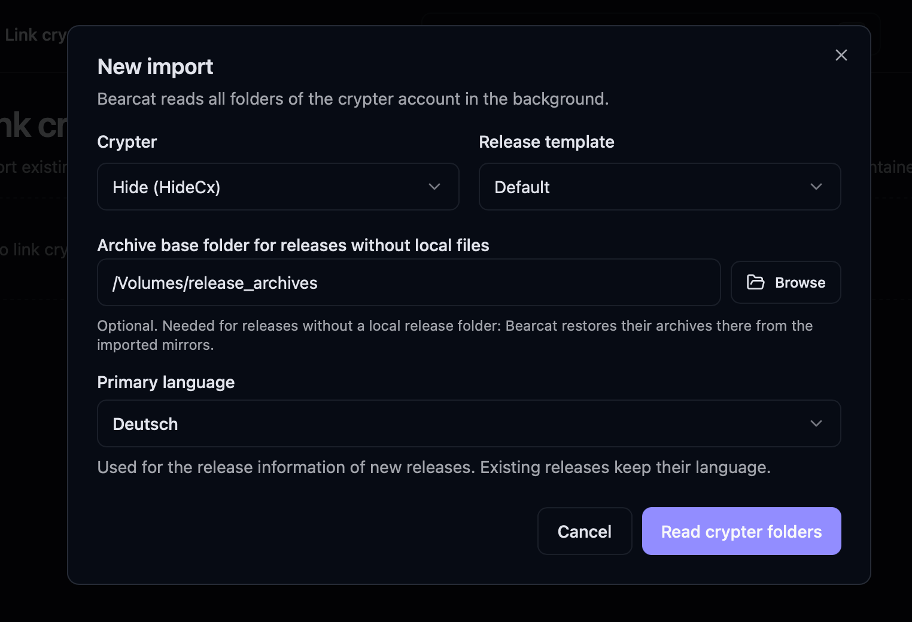
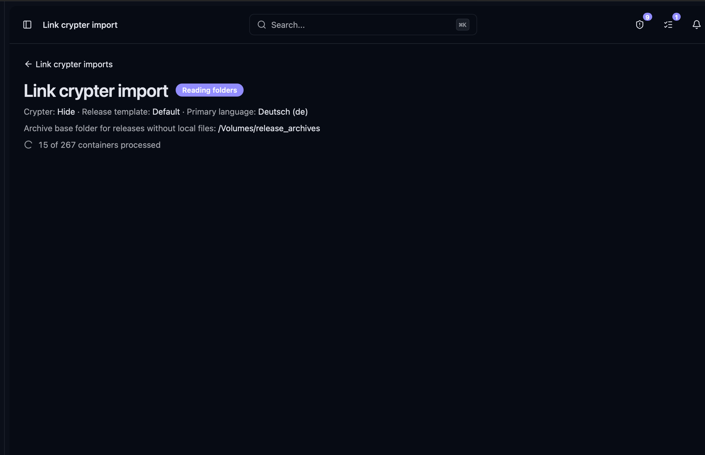
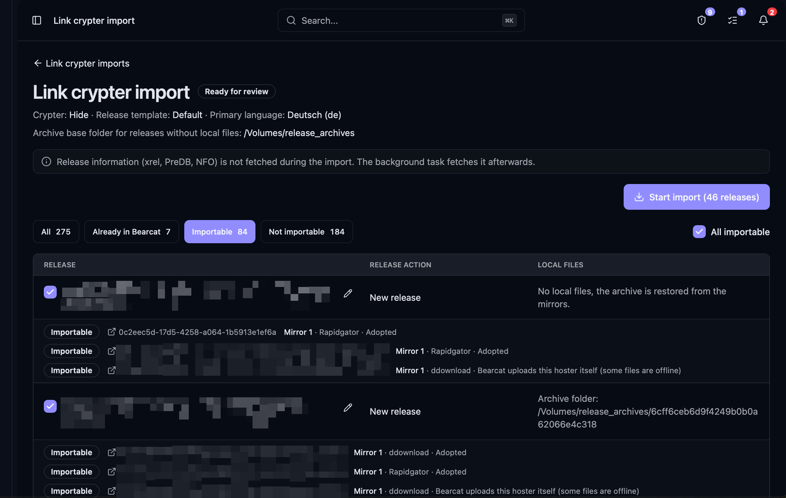
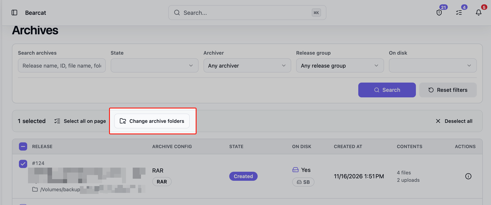
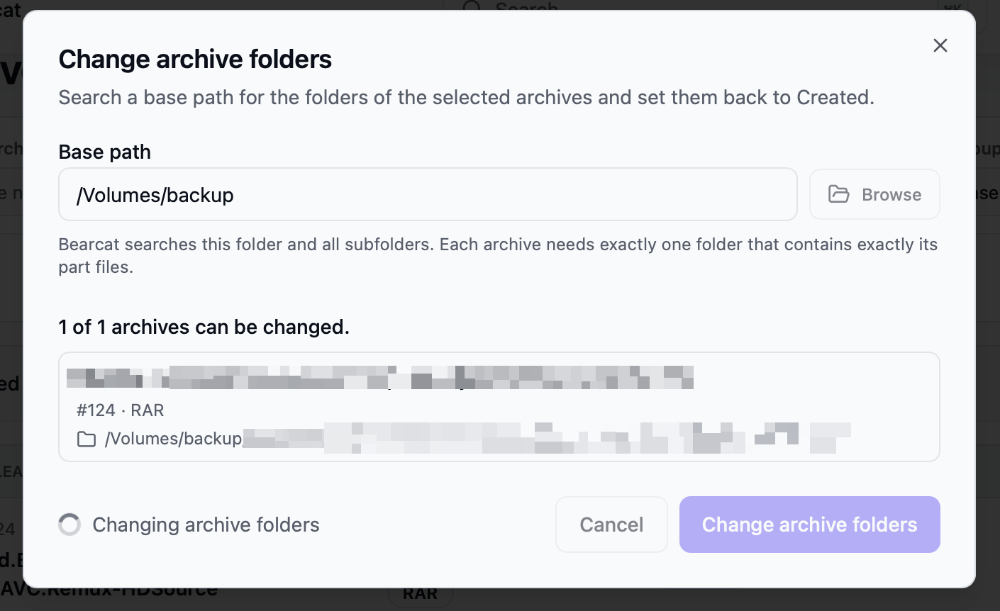

Bearcat liest die Ordner deines Linkcrypteraccounts und legt für jeden Releasenamen ein Release an.
Mirrors mit gültigen Archivlinks übernimmt Bearcat als abgeschlossene Uploads. Zu den übrigen Hostern des Releasetemplates lädt Bearcat die Dateien selbst hoch.

## Unterstützte Linkcrypter

- **FileCrypt**: Der API-Schlüssel braucht das Recht `LIST`, um deine Ordner aufzulisten.
- **Hide.cx**
- **ToLink**: Ein Ordner enthält alle Links in einer Liste. Bearcat bildet daraus pro Hosterdomain einen Mirror.

## Ablauf

1. Öffne **Registrierungen > Crypter** > **Linkcrypterimporte** und klicke auf **Neuer Import**.
2. Wähle die Crypterregistrierung und das **Standardtemplate** für neue Releases. Das Template legt die Hoster und die Einstellungen für Archive und Linkcrypter fest. Bei Bedarf kannst du ein eigenes **Serientemplate** und eine **Standardsprache** wählen. Wie Bearcat beides auswählt, steht unter [Template und Sprache](#template-und-sprache).
3. Fehlt der lokale Releaseordner, kann Bearcat die Archive aus den importierten Mirrors wiederherstellen. Wähle dafür einen **Archivbasisordner für Releases ohne lokale Dateien**.

   

4. Klicke auf **Crypterordner lesen**. Bearcat liest die Ordner und Links im Hintergrund und überspringt Ordner, deren URL es schon kennt.

   

5. Wähle pro Hoster einen Hosteraccount und klicke auf **Dateien prüfen**. Bearcat prüft die Dateien nur mit diesem Account.

   

6. Prüfe die Releases, wähle die gewünschten aus und klicke auf **Import starten**.

## Prüfung

Bearcat verwendet den Ordnernamen als Releasenamen. Ordner mit demselben Releasenamen erscheinen als ein Eintrag. Über **Release umbenennen** kannst du den Namen korrigieren. Gibst du einem Release den Namen eines anderen, führt Bearcat beide zusammen. Template und Sprache übernimmt es vom Release, das den Namen schon hatte.

### Releases suchen und auswählen

Gib einen Teil des Release- oder Ordnernamens ein. Gross- und Kleinschreibung spielen keine Rolle. Mit `Show.S01*-GRP` findest du Namen, die mit `Show.S01` beginnen und mit `-GRP` enden. Über den Statusfilter kannst du die Treffer weiter eingrenzen.

Nach der Dateiprüfung sind alle importierbaren Ordner markiert. Mit dem Häkchen neben einem Release wählst du seine Ordner gemeinsam aus oder ab. Mit **Alle Treffer auswählen** markierst du auch die Treffer auf den weiteren Seiten.

- **Releasetemplate ändern** und **Primärsprache ändern** gelten für die markierten Releases in der gefilterten Liste. Willst du nur ein Release ändern, suche nach seinem Namen und markiere nur diesen Treffer. Auch Releases mit dem Status **Nicht importierbar** kannst du so bearbeiten.
- Hast du ein Serientemplate gewählt, kannst du zwischen Standard- und Serientemplate wechseln. Bearcat berechnet die Vorschau danach neu. Bei vielen Releases kann das etwas dauern.
- Mit **Import starten** übernimmt Bearcat alle markierten Ordner mit dem Status **Importierbar**, auch wenn die Suche oder der Statusfilter sie gerade ausblendet.

## Template und Sprache

Nach der Dateiprüfung siehst du für jeden Ordner, welches Template und welche Sprache Bearcat gewählt hat. Beides kannst du vor dem Import ändern.

Das **Standardtemplate** gilt für alle Ordner. Hast du ein **Serientemplate** gewählt, verwendet Bearcat es in folgenden Fällen:

- Der Ordner enthält Archive verschiedener Releases.
- Der Releasename passt zum Folgenmuster der Collectionerkennung im Serientemplate.
- Der Releasename enthält eine Staffelnummer, etwa `S01` in `Show.S01.German.1080p-GRP`.

Die **Primärsprache** erkennt Bearcat am Releasenamen. Aus `German` wird zum Beispiel `de`. Fehlt die Sprache im Namen und enthält der Ordner Archive mehrerer Releases, prüft Bearcat den Namen des ersten Archivs. Erkennt Bearcat keine Sprache, gilt die Standardsprache des Imports.

## Welche Mirrors Bearcat übernimmt

Bearcat ordnet jeden Mirror einer Uploadkonfiguration mit demselben Hoster zu.
Bei neuen Releases stammen die Konfigurationen aus dem Template. Bei bestehenden Releases gelten deren Konfigurationen.

| Entscheidung | Wann |
| --- | --- |
| **Wird übernommen** | Alle Dateien sind online und haben ein unterstütztes Archivformat (`.rar`, `.r00`, `.7z`, `.7z.001`). Weitere Mirrors müssen dieselben Dateinamen wie der erste übernommene Mirror haben. |
| **Bearcat lädt die Dateien hoch** | Der Hoster ist im Release konfiguriert, aber der Mirror erfüllt nicht alle Bedingungen oben. |
| **Nicht unterstützter Hoster** | Bearcat kennt den Hoster der Links nicht. |
| **Hoster nicht im Release** | Das Release hat keine weitere Uploadkonfiguration für diesen Hoster. |

Bei einem Managed Template sucht Bearcat in den Arbeitsverzeichnissen und den Basispfaden der
Ordnerautomatisierungen nach einem noch nicht verwendeten Ordner mit dem Releasenamen. Findet es einen,
verwendet es ihn als Releaseordner für ein Managed Release. Sonst erstellt es ein Unmanaged Release.
Bearcat stellt sein Archiv dann bei Bedarf aus den Mirrors wieder her.

Bearcat sucht ausserdem nach einem vorhandenen Archiv in den Archivspeicherordnern, Arbeitsverzeichnissen,
dem Archivbasisordner und deren direkten Unterordnern. Die Dateinamen müssen genau mit denen des ersten
übernommenen Mirrors übereinstimmen. Findet Bearcat ein passendes Archiv, verwendet es dieses unverändert
und lädt nichts herunter. Ohne Releaseordner bleibt das Release auch mit vorhandenem Archiv vom Typ Unmanaged.

## Ordner, die sich nicht importieren lassen

- Kein Mirror gehört zu einem Hoster des Releases.
- Kein Mirror kann übernommen werden und es gibt keinen Releaseordner.
- Es gibt keinen Releaseordner, kein vorhandenes Archiv und du hast keinen Archivbasisordner gewählt.

Die letzten beiden Bedingungen gelten nur, wenn beim Import ein neues Release entsteht.

Bei [Staffelordnern](#staffelordner) scheitert der Import auch in diesen Fällen:

- Das Releasetemplate hat keine Collectionerkennung.
- Die Folgen gehören nicht zur selben Collection.

## Bestehende Releases

Bearcat erkennt bestehende Releases am Namen, unabhängig von der Gross- und Kleinschreibung.
Es verwendet den Ordnernamen oder den Namen, den du bei der Prüfung eingegeben hast.

- Ordner mit demselben Releasenamen gehören zu einem Release. Du kannst also pro Hoster einen eigenen Ordner importieren.
- Gibt es das Release bereits, fügt Bearcat den Ordner diesem Release hinzu, zum Beispiel den Ordner eines zweiten Crypters.
- Ein Mirror mit denselben Links wie ein bestehender Upload wird mit diesem Upload verknüpft.
- Gibt es für einen Hoster schon einen neueren Upload, übernimmt der Container dessen Links beim nächsten Update.
- Der Import eines Ordners schlägt fehl, wenn das Release für einen seiner Hoster schon einen Container desselben Crypteraccounts hat.

## Staffelordner

Ein Ordner kann mehrere Folgen enthalten, zum Beispiel eine ganze Staffel. Bearcat erkennt sie an den
Archivdateinamen, etwa `Show.S01E01...part1.rar` und `Show.S01E02...part1.rar`. Enthält ein Mirror mehrere
Archive, legt Bearcat für jedes ein Release an. Als Name dient der Archivname ohne Partnummer.
Bei der Prüfung siehst du die Folgen unter dem Ordner.

- Im Releasetemplate muss die [Collectionerkennung](/Bearcat/de/release-collections/#wie-eine-collection-entsteht) eingerichtet sein. Alle Folgen müssen derselben Collection zugeordnet werden.
- Bearcat sucht die lokalen Dateien jeder Folge einzeln. Ein Ordner, der genau die Parts einer Folge enthält, wird unverändert verwendet.
- Liegen alle Folgen in einem Ordner, verschiebt Bearcat die Parts jeder Folge in einen Unterordner mit dem Namen der Folge. Die Prüfung und die Benachrichtigung am Ende zeigen das an.
- Bearcat übernimmt den Ordner als Container des [Uploadslots](/Bearcat/de/release-collections/#uploadslots) der Collection. Alle Mirrors des Ordners müssen zu diesem Slot gehören, sonst schlägt der Import fehl.
- Mirrors mit unbekannten Dateinamen oder ohne Archivparts lassen sich keiner Folge zuordnen und werden übersprungen.
- Der Import schlägt fehl, wenn der Uploadslot schon einen anderen Container desselben Crypteraccounts hat oder ein Release der Collection diesen Crypteraccount für eigene Container nutzt.

Importierst du einen Ordner mit nur einer Folge und nutzt ihr Uploadslot bereits denselben Crypteraccount,
übernimmt Bearcat den Ordner ohne seinen Container. Die Links der Folge kommen in den Container der Collection.

## Linkcryptercontainer

- Ein Ordner mit einem einzelnen Mirror für einen Hoster des Releases wird zum Container der passenden Uploadkonfiguration (**Jedes Release einzeln**).
- Ein Ordner mit mehreren Mirrors wird zum Container **Release (alle Hoster als Mirrors)**. Entsteht beim Import ein neues Release, ergänzt Bearcat die Links der übrigen Hoster nach deren Upload.

Siehe [Linkcryptercontainer](/Bearcat/de/upload-lifecycle/#5-linkcryptercontainer).

## Nach dem Import

- Für die Releaseinformationen neuer Releases gilt die Primärsprache aus der Importvorschau. Bestehende Releases behalten ihre Sprache.
- Nach dem Import ruft eine Hintergrundaufgabe die Releaseinformationen ab (xREL, PreDB, NFO).
- Importierte Releases gelten als gepostet und erscheinen nicht in der [Postwarteschlange](/Bearcat/de/post-queue/). Das gilt auch für Collections aus einem Staffelordner.

## Archive beim Import nicht gefunden

Findet Bearcat beim Import die lokalen Archive nicht, erhalten sie den Status **Gelöscht**.
Bearcat stellt sie bei Bedarf aus den Mirrors wieder her. Liegen die Archivdateien bereits auf der
Festplatte, kannst du ihre Ordner nachträglich zuordnen:

1. Öffne **Uploads und Archive** > **Archive** und wähle die Archive aus.
2. Klicke auf **Archivordner ändern** und wähle einen Basispfad.

   

3. Bearcat durchsucht den Basispfad und alle Unterordner. Prüfe die gefundenen Archivordner und bestätige mit **Archivordner ändern**.

   

Bearcat muss für jedes Archiv einen eindeutigen Ordner finden, der genau dessen Archivteile enthält.
Dann setzt es den Status auf **Erstellt** und verwendet den Ordner unverändert.
Bearcat überspringt das Archiv in diesen Fällen:

- Das Archiv ist weder **Gelöscht** noch **Dateien fehlen**.
- Für die Archivkonfiguration gibt es bereits ein neueres Archiv.
- Es wurde kein passender Ordner gefunden oder es passen mehrere Ordner.
- Der Ordner enthält auch ein anderes Archiv.
- Der Ordner wird bereits von einem anderen Archiv verwendet.
- Derselbe Ordner wurde für mehrere ausgewählte Archive gefunden.
- Das Release ist vom Typ Managed und der Archivordner liegt in seinem Releaseordner.
