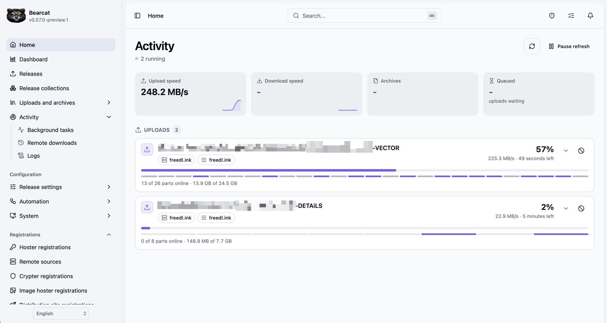

import { CardGrid, LinkCard } from '@astrojs/starlight/components';

## Was ist Bearcat?

Bearcat läuft auf deinem Desktop, NAS oder Server. Über die Weboberfläche verwaltest du Releases,
erstellst Archive und lädst sie zu deinen Hostern hoch. Bearcat prüft die Links und lädt Dateien
erneut hoch, wenn sie offline gehen.

Du kannst:

- [Releases automatisch von FTP/FTPS-Servern herunterladen](/de/remote-downloads/), SFV-Prüfsummen prüfen und optional RAR- oder 7z-Archive entpacken.
- Releases in RAR- oder 7z-Archive packen oder bereits vorhandene Archive hochladen.
- Zu Rapidgator, DDownload, Keep2Share und den anderen unten aufgeführten Hostern hochladen.
- Lokalen Speicherplatz freigeben und [Archive von einem Mirrorhoster wiederherstellen](/de/mirror-downloads/), wenn ein Reupload sie benötigt.
- Releaseinformationen und NFOs über xREL und SRRDB, Film- und Seriendaten über TMDB und TheTVDB und Spieldaten über Steam abrufen.
- Auflösung, Codecs sowie Audio- und Untertitelspuren deiner Videodateien mit MediaInfo auslesen.
- Coverbilder hochladen und [Videoscreenshots erstellen](/de/release-templates-and-automations/#screenshots). Die Bilder kannst du zusammen mit Downloadlinks und NFOs in [Postvorlagen](/de/forum-post-templates/) verwenden.
- [Entwürfe in Foren und Blogs mit WordPress vorbereiten](/de/posting-to-forums/) und selbst absenden oder mit [Postingregeln automatisch posten](/de/automatic-forum-posting/).
- In der [Postwarteschlange](/de/post-queue/) Releases finden, die du posten kannst.

## Unterstützte Dienste

### Filehoster

- Rapidgator
- DDownload
- GoFile
- [Keep2Share](/de/keep2share/)
- Alfafile
- NitroFlare
- 1fichier
- Uploady.io
- Katfile
- Krakenfiles
- FileQ
- UploadG.com
- FileServe.com
- Clicknupload.click
- HxFile.co
- file-upload.org
- datavaults.co (maximale Dateigrösse: 100 MB)
- Fast2Share.com
- CloudFam.io
- freedl.ink (minimale Dateigrösse: 1 MB)
- mega4upload.net
- filer.net (Free-Accounts: maximale Dateigrösse 2 GB)
- [FileFactory](/de/filefactory/) (Gratisaccounts: maximale Dateigrösse 2 GB)
- turbobit.net (API-Schlüssel von cabinet.costaction.com)
- hitfile.net (API-Schlüssel von cabinet.costaction.com)
- Zippyshare.day

### Videohoster

- DoodStream
- MixDrop
- Playmate
- Streamtape
- Vidara
- Videro
- Vixeo

### Linkcrypter

- Hide.cx
- Keeplinks
- tolink.to
- [filecrypt.cc](/de/filecrypt/)

### Bildhoster

- ImgBB
- pixhost.to (kein API-Schlüssel nötig)
- pixelfox.cc
- loepic.me
- directupload.eu (kein API-Schlüssel nötig)

### Foren

Das XenForo-Plugin sollte mit den meisten XenForo-Foren ohne Captcha beim Login funktionieren
(getestet mit data-load.me und myboerse.bz).
Für data-load.me und boerse.cx gibt es zusätzlich eigene Plugins.

### Blogs

[WordPress](/de/wordpress/) ab Version 5.6, mit einem Anwendungspasswort.

## Erste Schritte

Installiere Bearcat mit einer der folgenden Varianten. Beim ersten Öffnen startet die Einrichtung.
Die Schritte findest du unter [Dein erster Upload](/de/post-installation/).

<CardGrid>
	<LinkCard
		title="Desktopanwendung"
		description="Bearcat unter Windows, macOS mit Apple Silicon oder Linux starten."
		href="/de/use-the-desktop-launcher/"
	/>
	<LinkCard
		title="Windows-Dienst"
		description="Bearcat im Hintergrund ausführen, auch wenn du nicht angemeldet bist."
		href="/de/use-the-windows-service/"
	/>
	<LinkCard
		title="Docker-Container"
		description="Bearcat mit Docker unter Linux, auf einem NAS oder einem Server ausführen."
		href="/de/use-the-docker-image/"
	/>
	<LinkCard
		title="Dein erster Upload"
		description="Hosterkonto hinzufügen, Template erstellen und Quelle anlegen."
		href="/de/post-installation/"
	/>
</CardGrid>

## Nach der Einrichtung

| Du möchtest … | Anleitung |
| --- | --- |
| Neue Ordner automatisch hochladen | [Releasetemplates und Ordnerautomatisierungen](/de/release-templates-and-automations/) |
| Releases von einem Server herunterladen | [FTP/FTPS-Downloads](/de/remote-downloads/) |
| Speicherplatz freigeben | [Mirrordownloads](/de/mirror-downloads/) oder [Archivspeicherordner](/de/archive-storage-folders/) |
| Fertige Uploads in Foren oder Blogs posten | [Auf Seiten posten](/de/posting-to-forums/) oder [automatisches Posten](/de/automatic-forum-posting/) |

## Häufige Fragen

### Kann ich PostgreSQL verwenden?

Ja. Neue Installationen verwenden SQLite. Du kannst aber [PostgreSQL einrichten](/de/install-postgresql-for-desktop/) oder die [Docker-Variante](/de/use-the-docker-image/#datenbank) nutzen. Bestehende PostgreSQL-Installationen behalten ihre Einstellungen.

### Kann ich vorhandene Archive hochladen?

Ja. Verwende ein Unmanaged Release für vorhandene Archive oder ein Managed Release, damit Bearcat sie erstellt.
Siehe [Releasetypen](/de/release-types/).

### Muss ich jedes Archiv auf der Festplatte behalten?

Nein. Aktiviere einen Hoster als Mirror, damit Bearcat Archive für einen Reupload herunterladen kann.
Lösche lokale Kopien selbst oder lege eine Aufbewahrungsdauer für die automatische Bereinigung fest.

Der Hoster muss Downloads über seine API unterstützen, und manche Hoster verlangen ein Premiumkonto.
Unterstützte Hoster und die Einrichtung findest du unter [Mirrordownloads](/de/mirror-downloads/).

## Mehr erfahren

<CardGrid>
	<LinkCard
		title="Ablauf eines Uploads"
		description="Wie Bearcat Archive erstellt, Uploadlinks prüft und Reuploads plant."
		href="/de/upload-lifecycle/"
	/>
	<LinkCard
		title="Releasecollections"
		description="Uploadeinstellungen und Containerlinks für zusammengehörige Releases teilen."
		href="/de/release-collections/"
	/>
	<LinkCard
		title="Releaseinformationen und Metadaten"
		description="Metadatenquellen einrichten, NFOs abrufen und Angaben korrigieren."
		href="/de/release-information-and-metadata/"
	/>
	<LinkCard
		title="Postvorlagen"
		description="Foren- und Blogposts mit Releasedetails, Coverbildern, Screenshots, NFOs und Downloadlinks erstellen."
		href="/de/forum-post-templates/"
	/>
	<LinkCard
		title="Erweiterte Konfiguration"
		description="Uploadlimits, automatisches Aufräumen und Hintergrundaufgaben einstellen."
		href="/de/advanced-configuration/"
	/>
</CardGrid>
