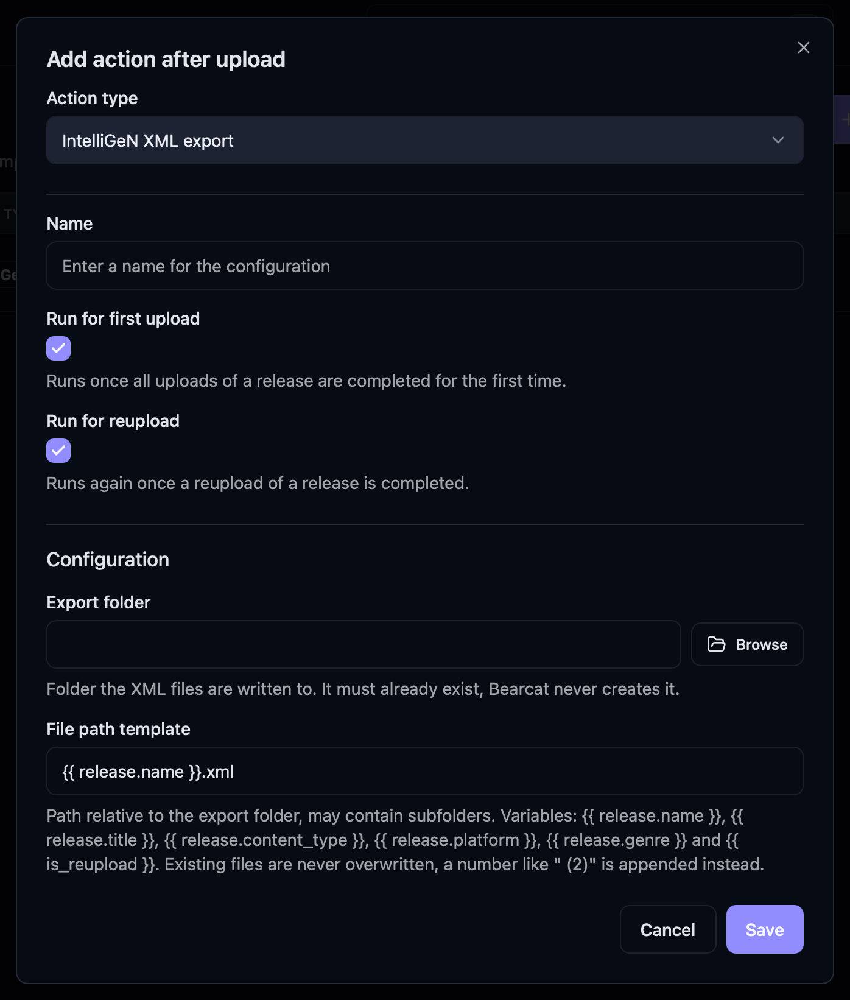
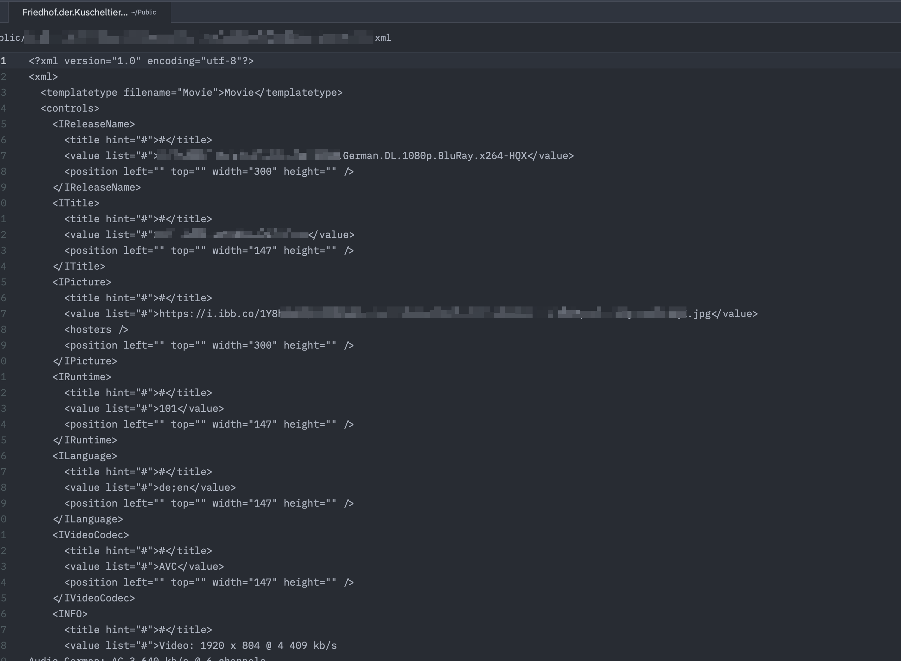

Bearcat schreibt die Downloadlinks und Metadaten eines Releases nach dem Upload in eine XML-Datei für IntelligeN.
Bei einer Collection enthält die Datei die Links aller Folgen. Innerhalb jedes Uploadslots fasst Bearcat die Links pro Hoster zu einem Mirror zusammen.

## Export einrichten

1. Öffne **Automatisierung > Aktionen nach dem Upload** und klicke auf **Neue Aktion**.
2. Wähle als **Aktionstyp** den Eintrag **IntelligeN XML export** und gib dem Export einen Namen.
3. Aktiviere **Nach dem ersten Upload**, **Nach einem Reupload** oder beides.
4. Wähle einen vorhandenen **Exportordner**. Unter **Dateipfadvorlage** kannst du den Dateinamen und bei Bedarf Unterordner angeben.
5. Klicke auf **Speichern**.



Jeder Export erstellt eine neue Datei. Ist der Dateiname bereits vergeben, hängt Bearcat eine Nummer an, etwa `Release.Name (2).xml`.
Das Ergebnis siehst du auf der Detailseite des Releases oder der Collection unter [Aktionen nach dem Upload](/de/upload-completion-actions/).



## In IntelligeN importieren

Wähle in **DirWatch** den Exportordner aus. IntelligeN importiert neue Dateien aus diesem Ordner automatisch.

IntelligeN übernimmt nur Crypter, die es kennt. Auch bei Genre, Sprache und Codecs muss der Wert in der jeweiligen Auswahlliste stehen.

## Dateipfadvorlage

Die Dateipfadvorlage verwendet [Scriban](https://github.com/scriban/scriban). Mit der Standardvorlage `{{ release.name }}.xml` trägt die Datei den Namen des Releases oder der Collection.

| Variable | Wert |
| --- | --- |
| `{{ release.name }}` | Name des Releases oder der Collection |
| `{{ release.title }}` | Titel aus den Metadaten |
| `{{ release.content_type }}` | Inhaltstyp |
| `{{ release.platform }}` | Plattform eines Spiels |
| `{{ release.genre }}` | Genre |
| `{{ release.runtime_minutes }}` | Laufzeit in Minuten |
| `{{ release.video_codec }}` | Videocodec des Hauptvideos |
| `{{ release.audio_codec }}` | Audiocodec der Haupttonspur |
| `{{ is_reupload }}` | `true` bei einem Reupload, sonst `false` |

Mit dieser Vorlage landen Reuploads im Unterordner `Reuploads`.

```text
{{ if is_reupload }}Reuploads/{{ end }}{{ release.name }}.xml
```
