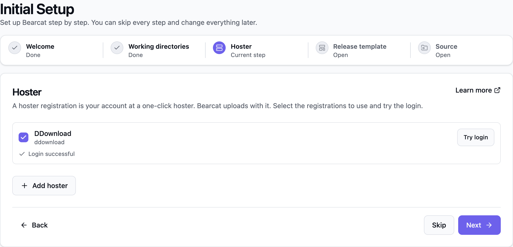
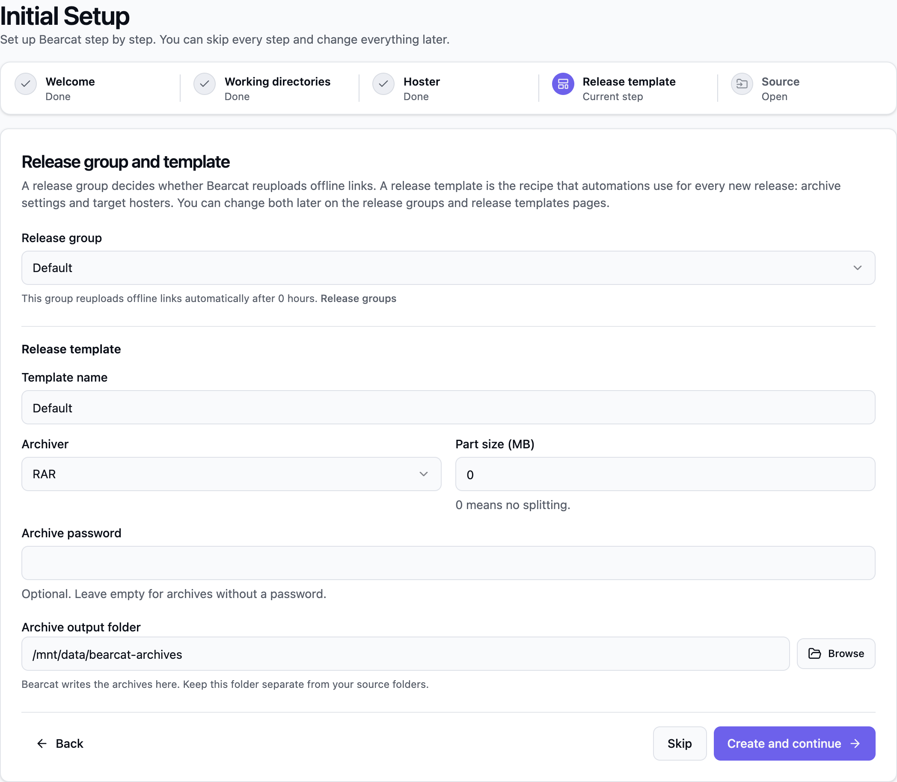
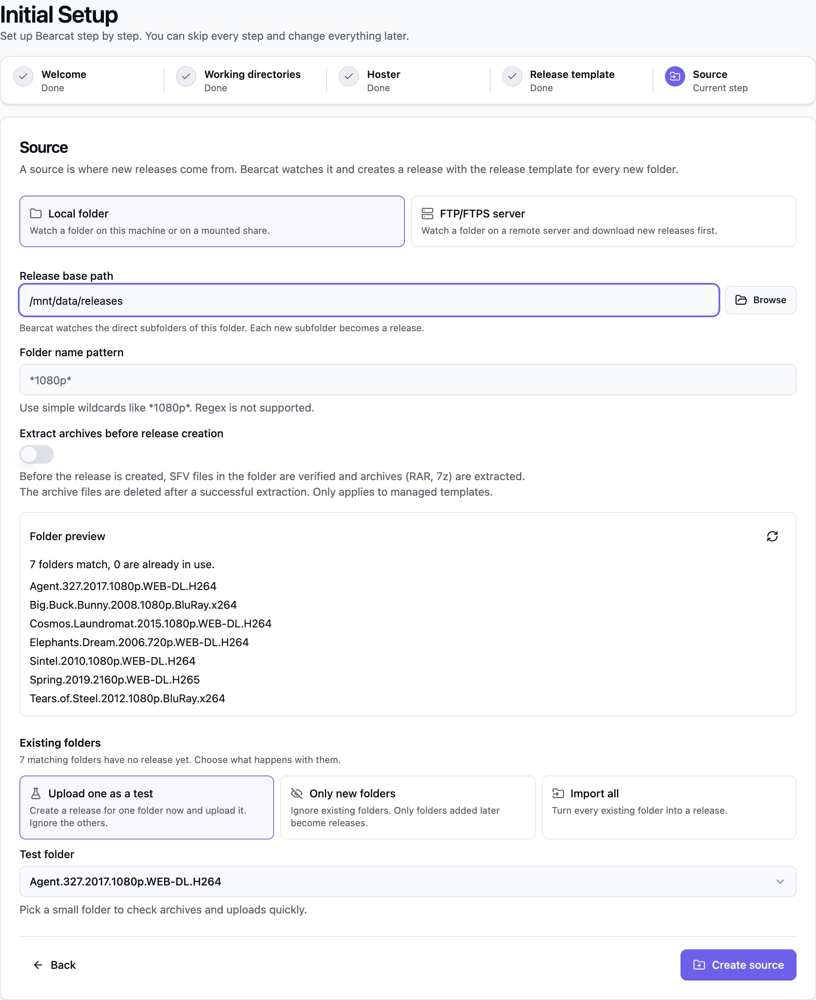
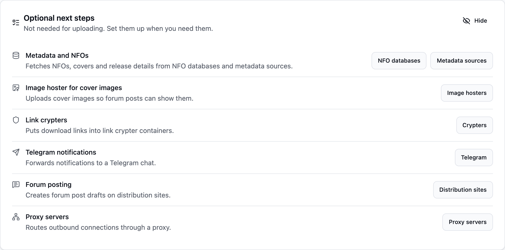

Halte dein Hosterkonto und deine Dateien bereit. Die Dateien, die du gemeinsam hochlädst, bilden ein **Release**.

Öffne Bearcat im Browser:

- **Desktopanwendung oder Windows-Dienst:** [http://127.0.0.1:17208](http://127.0.0.1:17208)
- **Docker:** [http://localhost:8080](http://localhost:8080) oder `http://<server-address>:8080` auf einem anderen Rechner

Falls du den Webport geändert hast, verwende diesen Port.

## Einrichtung öffnen

Nach der Installation öffnet sich die **Erste Einrichtung** einmalig beim ersten Aufruf der Startseite.
Später findest du sie unter **System > Erste Einrichtung** oder über die Suche mit **Ctrl+K** oder **Cmd+K**.

Du kannst Schritte überspringen und alle Einstellungen später ändern.

### Willkommen

Klicke auf **Einrichtung starten**. Mit **Einrichtung überspringen** kehrst du zur Startseite zurück.
Du kannst Bearcat auch [manuell einrichten](#manuell-einrichten).

### Arbeitsverzeichnisse

Bearcat kann nur auf Ordner in seinen Arbeitsverzeichnissen zugreifen. Die Einrichtung zeigt für jedes
Arbeitsverzeichnis den Status **OK**, **Fehlt** oder **Nicht beschreibbar**. Für **Weiter** muss mindestens
eines vorhanden und beschreibbar sein.

- **Docker:** Der Hostordner `RELEASES_DIR` aus deiner Datei `.env` erscheint als `/mnt/data/releases`.
- **Desktopanwendung oder Windows-Dienst:** Lege die Arbeitsverzeichnisse in den Einstellungen der Desktopanwendung
  oder in `appsettings.user.json` fest, starte Bearcat neu und klicke auf **Erneut prüfen**.

In der Einrichtung lassen sich die Arbeitsverzeichnisse nicht ändern.

### Hoster

1. Klicke auf **Hoster hinzufügen**, wähle deinen Hoster und gib Benutzername und Passwort oder API-Schlüssel ein.
   Lass Uploadlimits und Reuploadeinstellungen auf den Standardwerten.
2. Wähle die Hosterregistrierungen aus, die Bearcat für Uploads verwenden soll.
3. Klicke bei jeder ausgewählten Hosterregistrierung auf **Login testen**.

Sobald mindestens ein Logintest erfolgreich war, kannst du auf **Weiter** klicken.

Hostereinrichtung anzeigen

### Releasegruppe und Template

Die Releasegruppe legt fest, ob Bearcat Uploads ersetzt, die offline gehen. Im Releasetemplate speicherst du
die Archiveinstellungen und Zielhoster. Automatisierungen übernehmen diese Einstellungen für neue Releases.

Falls du bereits ein Template hast, wähle **Vorhandenes Template verwenden**. Ansonsten wähle
**Neues Template erstellen**. Für neue Templates gelten diese Standardwerte:

| Feld | Standard |
| --- | --- |
| **Releasegruppe** | `Default`, sonst die erste Gruppe |
| **Name des Templates** | `Standard` |
| **Archiver** | RAR |
| **Teilgrösse (MB)** | Das kleinste Dateigrössenlimit der ausgewählten Hoster. Mit `0` wird das Archiv nicht aufgeteilt. Für 7z muss der Wert grösser als `0` sein. |
| **Archivpasswort** | Leer, kein Passwort |
| **Archivausgabeordner** | `bearcat-archives` im ersten beschreibbaren Arbeitsverzeichnis |

Unter **Releasegruppe** siehst du, ob automatische Reuploads für die gewählte Gruppe aktiv sind.
Ändern kannst du das unter **Releasegruppen**.

Falls noch keine Gruppe existiert, führt dich ein Link zu **Releasegruppen**. Lege dort eine Gruppe an,
damit du das Template erstellen kannst.

Wähle einen Archivausgabeordner getrennt von deinen Quellordnern. Falls er noch nicht existiert, klicke auf
**Ordner erstellen**. Speichere das Template mit **Erstellen und weiter**.

Das neue Template hat den Typ **Managed** und enthält eine Archivkonfiguration sowie eine Uploadkonfiguration
pro ausgewähltem Hoster. Hast du keinen Hoster ausgewählt, musst du die Uploadkonfigurationen später unter
**Releasetemplates** ergänzen.

Archive erhalten einen zufälligen Namen. Wenn du den Releasenamen verwenden möchtest, ändere die
Archivkonfiguration unter **Releasetemplates**.

Templateschritt anzeigen

### Quelle

Eine Quelle legt fest, wo Bearcat nach neuen Releases sucht. Wähle **Lokaler Ordner** oder **Server (FTP/FTPS)**.

**Lokaler Ordner:**

1. Wähle unter **Releasebasispfad** den Ordner, dessen direkte Unterordner zu Releases werden sollen.
2. Gib bei Bedarf ein **Muster für Ordnernamen** ein, etwa `*1080p*`.
3. Liegen RAR- oder 7z-Archive in den Ordnern, aktiviere **Archive vor der Releaseerstellung entpacken**.
   Siehe [Archive vor der Releaseerstellung entpacken](/Bearcat/de/release-templates-and-automations/#archive-vor-der-releaseerstellung-entpacken).

Die **Ordnervorschau** listet die passenden Ordner und zeigt, wie viele davon bereits verwendet werden.
Archivausgabeordner gelten als belegt und werden nie zu Releases.

Unter **Vorhandene Ordner** wählst du, was mit passenden Ordnern passiert, die noch kein Release haben:

| Option | Ergebnis |
| --- | --- |
| **Einen als Test hochladen** (Standard) | Bearcat erstellt ein Release aus dem gewählten **Testordner** und startet die Uploads ohne Wartezeit. Die übrigen vorhandenen Ordner werden ignoriert. Diese Option ist bei aktiviertem Entpacken nicht verfügbar. |
| **Nur neue Ordner** | Vorhandene Ordner werden ignoriert. Nur später hinzugefügte Ordner werden zu Releases. |
| **Alle importieren** | Alle passenden Ordner ohne Release werden importiert und hochgeladen. |

Wähle einen kleinen Testordner, um Archive und Uploads schnell zu prüfen. Klicke auf **Quelle anlegen**.

Quellenschritt anzeigen

**Server (FTP/FTPS):**

1. Falls noch keine aktive Remotequelle existiert, klicke auf **Remotequelle hinzufügen** und gib deine Serverdaten ein.
2. Klicke auf **Remoteautomatisierung anlegen**. Im Dialog wählst du die Remotequelle, den überwachten
   Remoteordner und den lokalen Downloadordner.

Vorhandene Ordner auf dem Server werden ignoriert. Mehr zu den Einstellungen findest du unter
[FTP/FTPS-Downloads](/Bearcat/de/remote-downloads/).

Nach dem Anlegen bestätigt Bearcat die neue Quelle. Falls du einen Testordner gewählt hast, siehst du auch,
ob seine Uploads erstellt wurden. Mit **Release öffnen** gelangst du zum Testrelease, mit **Zur Aktivität**
zur Startseite.

## Wie es weitergeht

- **Testrelease:** Das Packen startet kurz nach dem Klick auf **Quelle anlegen**.
- **Neue lokale Ordner:** Bearcat scannt etwa alle zwei Minuten. Ein Ordner muss für die eingestellte
  [Stabilitätsdauer](/Bearcat/de/advanced-configuration/#ordnerautomatisierung) unverändert bleiben
  (Standard: 5 Minuten). Danach erstellt Bearcat das Release.
- **Neue Ordner auf dem Server:** Auch hier wartet Bearcat, bis der Ordner für die eingestellte
  [Stabilitätsdauer](/Bearcat/de/advanced-configuration/#remotedownloads) unverändert bleibt
  (Standard: 5 Minuten). Dann lädt es ihn herunter und erstellt das Release.
- **Uploads** starten nach dem [Cooldown für initiale Uploads](/Bearcat/de/advanced-configuration/#cooldown-für-initiale-uploads)
  (Standard: 5 Minuten). Um die Wartezeit für ein Release zu überspringen, klicke auf seiner Detailseite auf **Uploads jetzt starten**.

Laufende Archiverstellungen und Uploads erscheinen auf der Startseite. Öffne auf der Releasedetailseite
**Uploads** und wechsle zu **Verlauf**, um den Fortschritt zu verfolgen. Ist der Upload fertig, kopiere die
Downloadlinks aus der **Übersicht**.

Schlägt der Upload fehl oder startet er nicht, prüfe die Fehler unter der Benachrichtigungsglocke.
Stelle sicher, dass **Login testen** erfolgreich ist und der Archivausgabeordner beschreibbar ist.
Mehr dazu findest du unter [Ablauf eines Uploads](/Bearcat/de/upload-lifecycle/).

### Startseite

Ein Banner auf der Startseite zeigt dir, ob noch Hoster, Releasetemplate oder Quelle fehlen.
**Einrichtung fortsetzen** öffnet die Einrichtung erneut.

Sobald die Grundeinrichtung abgeschlossen ist, zeigt die Startseite **Optionale nächste Schritte**: Metadaten und NFOs,
ein Bildhoster für Coverbilder, Linkcrypter, Telegrambenachrichtigungen, Forenposts und Proxyserver.
Jeder Eintrag führt zu den passenden Einstellungen und wird nach der Einrichtung als erledigt markiert.

Optionale nächste Schritte anzeigen

Mit **Ausblenden** blendest du die Liste und das Einrichtungsbanner in allen Browsern aus. Um beides wieder
anzuzeigen, aktiviere **Assistent auf der Aktivitätsseite anzeigen** unter **Konfigurationen > Erste Einrichtung**.

## Manuell einrichten

1. **Hoster:** Öffne **Hosterregistrierungen**, klicke auf **Neuer Hoster**, gib deine Zugangsdaten ein,
   speichere und klicke auf **Login testen**.
2. **Releasegruppe:** Öffne **Releasegruppen**, klicke auf **Neue Releasegruppe** und speichere. Lass
   automatische Reuploads für einen ersten Test deaktiviert.
3. **Release:** Lege deine Dateien in einen Unterordner eines Arbeitsverzeichnisses, zum Beispiel `releases/My.First.Upload/`.
   Öffne **Releases**, klicke auf **Neues Release**, wähle **Managed**, den Ordner und die Gruppe und klicke
   auf **Release erstellen**. In Docker erscheint `RELEASES_DIR` als `/mnt/data/releases`. Für bereits fertige
   Archive verwende ein [Unmanaged Release](/Bearcat/de/release-types/#unmanaged-releases).
4. **Archive:** Klicke im Tab **Archive** des Releases auf **Hinzufügen** und wähle RAR oder 7z.
   Wähle einen beschreibbaren Ausgabeordner in einem Arbeitsverzeichnis, getrennt von den Quelldateien.
   Gib ein Dateipräfix und eine Partgrösse in MB ein, die das Dateigrössenlimit deines Hosters einhält.
   Setze bei Bedarf ein Passwort und speichere.
5. **Uploads:** Klicke unter **Uploads** > **Konfiguration** auf **Hinzufügen**, wähle dein Hosterkonto und die
   Archivkonfiguration und speichere. Lass **Links verteilt an** vorerst leer.

Der Upload startet nach dem Cooldown für initiale Uploads oder sofort mit **Uploads jetzt starten**.

Logintest anzeigen

Um Releases automatisch aus neuen Ordnern zu erstellen, speichere die Einstellungen als Template und lege eine
[Ordnerautomatisierung](/Bearcat/de/release-templates-and-automations/) an.

## Nach deinem ersten Upload

Für weitere Uploads kannst du:

- [Template speichern und Ordner überwachen](/Bearcat/de/release-templates-and-automations/), um diese Einstellungen wiederzuverwenden.
- [Reuploads aktivieren oder Linkcrypter hinzufügen](/Bearcat/de/account-settings/), um deine Uploadlinks zu verwalten.
- [Von FTP oder FTPS herunterladen](/Bearcat/de/remote-downloads/), um Releases automatisch abzurufen.
- [Metadaten und Coverbilder hinzufügen](/Bearcat/de/release-information-and-metadata/) für deine Releases.
- [Die Releasedetailseite ansehen](/Bearcat/de/release-detail-page/), um weitere Einstellungen zu finden.
