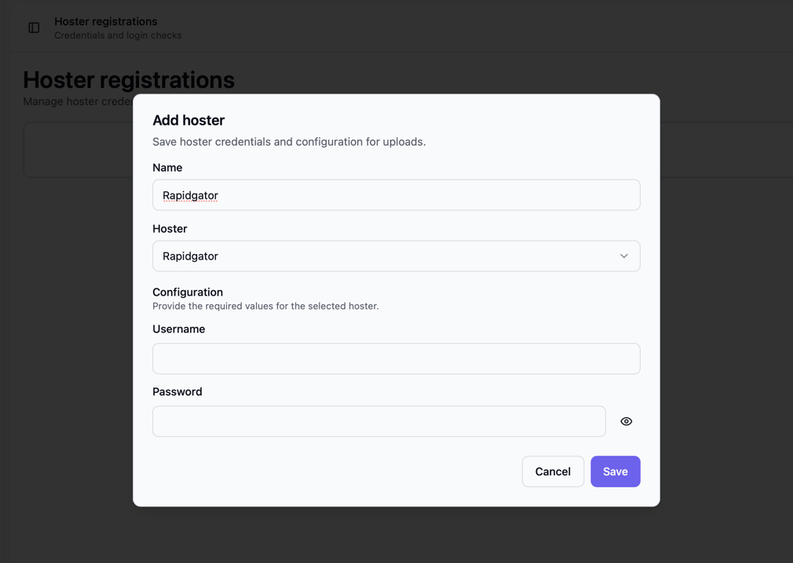
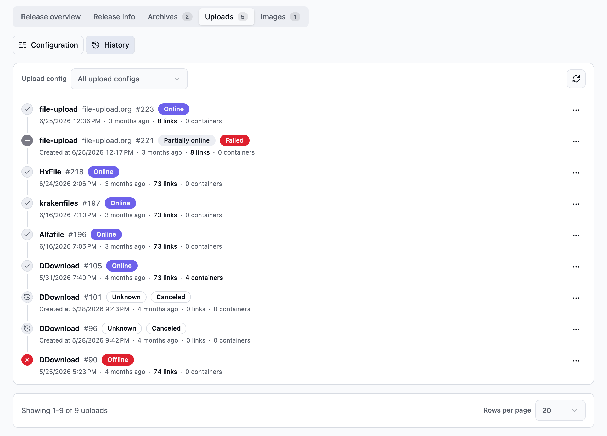
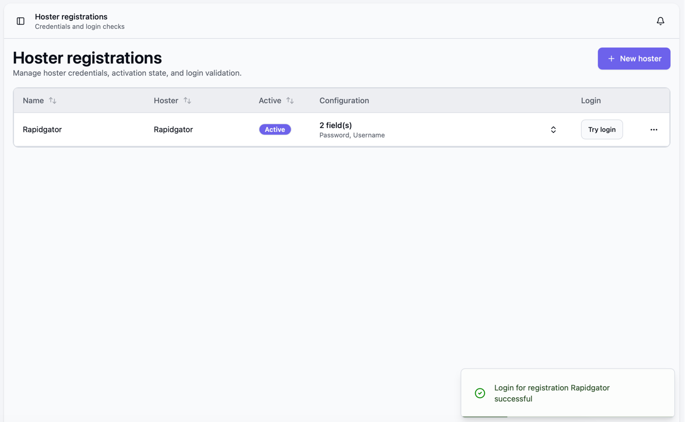

Halte dein Hosterkonto und deine Dateien bereit. Die Dateien, die du gemeinsam hochlädst, bilden ein **Release**.

Öffne Bearcat im Browser:

- **Desktopanwendung oder Windows-Dienst:** [http://127.0.0.1:17208](http://127.0.0.1:17208)
- **Docker:** [http://localhost:8080](http://localhost:8080) oder `http://<server-address>:8080` auf einem anderen Rechner

Falls du den Webport geändert hast, verwende diesen Port.

## Einrichtung öffnen

Bei einer neuen Installation öffnet sich die **Einrichtung** automatisch, wenn du die Startseite zum ersten Mal aufrufst.
Das passiert nur einmal. Später öffnest du **Einrichtung** unter **System** in der Navigation oder findest sie
mit **Ctrl+K** oder **Cmd+K**.

Du kannst jeden Schritt überspringen und alles später ändern.

### Willkommen

Klicke auf **Einrichtung starten**. **Einrichtung überspringen** führt zurück zur Startseite. Wie du Bearcat
ohne Einrichtung konfigurierst, steht unter [Manuell einrichten](#manuell-einrichten).

### Arbeitsverzeichnisse

Bearcat sieht nur Ordner innerhalb seiner Arbeitsverzeichnisse. Der Schritt zeigt jedes davon als **OK**,
**Fehlt** oder **Nicht beschreibbar**. Um fortzufahren, brauchst du mindestens ein vorhandenes, beschreibbares Arbeitsverzeichnis.

- **Docker:** Der Hostordner `RELEASES_DIR` aus deiner Datei `.env` erscheint als `/mnt/data/releases`.
- **Desktopanwendung oder Windows-Dienst:** Lege die Arbeitsverzeichnisse in den Einstellungen der Desktopanwendung
  oder in `appsettings.user.json` fest, starte Bearcat neu und klicke auf **Erneut prüfen**.

In der Einrichtung lassen sich die Arbeitsverzeichnisse nicht ändern.

### Hoster

1. Klicke auf **Hoster hinzufügen**, wähle deinen Hoster und gib Benutzername und Passwort oder API-Schlüssel ein.
   Lass Uploadlimits und Reuploadeinstellungen auf den Standardwerten.
2. Wähle die Registrierungen aus, zu denen Bearcat hochladen soll.
3. Klicke bei jeder ausgewählten Registrierung auf **Login testen**.

**Weiter** ist verfügbar, sobald mindestens eine ausgewählte Registrierung einen erfolgreichen Login hat.

Hostereinrichtung anzeigen

### Releasegruppe und Template

Die Releasegruppe legt fest, ob Bearcat Offlinelinks erneut hochlädt. Das Releasetemplate enthält die
Archiveinstellungen und Zielhoster, die Automatisierungen für jedes neue Release verwenden.

Gibt es bereits Templates, wähle **Vorhandenes Template verwenden** oder **Neues Template erstellen**. Für ein neues Template:

| Feld | Standard |
| --- | --- |
| **Name der Releasegruppe** und **Name des Templates** | `Standard` |
| **Automatische Reuploads** | Aus. Schalte es ein, um Offlineuploads nach **Stunden bis Reupload** zu ersetzen. |
| **Archiver** | RAR |
| **Teilgrösse (MB)** | Das kleinste Dateigrössenlimit der ausgewählten Hoster. `0` bedeutet keine Aufteilung, 7z braucht einen Wert grösser als `0`. |
| **Archivpasswort** | Leer, kein Passwort |
| **Archivausgabeordner** | `bearcat-archives` im ersten beschreibbaren Arbeitsverzeichnis |

Halte den Archivausgabeordner getrennt von deinen Quellordnern. Existiert er noch nicht, klicke auf
**Ordner erstellen**. Klicke dann auf **Erstellen und weiter**.

Bearcat erstellt ein Managed Template mit einer Archivkonfiguration und einer Uploadkonfiguration pro
ausgewähltem Hoster. Ohne ausgewählten Hoster hat das Template keine Uploads. Hoster fügst du später unter
**Releasetemplates** hinzu.

### Quelle

Eine Quelle ist der Ort, an dem neue Releases ankommen. Wähle **Lokaler Ordner** oder **Server (FTP/FTPS)**.

**Lokaler Ordner:**

1. Setze den **Releasebasispfad**. Jeder direkte Unterordner wird zu einem Release.
2. Setze optional ein **Muster für Ordnernamen**, etwa `*1080p*`.
3. Liegen RAR- oder 7z-Archive in den Ordnern, aktiviere **Archive vor der Releaseerstellung entpacken**.
   Siehe [Archive vor der Releaseerstellung entpacken](/Bearcat/de/release-templates-and-automations/#archive-vor-der-releaseerstellung-entpacken).

Die **Ordnervorschau** listet die passenden Ordner und zeigt, wie viele davon bereits ein Release haben. Der
Basispfad darf den Archivausgabeordner des Templates nicht enthalten.

Gibt es passende Ordner ohne Release, wählst du unter **Vorhandene Ordner**, was mit ihnen passiert:

| Option | Ergebnis |
| --- | --- |
| **Einen als Test hochladen** (Standard) | Bearcat erstellt sofort ein Release für den gewählten **Testordner** und startet seine Uploads ohne Cooldown für initiale Uploads. Die übrigen vorhandenen Ordner werden ignoriert. Nicht verfügbar mit Entpacken. |
| **Nur neue Ordner** | Vorhandene Ordner werden ignoriert. Nur später hinzugefügte Ordner werden zu Releases. |
| **Alle importieren** | Jeder vorhandene Ordner wird zu einem Release und hochgeladen. |

Wähle einen kleinen Testordner, um Archive und Uploads schnell zu prüfen. Klicke auf **Quelle anlegen**.

**Server (FTP/FTPS):**

1. Wähle eine Remotequelle aus oder klicke auf **Remotequelle hinzufügen** und gib deine Serverdaten ein.
2. Klicke auf **Verbindung testen**.
3. Klicke auf **Remoteautomatisierung anlegen**. Im Dialog wählst du den überwachten Remoteordner und den
   lokalen Downloadordner.

Vorhandene Ordner auf dem Server werden ignoriert. Die Einstellungen beschreibt [FTP/FTPS-Downloads](/Bearcat/de/remote-downloads/).

Nach dem Anlegen der Quelle zeigt Bearcat, wann neue Ordner übernommen werden. **Release öffnen** öffnet das
Testrelease. **Zur Aktivität** öffnet die Startseite.

## Wie es weitergeht

- **Testrelease:** Das Packen startet kurz nach dem Klick auf **Quelle anlegen**.
- **Neue lokale Ordner:** Bearcat scannt etwa alle zwei Minuten. Es erstellt das Release, sobald sich der Ordner
  während der [Ordnerstabilität](/Bearcat/de/advanced-configuration/#ordnerautomatisierung) nicht verändert hat
  (Standard: 5 Minuten).
- **Neue Ordner auf dem Server:** Bearcat lädt einen Ordner herunter, sobald er sich auf dem Server während der
  [Stabilitätsdauer](/Bearcat/de/advanced-configuration/#remotedownloads) nicht verändert hat (Standard: 5 Minuten),
  und erstellt danach das Release.
- **Uploads** starten nach dem [Cooldown für initiale Uploads](/Bearcat/de/advanced-configuration/#cooldown-für-initiale-uploads)
  (Standard: 5 Minuten). Um die Wartezeit für ein Release zu überspringen, klicke auf seiner Detailseite auf **Uploads jetzt starten**.

Laufende Archiverstellungen und Uploads erscheinen auf der Startseite. Öffne auf der Releasedetailseite
**Uploads** und wechsle zu **Verlauf**, um den Fortschritt zu verfolgen. Ist der Upload fertig, kopiere die
Downloadlinks aus der **Übersicht**.

Schlägt der Upload fehl oder startet er nicht, prüfe die Fehler unter der Benachrichtigungsglocke.
Stelle sicher, dass **Login testen** erfolgreich ist und der Archivausgabeordner beschreibbar ist.
Die Phasen beschreibt [Ablauf eines Uploads](/Bearcat/de/upload-lifecycle/).

### Startseite

Fehlen Hoster, Releasetemplate oder Quelle, zeigt ein Banner auf der Startseite, was fehlt.
**Einrichtung fortsetzen** öffnet die Einrichtung erneut.

Nach der erforderlichen Einrichtung zeigt die Startseite **Optionale nächste Schritte**: Metadaten und NFOs,
ein Bildhoster für Coverbilder, Linkcrypter, Telegrambenachrichtigungen, Forenposts und Proxyserver.
Jeder Eintrag verlinkt auf seine Einstellungsseite und wird als erledigt markiert, sobald er eingerichtet ist.
Mit **Ausblenden** blendest du die Liste aus.

## Manuell einrichten

1. **Hoster:** Öffne **Hosterregistrierungen**, klicke auf **Neuer Hoster**, gib deine Zugangsdaten ein,
   speichere und klicke auf **Login testen**.
2. **Releasegruppe:** Öffne **Releasegruppen**, klicke auf **Neue Releasegruppe** und speichere. Lass
   automatische Reuploads für einen ersten Test deaktiviert.
3. **Release:** Lege deine Dateien in einen Unterordner eines Arbeitsverzeichnisses, zum Beispiel `releases/My.First.Upload/`.
   Öffne **Releases**, klicke auf **Neues Release**, wähle **Managed**, den Ordner und die Gruppe und klicke
   auf **Release erstellen**. In Docker erscheint `RELEASES_DIR` als `/mnt/data/releases`. Für bereits fertige
   Archive verwende ein [Unmanaged Release](/Bearcat/de/release-types/#unmanaged-releases).
4. **Archive:** Klicke im Tab **Archive** des Releases auf **Hinzufügen**. Wähle RAR oder 7z, einen beschreibbaren
   Ausgabeordner in einem Arbeitsverzeichnis getrennt von den Quelldateien, ein Dateipräfix, eine Partgrösse
   innerhalb des Dateigrössenlimits deines Hosters und optional ein Passwort.
5. **Uploads:** Klicke unter **Uploads** > **Konfiguration** auf **Hinzufügen**, wähle dein Hosterkonto und die
   Archivkonfiguration und speichere. Lass **Links verteilt an** vorerst leer.

Der Upload startet nach dem Cooldown für initiale Uploads oder sofort mit **Uploads jetzt starten**.

Logintest anzeigen

Um Releases automatisch aus neuen Ordnern zu erstellen, speichere die Einstellungen als Template und lege eine
[Ordnerautomatisierung](/Bearcat/de/release-templates-and-automations/) an.

## Nach deinem ersten Upload

Für weitere Uploads kannst du:

- [Template speichern und Ordner überwachen](/Bearcat/de/release-templates-and-automations/), um diese Einstellungen wiederzuverwenden.
- [Reuploads aktivieren oder Linkcrypter hinzufügen](/Bearcat/de/account-settings/), um deine Uploadlinks zu verwalten.
- [Von FTP oder FTPS herunterladen](/Bearcat/de/remote-downloads/), um Releases automatisch abzurufen.
- [Metadaten und Coverbilder hinzufügen](/Bearcat/de/release-information-and-metadata/) für deine Releases.
- [Die Releasedetailseite ansehen](/Bearcat/de/release-detail-page/), um weitere Einstellungen zu finden.
