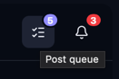
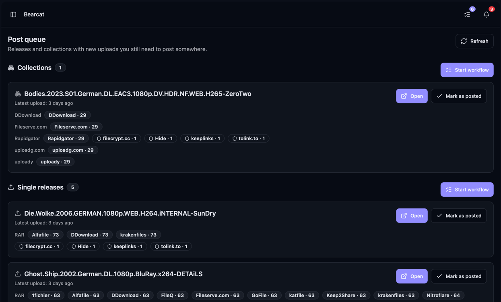
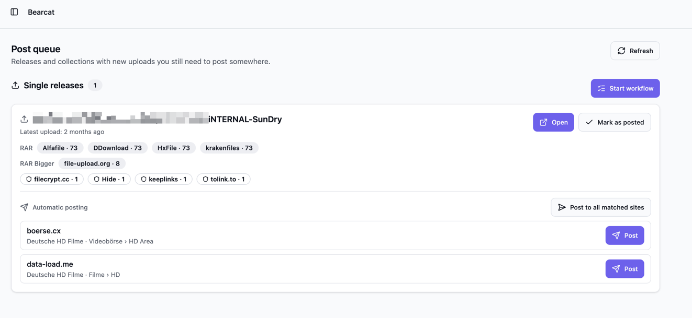
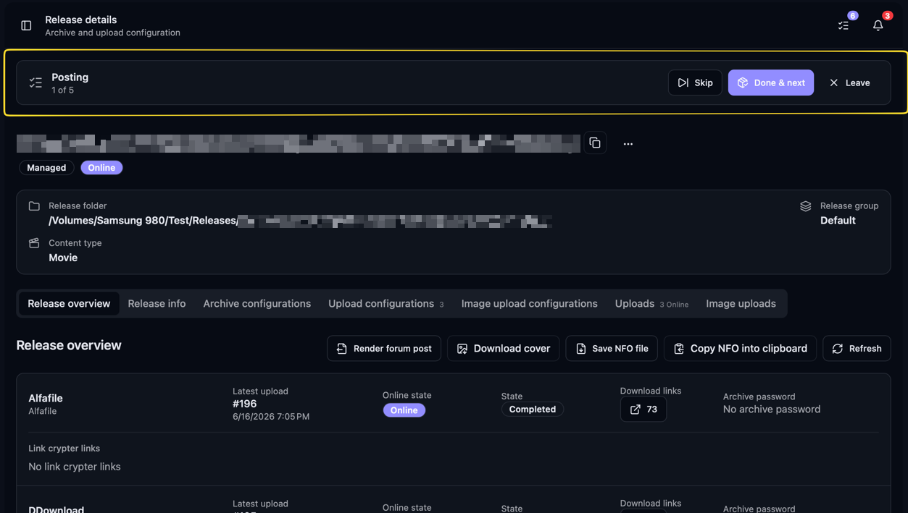
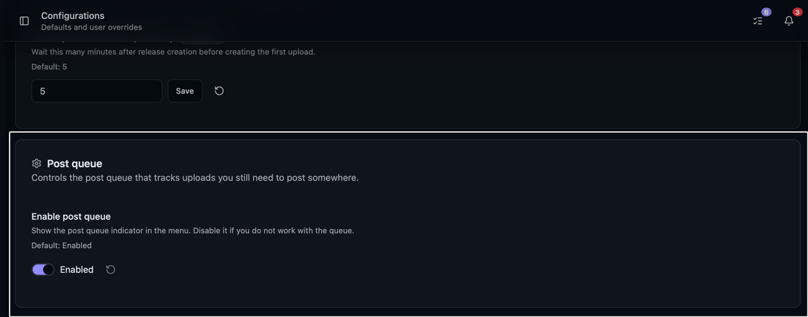

Die Postwarteschlange listet Releases und Collections mit neuen Uploads, die du noch nicht gepostet hast.
Von dort aus kannst du Posts für Foren und Blogs vorbereiten, sie über Postingregeln absenden oder Releases als
gepostet markieren, nachdem du sie selbst geteilt hast.

## Wo du sie findest

Klicke auf das Listensymbol neben der Benachrichtigungsglocke. Das Badge zeigt, wie viele Releases
und Collections noch gepostet werden müssen.

Sind alle Einträge erledigt, verschwindet das Badge.

## Wann etwas in die Warteschlange kommt

Ein Release erscheint in der Warteschlange, sobald es einen fertigen Upload hat, den du nicht als gepostet
markiert hast. Bearcat betrachtet pro Uploadkonfiguration den neuesten fertigen Upload. Ältere Uploads werden nicht einzeln aufgeführt.

Bearcat wartet, bis alle laufenden und ausstehenden Bilduploads fertig sind. Sollen Screenshots hochgeladen werden,
wartet es auch, bis sie erstellt und hochgeladen sind. Fehlgeschlagene Bilduploads blockieren die Warteschlange nicht.

Die Warteschlange hat zwei Bereiche:

- **Einzelreleases**: Releases, die ausserhalb einer Collection hochgeladen wurden.
- **Collections**: Neue Uploads über Uploadslots einer Collection. Eine TV-Staffel erscheint als ein Eintrag.

Wie Collections und ihre Uploadslots funktionieren, steht unter [Releasecollections](/de/release-collections/).

## Aus der Warteschlange auf einer Seite posten

Mit eingerichteten [Postingregeln](/de/automatic-forum-posting/) zeigt der Bereich **Automatisches Posten**
bei Einzelreleases und Collections die passende Regel und das Ziel pro Verteilungsseite.

Mit **Posten** sendest du den Post ab. **Auf allen passenden Seiten posten** postet auf allen übrigen Seiten mit passender Regel.
Das Badge **Auto** zeigt, dass Bearcat auf dieser Seite automatisch postet.

Nach einem Reupload oder wenn du eine neue Folge in eine Collection hochlädst, steht bei bestehenden Posts
**Postinhalt ist veraltet**. Mit **Post aktualisieren** ersetzt du den Post.
Ist automatisches Posten blockiert, zeigt der Abschnitt den Grund statt der Seitenliste.

Sobald alle Posts auf den passenden Seiten erstellt oder aktualisiert sind, markiert Bearcat das Release oder die Collection
als gepostet und entfernt den Eintrag aus der Warteschlange.

## Als gepostet markieren

Sobald du ein Release gepostet hast, klicke in seinem Eintrag auf **Als gepostet markieren**, um es aus der Liste zu entfernen.

## Der geführte Workflow

Klicke unter Einzelreleases oder Collections auf **Workflow starten**, um die Einträge nacheinander abzuarbeiten.
Bearcat öffnet den ersten Eintrag und zeigt deinen Fortschritt in der Workflowleiste.

Verwende im Kopfbereich des Releases oder der Collection [**Auf Seite posten**](/de/posting-to-forums/),
um einen Entwurf vorzubereiten, oder [**Post rendern**](/de/forum-post-templates/#post-rendern)
aus dem Pfeilmenü, um den Text zu kopieren.
Sende den Post auf der Seite ab und kehre dann zur Workflowleiste zurück.

Die Workflowleiste bietet drei Aktionen:

- **Erledigt & weiter** markiert das aktuelle Release als gepostet und bringt dich zum nächsten.
- **Überspringen** geht weiter, ohne das aktuelle Release zu markieren. Es bleibt also in der Warteschlange.
- **Verlassen** beendet den Durchlauf und bringt dich zurück zur Seite der Postwarteschlange.

Nach dem letzten Eintrag kehrst du zur Postwarteschlange zurück. Sind alle Einträge erledigt,
erscheint **Nichts offen zum Posten**.

Mit **Öffnen** bei einem Eintrag startest du den Workflow direkt an dieser Stelle.

## Die Postwarteschlange deaktivieren

Öffne **System > Konfigurationen > Postwarteschlange** und deaktiviere die Postwarteschlange, um ihr Symbol in der Kopfzeile auszublenden und
offene Einträge nicht mehr zu zählen. Die Seite der Warteschlange zeigt dann einen Hinweis statt der Listen.
Du kannst sie wieder aktivieren, ohne Bearcat neu zu starten.

