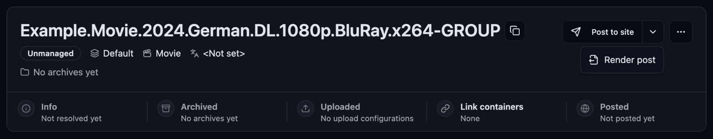
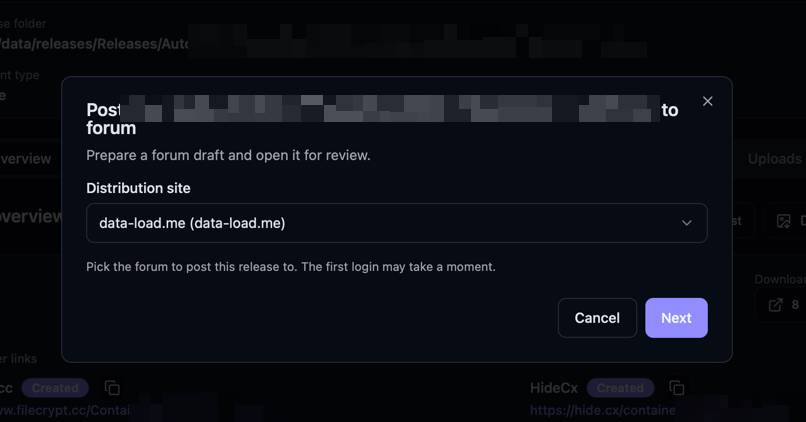
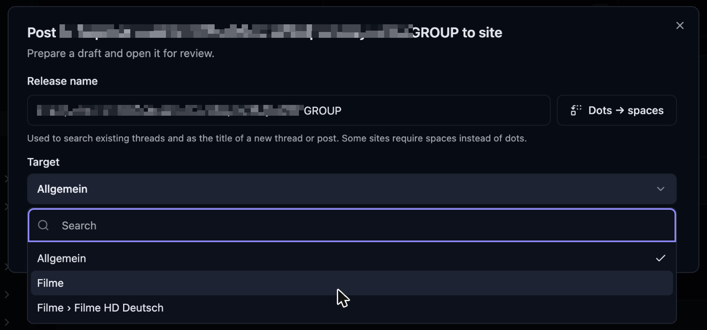
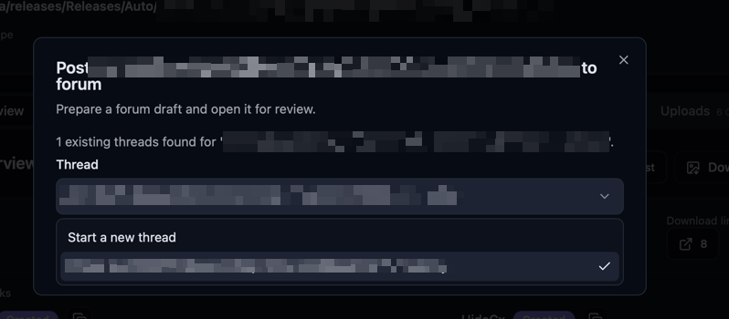
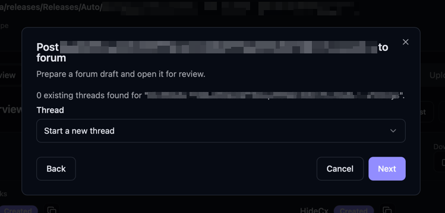
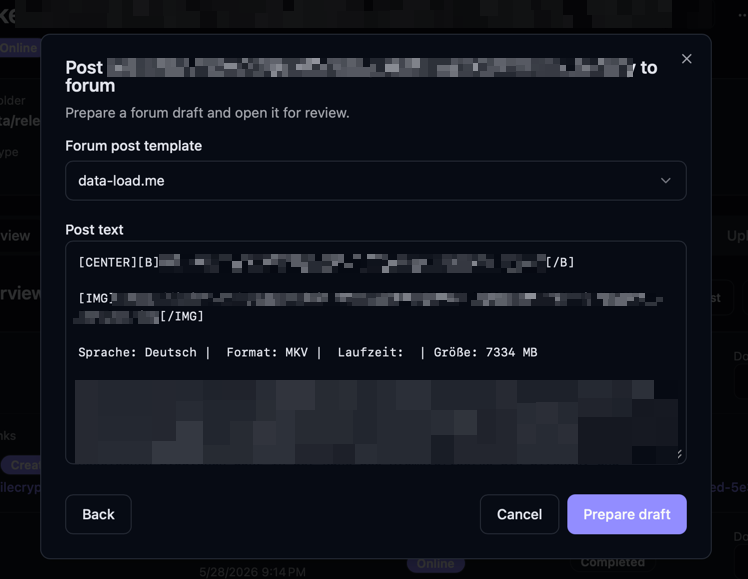
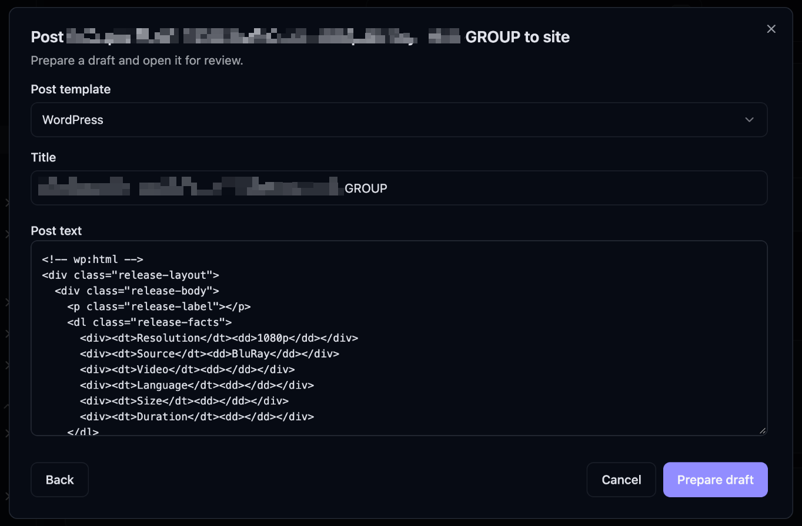
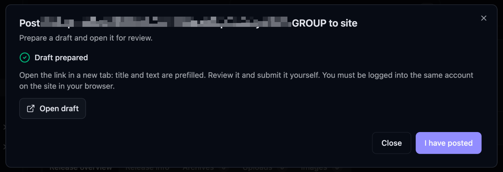
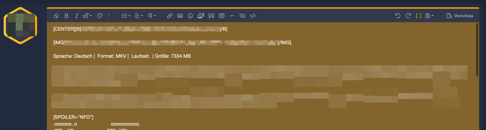
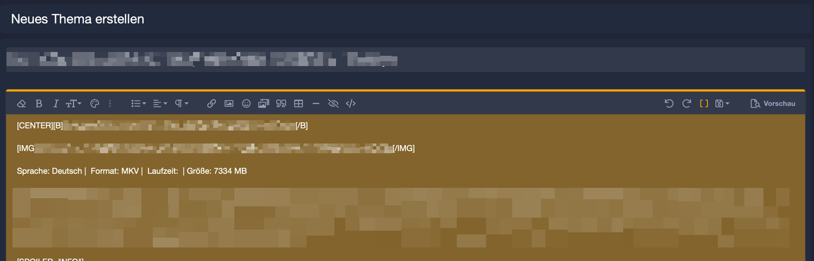

Bearcat erstellt aus den Releasedaten und deiner Vorlage einen Entwurf für einen Post. Öffne ihn im Browser,
prüfe Titel und Text und sende den Post ab. Du musst dabei mit demselben Konto auf der Seite angemeldet sein.

Damit Bearcat Posts für dich absendet, verwende [Postingregeln](/de/automatic-forum-posting/).

## Voraussetzungen

- Ein in Bearcat hinzugefügtes Konto für ein Forum oder [WordPress](/de/wordpress/).
- Eine [Postvorlage](/de/forum-post-templates/) im Ausgabeformat der Seite: BBCode für Foren, HTML für WordPress.
- Ein Release mit abgeschlossenen Uploads und Downloadlinks.

## Eine Verteilungsseite einrichten

Öffne **Registrierungen > Verteilungsseitenregistrierungen** in der Seitenleiste und füge eine hinzu. Wähle die Seite, gib Benutzername und
Passwort ein und speichere. Dein Passwort wird verschlüsselt gespeichert. Aktiviere die Seite und prüfe mit **Login testen**,
ob die Anmeldung funktioniert.

Wähle für boerse.cx und data-load.me den jeweiligen Foreneintrag.

Für andere XenForo-Foren wählst du **XenForo**. Gib Benutzername, Passwort und unter **Adresse** die Startseite des Forums
ein, einschliesslich eines Installationsordners, zum Beispiel `https://example.org/community/`. Verwende die
Adresse, die dein Browser nach Weiterleitungen anzeigt. Füge jedes Forum einzeln hinzu.

Der XenForo-Eintrag braucht Friendly URLs und die Standardformulare von XenForo für Login, Post und Entwurf.
Routing über `index.php`, SSO, CAPTCHA und Zwei-Faktor-Login werden nicht unterstützt. Eigene Themes,
Pflichtfelder für Threads oder Add-ons können das Posten verhindern. Teste den Login und bereite einen Entwurf vor,
bevor du automatisches Posten aktivierst.

Wie du WordPress einrichtest, steht unter [WordPress](/de/wordpress/).

## Ein Release posten

Öffne ein Release und klicke im Kopfbereich auf **Auf Seite posten**. **Post rendern** findest du im Pfeilmenü
derselben Schaltfläche.

Im Dialog:

1. Wähle die Verteilungsseite, auf der du posten willst.
   
2. Wähle als Ziel ein Unterforum oder eine Blogkategorie. Du kannst auch den Releasenamen
   bearbeiten, mit dem Bearcat nach bestehenden Threads sucht und neue Threads und Posts benennt. **Punkte → Leerzeichen** ersetzt Punkte durch Leerzeichen
   und setzt Leerzeichen um den letzten Bindestrich vor der Releasegruppe.
   
3. Nur bei Foren: Bearcat sucht im Unterforum nach Threads, deren Titel zum Releasenamen passt. Dafür gelten dieselben
   [Suchregeln wie beim automatischen Posten](/de/automatic-forum-posting/#bestehendes-thema-finden).
   Bei genau einem passenden Thread schlägt Bearcat eine Antwort vor, sonst einen neuen Thread.
   Du kannst auch selbst einen Thread aus den Suchergebnissen wählen. Bei Blogs überspringt der Dialog diesen Schritt.

   <figure>

   

   <figcaption>Bestehender Thread gefunden</figcaption>
   </figure>

   <figure>

   

   <figcaption>Kein bestehender Thread gefunden</figcaption>
   </figure>

4. Wähle eine Postvorlage. Die Liste zeigt nur Vorlagen im Ausgabeformat der Seite. Bearcat füllt sie mit den
   Releasedaten aus. Den fertigen Text kannst du noch bearbeiten. Für einen neuen Thread oder Blogpost legst du auch den Titel fest.
   In Foren kannst du zusätzlich ein Präfix wie 1080p oder x265 setzen.

   <figure>

   

   <figcaption>Antwort auf einen bestehenden Thread vorbereiten</figcaption>
   </figure>

   <figure>

   

   <figcaption>Neuen Thread vorbereiten</figcaption>
   </figure>

5. Klicke auf **Entwurf vorbereiten**. Bearcat speichert den Entwurf auf der Seite und zeigt den Link **Entwurf öffnen**.

   

## Den Post absenden

1. Melde dich im Browser mit demselben Konto auf der Seite an und klicke auf **Entwurf öffnen**. Sonst
   zeigt der Editor den Entwurf nicht an.
2. Prüfe Titel und Text und nutze bei Bedarf die Vorschau. Sende den Post ab oder veröffentliche ihn im Blog.
3. Klicke zurück in Bearcat auf **Ich habe gepostet**, um die URL des Posts unter **Veröffentlichungsorte** zu speichern.
   Findet Bearcat einen Forenpost noch nicht, füge seine URL ein. Es kann einige Sekunden dauern, bis die Forensuche ihn findet.
   Bei WordPress speichert Bearcat die URL ohne Suche.

<figure>

<figcaption>Antwortentwurf in einem bestehenden Thread</figcaption>
</figure>

<figure>

<figcaption>Entwurf eines neuen Threads</figcaption>
</figure>

**Ich habe gepostet** speichert die URL, entfernt das Release aber nicht aus der
[Postwarteschlange](/de/post-queue/). Verwende dort **Als gepostet markieren**, wenn du mit dem Posten fertig bist.

## Veröffentlichungsorte

**Veröffentlichungsorte** listet die URLs, unter denen ein Release oder eine Collection veröffentlicht wurde,
etwa Forenthreads oder Posts in WordPress. Wenn du einen Post bestätigst, speichert Bearcat seine URL hier.
Du findest die Liste im Tab **Übersicht** des Releases oder der Collection.
Dort kannst du Links auch von Hand hinzufügen oder entfernen.
