Öffne **Releases** und klicke auf einen Releasenamen. Eine Anleitung findest du unter [Dein erster Upload](/de/post-installation/).

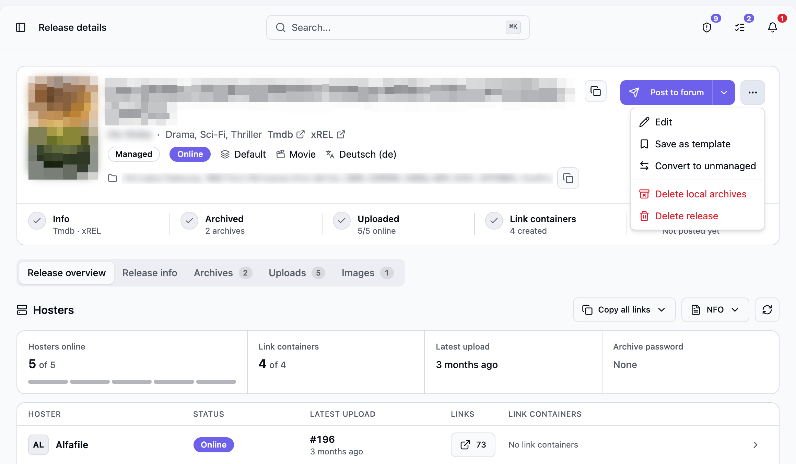

## Kopfzeile

**Auf Seite posten** öffnet den [Dialog zum Posten](/de/posting-to-forums/). Die Schaltfläche ist hervorgehoben,
wenn das Release mindestens einen Hoster online hat und noch nicht gepostet wurde. Ohne aktive
Verteilungsseite siehst du stattdessen **Post rendern**.

Mit **Uploads jetzt starten** überspringst du den [Cooldown für initiale Uploads](/de/upload-lifecycle/#2-der-erste-upload)
für dieses Release. Die Schaltfläche erscheint, wenn für mindestens eine Uploadkonfiguration noch kein Upload erstellt wurde.

Über das `...`-Menü wandelst du zwischen den [Releasetypen](/de/release-types/#zwischen-typen-umwandeln) um.

Die Statusanzeige unter der Kopfzeile zeigt den Fortschritt. Rot weist auf ein Problem oder einen offenen Schritt hin.
Klicke auf einen Schritt, um den passenden Tab zu öffnen.

## Übersicht

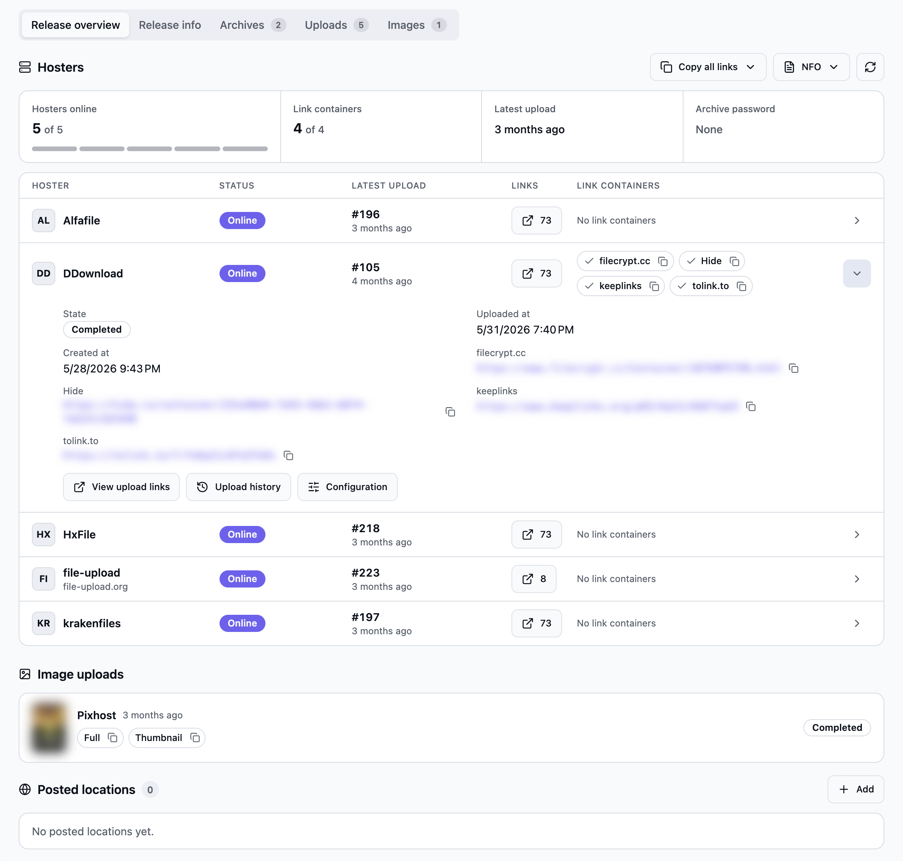

**Alle Links kopieren** kopiert die Containerlinks eines Linkcrypters für alle Hoster.
Unten findest du die [Veröffentlichungsorte](/de/posting-to-forums/#veröffentlichungsorte).

Unter **Bilduploads** siehst du pro Bilduploadkonfiguration das Cover und eine Vorschau der Screenshots.
Mit den Kopierbuttons kopierst du die Bildlinks.

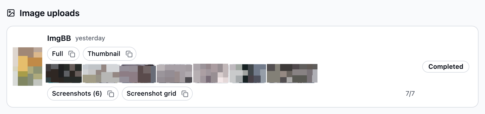

## Releaseinfo

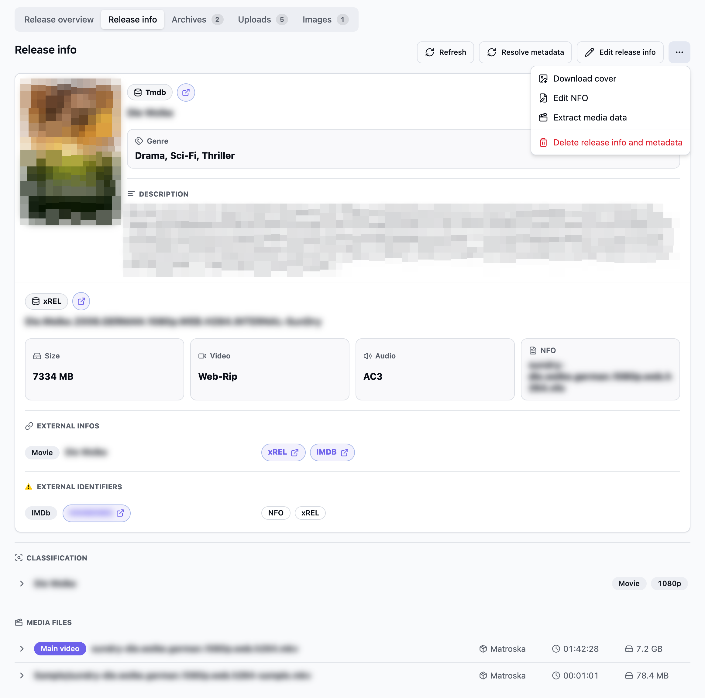

Hier siehst und bearbeitest du Titel, Beschreibung, Cover, NFO und Mediendaten.
Mit **Metadaten abrufen** suchst du erneut bei den eingerichteten Anbietern.
Wie du Quellen einrichtest oder falsche Treffer korrigierst, steht unter
[Releaseinformationen und Metadaten](/de/release-information-and-metadata/).

## Archive

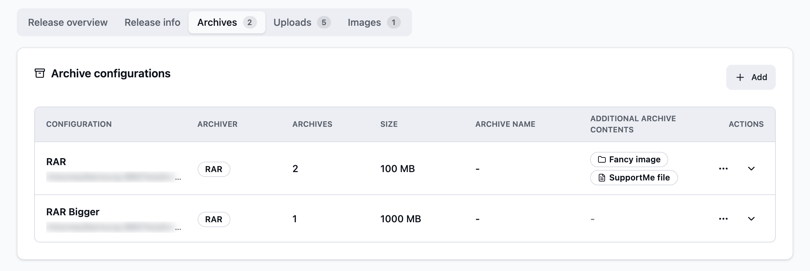

Um ein Managed Release als Archiv hochzuladen, füge hier eine Archivkonfiguration hinzu. Die Packoptionen sind unter
[Archiv erstellen](/de/upload-lifecycle/#3-archiv-erstellen) beschrieben.

Archive in einem [Speicherordner](/de/archive-storage-folders/) zeigen den Namen des Speicherordners
neben ihrem Status. Solange ein Reupload eine [lokale Arbeitskopie](/de/archive-storage-folders/#reuploads)
verwendet, folgt dem Namen **lokale Arbeitskopie**.

## Uploads

**Konfiguration** verbindet eine Archivkonfiguration mit einem Hosterkonto und optionalen Linkcryptern.

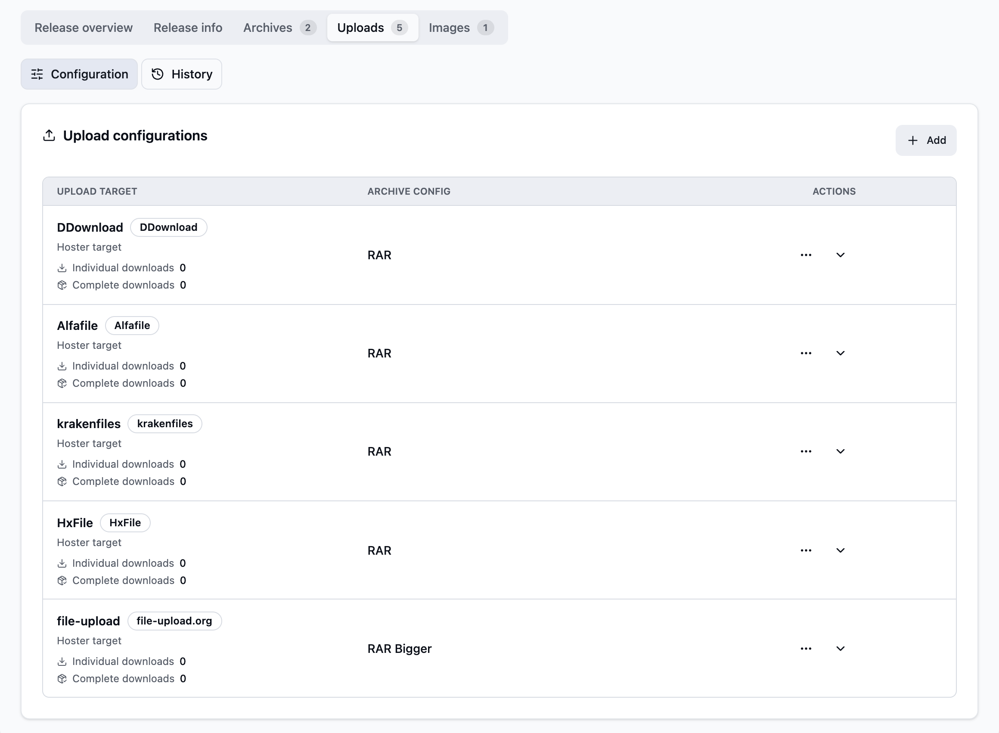

**Verlauf** listet alle Uploaddurchläufe. Über die Aktionen eines Durchlaufs startest du zum Beispiel einen manuellen Reupload.

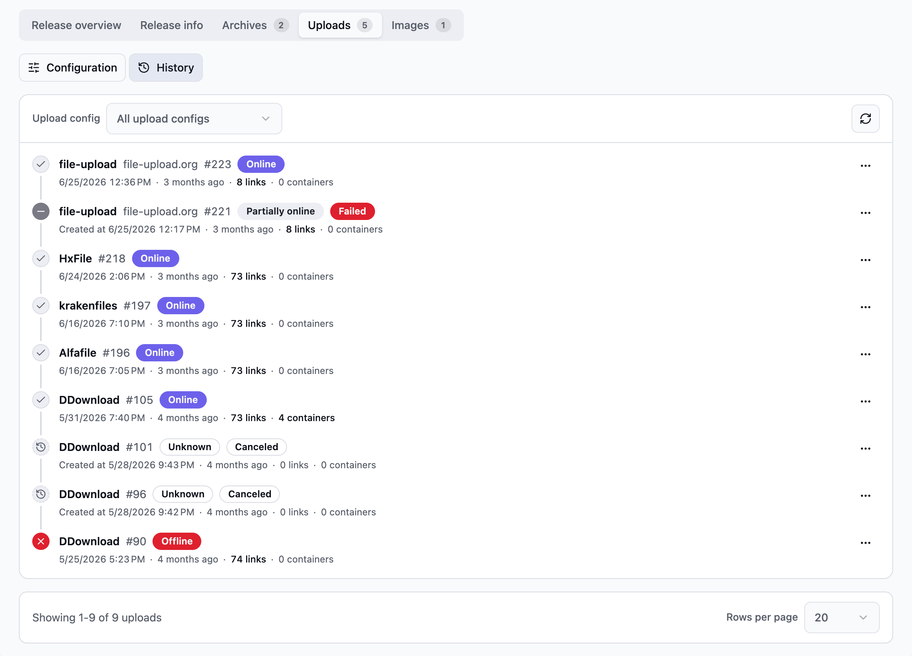
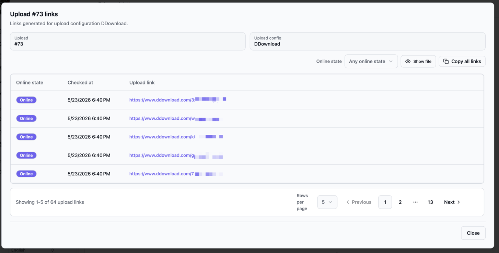
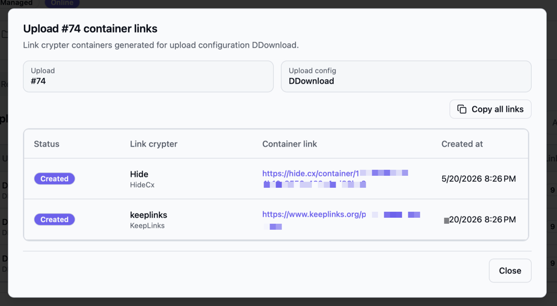

## Bilder

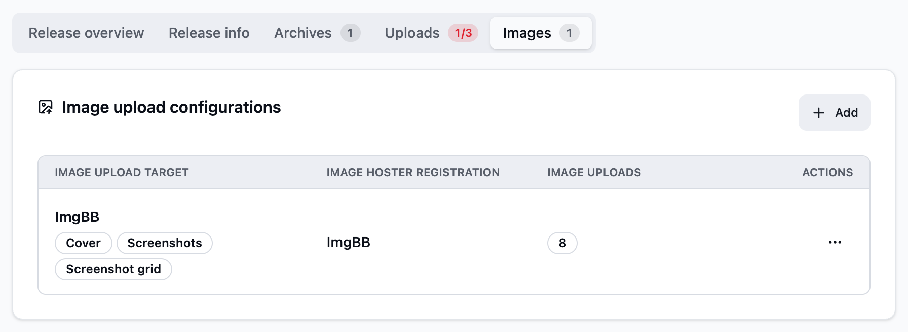

Für Coveruploads braucht das Release eine Cover-URL, etwa von TMDB oder xREL.
Eine [Bilduploadkonfiguration](/de/account-settings/#bilduploadkonfiguration) kann auch Screenshots
und das Screenshotraster hochladen. In der Liste **Bilduploads** siehst du den Bildtyp jedes Uploads:
Cover, Screenshot oder Screenshotraster.

Die Karte **Screenshots** zeigt die erstellten [Screenshots](/de/release-templates-and-automations/#screenshots).
Klicke auf ein Bild, um es in voller Grösse zu öffnen.

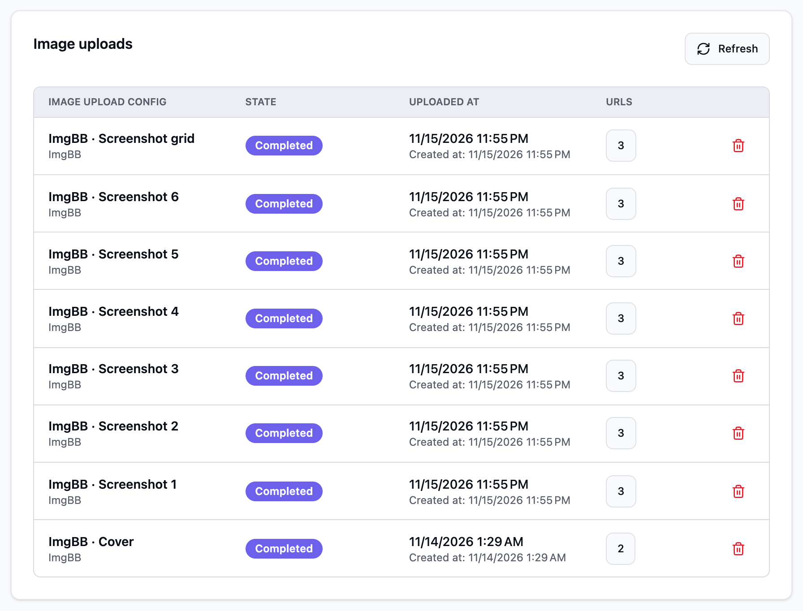
