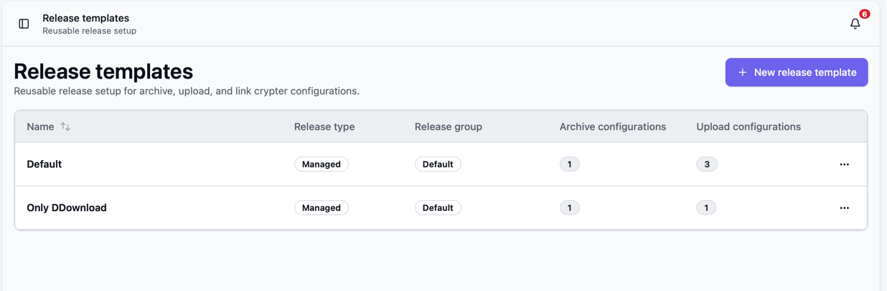
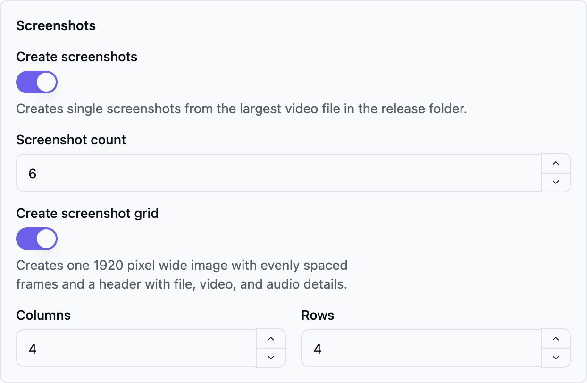
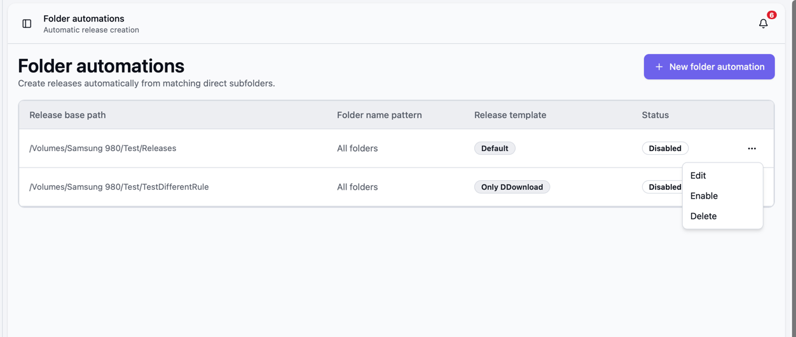

Speichere die Einstellungen deines [ersten Uploads](/de/post-installation/) als Template.
Damit erstellst du weitere Releases von Hand oder automatisch aus neuen Ordnern.

## Releasetemplates einrichten

Ein Releasetemplate ist eine Vorlage für neue Releases. Es enthält die Releasegruppe und die
Einstellungen für Archive, Uploads, Bilder und Linkcrypter. Du kannst es auf drei Arten anlegen:

- Öffne **Releaseeinstellungen > Releasetemplates**, klicke auf **Neues Releasetemplate** und füge die Konfigurationen hinzu.
- Öffne ein konfiguriertes Release und wähle im Aktionsmenü **Als Template speichern**.
- Wähle im Aktionsmenü eines Templates **Duplizieren**, um eine Variante davon zu erstellen.

Mit **Container erstellen für** wählst du in der Linkcrypterkonfiguration, ob jeder Hoster einen eigenen
Container bekommt oder alle Hoster eines Releases als Mirrors in einem Container erscheinen.
Siehe [Linkcryptercontainer](/de/upload-lifecycle/#5-linkcryptercontainer).



Wähle auf **Releases** den Eintrag **Neu aus Template**. Das neue Release übernimmt normalerweise
den Ordnernamen, ebenso die Archivkonfigurationen, die den Releasenamen verwenden.

Aktiviere **Ein Release pro Unterordner**, um für jeden direkten Unterordner des gewählten Ordners
ein Release zu erstellen. Wähle die Unterordner ab, die du nicht willst. Bereits verwendete
Unterordner lassen sich nicht auswählen.

Aktiviere **Collectionerkennung** im Template, um zusammengehörige Releases zu gruppieren, etwa die Folgen
einer TV-Staffel. Siehe [Releasecollections](/de/release-collections/).

### Screenshots

Unter **Screenshots** im Template und in den Releaseeinstellungen findest du zwei Optionen:



| Option | Standard | Ergebnis |
| --- | --- | --- |
| **Screenshots erstellen** | Aus, 6 Screenshots | 1 bis 20 einzelne Screenshots in gleichmässigen Abständen. |
| **Screenshotraster erstellen** | Aus, 4 Spalten × 4 Zeilen | Ein 1920 Pixel breites Bild mit bis zu 8 Spalten und 10 Zeilen. Die Kopfzeile enthält Angaben zu Datei, Video und Audio. |

- Screenshots lassen sich nur für Releases vom Typ Managed erstellen, deren Releaseordner noch existiert.
- Bearcat verwendet die grösste Videodatei im Releaseordner.
- Videos mit HDR10 oder HLG werden auf SDR umgerechnet. Dolby Vision ohne Basisschicht in HDR10 oder HLG wird nicht unterstützt.
- Die Hintergrundaufgabe **Screenshot creation** erstellt die Bilder. ffmpeg wird [bei Bedarf heruntergeladen](/de/advanced-configuration/#ffmpeg).
- Bearcat erstellt nur Bilder, für die ein Upload eingerichtet ist. Aktiviere dafür **Screenshots** oder
  **Screenshotraster** in einer [Bilduploadkonfiguration](/de/account-settings/#bilduploadkonfiguration) mit aktivem Bildhoster.

Im Tab **Bilder** siehst du das Ergebnis oder eine Fehlermeldung. Mit **Neu erstellen** ersetzt du die
Screenshots und ihre Bilduploads, etwa nachdem du die Einstellungen geändert hast. Dafür muss der
Releaseordner noch existieren und das Release vom Typ Managed sein.

Du kannst die hochgeladenen Bilder in [Postvorlagen verwenden](/de/forum-post-templates/#screenshots).
Bearcat löscht die lokalen Screenshotdateien, sobald alle dafür eingerichteten Bilduploadkonfigurationen
sie hochgeladen haben. Ist kein Upload mehr dafür eingerichtet, löscht es sie sofort.
Der Tab **Bilder** zeigt danach die Bilder vom Bildhoster.

## Ordnerautomatisierungen einrichten

1. Erstelle ein Releasetemplate, öffne dann **Automatisierung > Ordnerautomatisierungen** und klicke auf **Neue Ordnerautomatisierung**.
2. Setze **Releasebasispfad** auf den Ordner, den Bearcat durchsuchen soll. Nur direkte Unterordner werden geprüft.
3. Setze optional ein **Muster für Ordnernamen**, etwa `*1080p*` oder `*.GERMAN.*`. Der Abgleich ignoriert
   Gross- und Kleinschreibung und unterstützt Wildcards, aber keine regulären Ausdrücke. Lass das Feld leer,
   um alle direkten Unterordner einzubeziehen.
4. Lass **Vorhandene Ordner ignorieren** eingeschaltet, um nur neue Ordner zu verarbeiten.
   Zum Importieren vorhandener Ordner schaltest du die Option aus. Siehe [Vorhandene Ordner](#vorhandene-ordner).
5. Wähle das Template und optional eine Primärsprache für übersetzte Metadaten. Ohne Sprache wird die
   Standardsprache des Metadatenanbieters verwendet.
6. Lass **Aktiviert** eingeschaltet und speichere. Über das Aktionsmenü kannst du die Automatisierung deaktivieren
   oder wieder aktivieren.



Beispiel für einen Basisordner:

```text
/data/releases/incoming/
  Movie.One.2026.1080p/
  Movie.Two.2026.2160p/
  Some.Other.Folder/
```

Das Muster `*1080p*` wählt nur `Movie.One.2026.1080p` aus. Ein leeres Muster schliesst alle drei Ordner ein.

Bearcat scannt etwa alle zwei Minuten und überspringt Ordner, die schon ein Release haben. Sobald
ein Ordner die [Vorgaben für Stabilität und Mindestgrösse](/de/advanced-configuration/#ordnerautomatisierung)
erfüllt, erstellt Bearcat das Release und ruft die Metadaten ab. Danach packt es die Dateien und
lädt sie mit den Einstellungen des Templates hoch.

### Vorhandene Ordner

**Vorhandene Ordner ignorieren** ist standardmässig eingeschaltet. Beim ersten Scan merkt sich Bearcat alle
passenden Ordner und ignoriert sie dauerhaft für diese Automatisierung. Nur neue Ordner werden zu Releases.
Schalte die Option aus, um auch vorhandene Ordner ohne Release zu importieren.

Änderst du **Releasebasispfad** oder **Muster für Ordnernamen**, gilt die Einstellung erneut für die Ordner,
die Bearcat mit den neuen Einstellungen findet.

Die **Ordnervorschau** zeigt, welche Ordner zum Basispfad und Muster passen. Ordner mit einem Release und
Archivausgabeordner sind als **Bereits verwendet** markiert.

Beim Anlegen oder Ändern von Basispfad oder Muster zeigt die Vorschau auch, was mit den übrigen Ordnern
passiert: Bearcat ignoriert sie oder zeigt eine Warnung mit der Anzahl der Ordner, die importiert und
hochgeladen werden. Mit der Schaltfläche zum Aktualisieren lädst du die Vorschau neu.

### Archive vor der Releaseerstellung entpacken

Aktiviere bei Managed Templates in der Ordnerautomatisierung **Archive vor der Releaseerstellung entpacken**,
wenn die Ordner RAR- oder 7z-Archive enthalten und Bearcat das Release selbst packen soll. Die Option ist
standardmässig deaktiviert und gilt nicht für Unmanaged Templates.

Bevor das Release erstellt wird, prüft Bearcat den Ordner anhand seiner `.sfv`-Dateien, falls vorhanden,
und entpackt alle RAR- und 7z-Archive im Ordner und in seinen Unterordnern. Nach erfolgreichem Entpacken
löscht es die Archivparts und die `.sfv`-Dateien, die nur diese Parts auflisten. Es gelten dieselben
Regeln wie bei [Remotedownloads](/de/remote-downloads/#archive-vor-der-releaseerstellung-entpacken).

Laufende Prüfungen und Entpackvorgänge erscheinen auf der Seite **Home** unter **Ordnerautomatisierungen**.

Schlägt die Prüfung oder das Entpacken fehl, behält Bearcat die Dateien und erstellt kein Release.
Du findest den Fehler unter **Fehlgeschlagene Entpackvorgänge** auf **Ordnerautomatisierungen**.
Behebe die Ursache und klicke auf **Erneut versuchen**, damit Bearcat den Ordner beim nächsten Scan
verarbeitet. Bearcat versucht es auch erneut, wenn sich die Dateien im Ordner ändern.

### Releases von FTP oder FTPS herunterladen

Mit **Remotequellen** und **Remoteautomatisierungen** lädst du neue Ordner von einem Server herunter und
erstellst daraus Releases mit einem Template. Einrichtung und Beispiele findest du unter
[FTP/FTPS-Downloads](/de/remote-downloads/).
