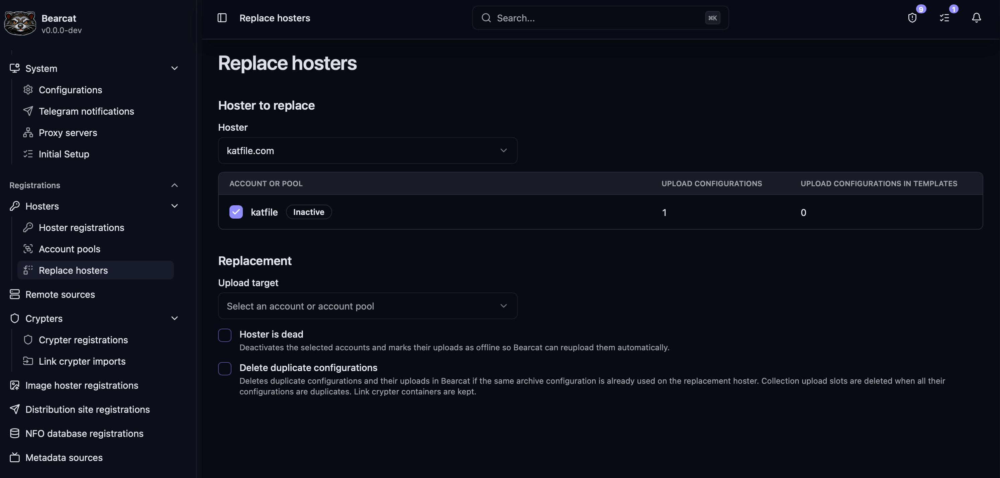
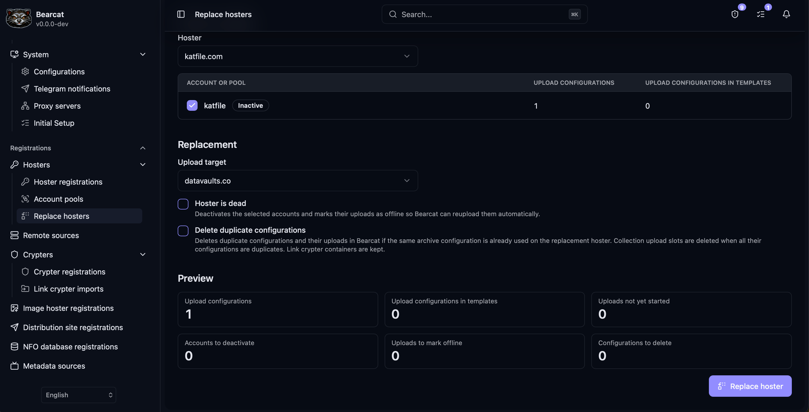
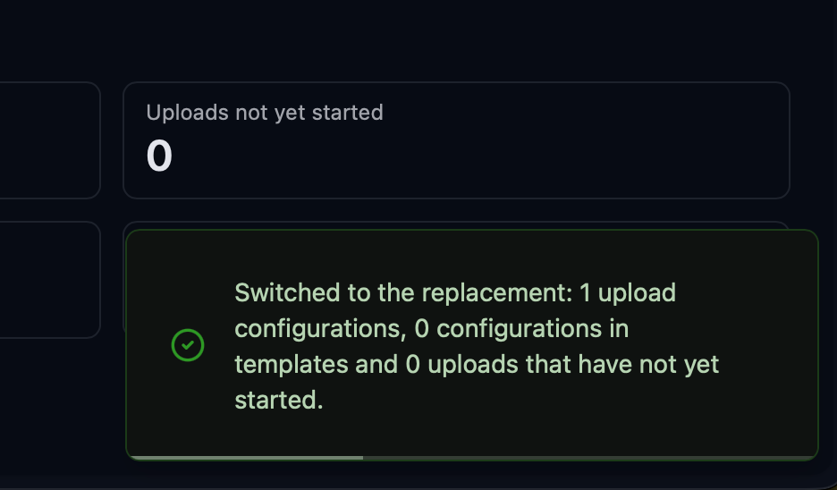
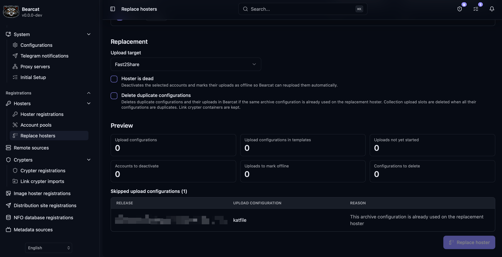

Öffne **Registrierungen > Hoster** > **Hoster ersetzen**. Wähle den Hoster, die zu ersetzenden Accounts und Pools sowie einen
Ersatzaccount oder Ersatzpool derselben Art (Video oder Archiv).

Die Vorschau aktualisiert sich bei jeder Änderung. Klicke auf **Hoster ersetzen**, um die Auswahl zu
übernehmen. Das lässt sich nicht automatisch rückgängig machen.

Nach dem Ersetzen zeigt eine Meldung, wie viele Konfigurationen und Uploads umgestellt wurden.

## Was ersetzt wird

- Uploadkonfigurationen in Releases und Releasetemplates werden auf den gewählten Account oder Pool umgestellt.
- Eine Konfiguration, die wie der alte Account oder Pool heisst, übernimmt den Namen des Ersatzes. Eigene
  Namen bleiben unverändert.
- **Premium only** wird ausgeschaltet, wenn der Ersatzhoster das nicht unterstützt.
- Uploads, die noch nicht gestartet sind und noch keine Dateien haben, wechseln zum Ersatz.

Die Pools selbst bleiben unverändert. Unbenutzte Pools kannst du unter
[Accountpools](/de/account-pools/) löschen.

Bestehende Uploads bleiben beim alten Hoster. Erst der nächste Reupload verwendet den gewählten Account
oder Pool.

## Übersprungene Konfigurationen

| Fall | Ergebnis |
|---|---|
| Das Release oder Template hat dieselbe Archivkonfiguration bereits beim Ersatzhoster | Die Konfiguration bleibt beim alten Hoster |
| Mehrere ausgewählte Accounts verwenden dieselbe Archivkonfiguration eines Releases oder Templates | Nur die erste Uploadkonfiguration wird umgestellt |
| Eine Konfiguration eines Uploadslots wird übersprungen | Der gesamte Uploadslot bleibt unverändert |

Die Vorschau listet übersprungene Konfigurationen mit einem Link zum Release oder Template auf.

## Doppelte Konfigurationen löschen

Aktiviere **Doppelte Konfigurationen löschen**, um Duplikate zu entfernen, statt sie zu überspringen. Als
doppelt gilt eine Konfiguration, wenn dasselbe Release oder Template für diese Archivkonfiguration bereits
eine Uploadkonfiguration beim Ersatzhoster hat. Verwenden mehrere ausgewählte Accounts dieselbe
Archivkonfiguration, stellt Bearcat die erste um und löscht die übrigen.

- Ihre Uploads und Links werden gelöscht.
- Container bei Linkcryptern bleiben bestehen. Lösche sie bei Bedarf direkt beim Linkcrypter.
- Ein Uploadslot wird nur als Ganzes gelöscht, wenn alle seine Konfigurationen doppelt sind und keine einen
  laufenden Upload hat. Andernfalls bleibt der gesamte Slot unverändert.
- Konfigurationen mit einem laufenden Upload werden nicht gelöscht.
- Doppelte Konfigurationen in Templates werden immer gelöscht.

Die Vorschau zeigt, welche Konfigurationen und Uploadslots gelöscht werden. Was nicht gelöscht werden kann,
bleibt in der Liste der übersprungenen Konfigurationen. Das Löschen lässt sich nicht rückgängig machen.

## Hoster ist tot

Ein toter Hoster meldet Dateien meist nicht mehr als offline, und inaktive Accounts prüft Bearcat ebenfalls
nicht. Ohne diese Option gelten bestehende Uploads in Bearcat weiterhin als online und es startet kein
Reupload.

Mit **Hoster ist tot** führt Bearcat zwei zusätzliche Schritte aus:

- Es deaktiviert die ausgewählten Accounts und alle Accounts der ausgewählten Pools. Das gilt auch für
  Accounts, die du nicht einzeln ausgewählt hast oder die zusätzlich in anderen Pools liegen.
- Es markiert abgeschlossene Uploads dieser Accounts und deren Dateien als offline, einschliesslich der
  Uploads von übersprungenen Konfigurationen.

Die Option steht nicht zur Verfügung, wenn der Ersatz beim selben Hoster liegt.

[Automatische Reuploads](/de/upload-lifecycle/#7-automatische-reuploads) starten nach der üblichen
Wartezeit beim neuen Account oder Pool, sofern **Automatische Reuploads** in der Releasegruppe aktiv
sind. Übersprungene Konfigurationen nutzen weiterhin den deaktivierten Account und starten erst wieder
einen Reupload, wenn du sie anpasst.

## Was sich nicht ändert

- Laufende Uploads und Uploads, die schon Dateien haben, bleiben beim alten Hoster. Brich sie ab, falls sie
  nicht fertig werden.
- Links in bestehenden Posts ändern sich nicht.
- Fest eingetragene Hosternamen in Postvorlagen musst du von Hand ändern. `upload.hoster_name` zeigt
  den Hosternamen des letzten Uploads.
