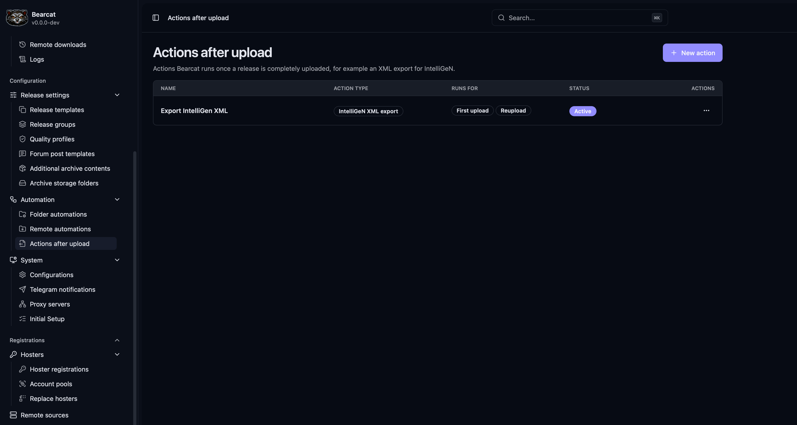
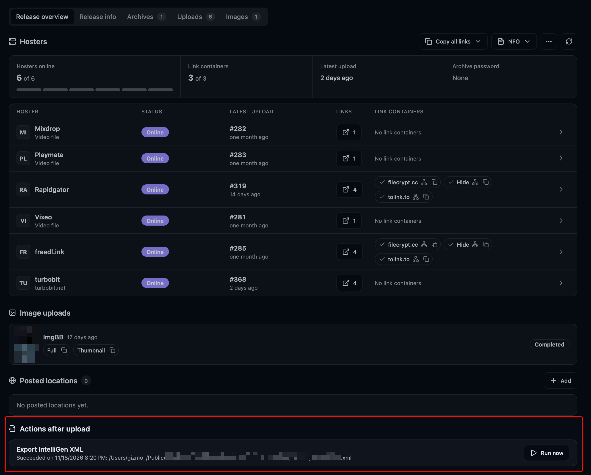

Bearcat kann nach dem Upload eines Releases oder einer Releasecollection automatisch eine Aktion ausführen.
Eine solche Aktion ist der [XML-Export für IntelliGeN](/Bearcat/de/intelligen-xml-export/).

## Aktion einrichten

1. Öffne **Automatisierung > Aktionen nach dem Upload** und klicke auf **Neue Aktion**.
2. Wähle den **Aktionstyp** und gib der Aktion einen Namen.
3. Wähle, wann die Aktion laufen soll. Du kannst **Nach dem ersten Upload**, **Nach einem Reupload** oder beides aktivieren.
4. Fülle die Felder für den gewählten Aktionstyp aus und klicke auf **Speichern**.

Neue Aktionen sind sofort aktiv. Über **Deaktivieren** im Aktionsmenü kannst du sie pausieren.

## Wann eine Aktion läuft

Bearcat prüft standardmässig alle fünf Minuten, ob alle Uploads, Linkcontainer und Bilder eines Releases fertig sind.
Eine neue Aktion berücksichtigt nur Uploads, die nach dem Einrichten fertig werden.
Nach einem erfolgreichen Lauf startet die Aktion erst wieder, wenn ein weiterer passender Upload abgeschlossen ist.

Schlägt die Aktion fehl, benachrichtigt dich Bearcat beim ersten Fehler und versucht es bei der nächsten Prüfung erneut.

## Aktionen für Releasecollections

Nutzt eine [Releasecollection](/Bearcat/de/release-collections/) [Uploadslots](/Bearcat/de/release-collections/#uploadslots),
läuft die Aktion für die ganze Collection. Bearcat wartet, bis alle Uploads in den Slots, die Linkcontainer und die Bilder
der Collection fertig sind. Ausserdem muss jedes Release das [Quality Gate](/Bearcat/de/quality-gates/) bestanden haben oder manuell freigegeben sein.

Kommt eine neue Folge hinzu, gilt für ihren Upload **Nach dem ersten Upload**. **Nach einem Reupload** gilt nur,
wenn alle neuen Uploads in den Slots Reuploads sind. Uploads ausserhalb der Slots lösen die Aktion für das einzelne Release aus.

## Ergebnis prüfen oder Aktion manuell starten

Im Tab **Übersicht** auf der [Releasedetailseite](/Bearcat/de/release-detail-page/) siehst du unter
**Aktionen nach dem Upload** das letzte Ergebnis jeder aktiven Aktion. Auf der Detailseite einer Collection findest du denselben Abschnitt.

Sobald Uploads, Linkcontainer und Bilder fertig sind, kannst du eine Aktion mit **Jetzt ausführen** manuell starten.
Das geht auch, wenn sie bereits gelaufen ist oder der passende Auslöser deaktiviert ist.
Fehler beim manuellen Start siehst du direkt in der Übersicht. Bearcat verschickt dafür keine Benachrichtigung.

