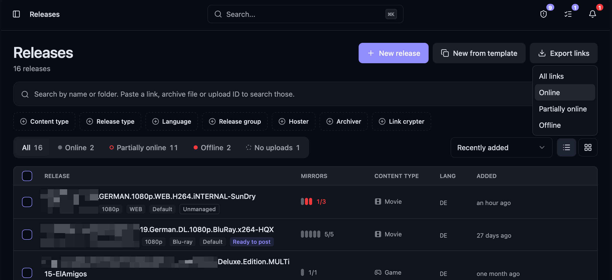
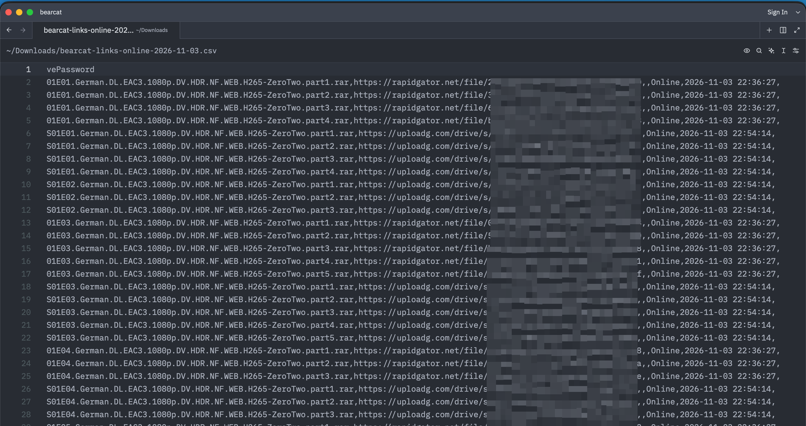

Open **Releases**, click **Export links** and select a filter. The browser downloads a CSV file with one row per uploaded file.

:::caution
The file contains archive passwords in plain text. Keep it as secure as your passwords.
:::

## Filter

| Filter | Exported uploads |
| --- | --- |
| **All links** | All uploads, including those with an unknown online state |
| **Online** | Uploads that are fully online |
| **Partially online** | Uploads with at least one offline link |
| **Offline** | Uploads that are fully offline |

The filter uses the online state of the whole upload. The export includes every link from each matching upload, including offline links for **Partially online** uploads. `LinkOnlineState` shows the state of each individual link.

The export contains completed uploads only. Link crypter containers are not exported.

## Format

The CSV file uses UTF-8 without a BOM and commas as separators. Values are quoted where needed. Column names are always in English.

| Column | Content |
| --- | --- |
| `Release` | Release name |
| `ReleaseGroup` | Release group |
| `Hoster` | The upload's hoster account, falling back to the account or account pool from the upload configuration |
| `UploadId` | Upload ID |
| `UploadOnlineState` | Online state of the upload |
| `FileName` | Archive or video filename without the folder path |
| `Link` | Hoster link |
| `EmbedLink` | Embed link for video hosters |
| `LinkOnlineState` | Online state of the link |
| `CheckedAt` | Time of the last check in `yyyy-MM-dd HH:mm:ss` format; empty if never checked |
| `ArchivePassword` | Archive password; empty if none is set |

Bearcat exports values unchanged. Spreadsheet programs may interpret values that start with `=`, `+`, `-` or `@` as formulas.
