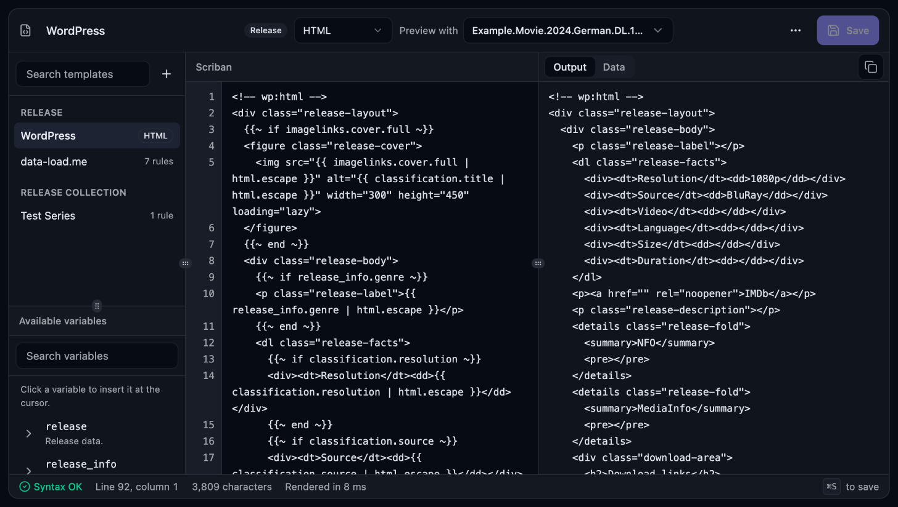
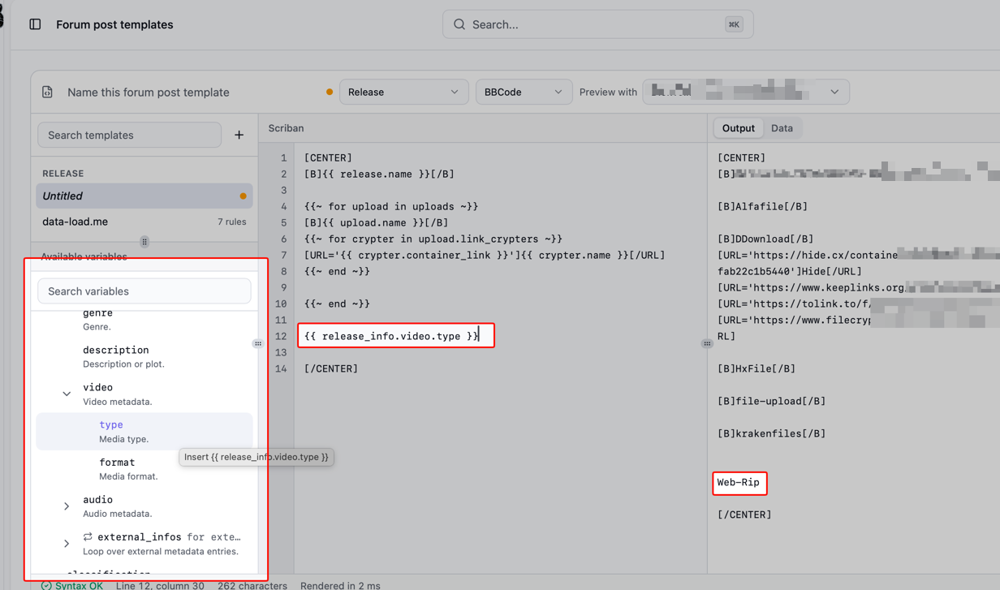
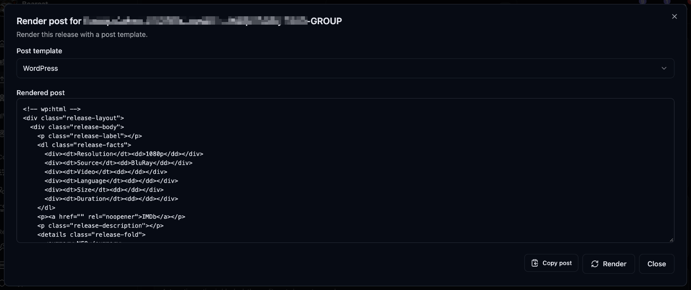

Write your post with placeholders for the release name, NFO, links, and images. Bearcat fills them
with data from a release or collection.

You can copy the result by hand or let [posting rules](/Bearcat/automatic-forum-posting/) post it for you.



## Create a template

1. Open **Release settings > Post templates** and click **+** next to the search field.
2. Choose the type: **Release** or **Release collection**. You can't change it later.
3. Choose the output format:

   | Output format | Use |
   | --- | --- |
   | **BBCode** | Forums |
   | **HTML** | [WordPress](/Bearcat/wordpress/) |
   | **Plain text** | Copying text without formatting |

   When posting to a distribution site, only templates in the matching format are available:
   BBCode for forums, HTML for WordPress.
4. Enter a name, write the template and press **Ctrl+S** (**⌘S** on a Mac) to save.

## Use the editor

The editor has three parts: your templates and variables on the left, the template in the middle
and a live preview on the right.

- **Insert variables:** click a variable under **Available variables** to insert it at the cursor.
  Lists like `uploads` insert a complete loop. Use the search field to find a variable.

  

- **Preview:** choose a release under **Preview with**. The preview updates while you type.
  **Output** shows the finished post, **Data** shows all values of that release.
- **Errors:** the status bar shows syntax errors. Click them to jump to the line.

If a placeholder stays empty in the preview, check the **Data** tab. It shows what the release
actually has.

## Template syntax

Templates use [Scriban](https://scriban.github.io/docs/language/).

Print a value:

```text
{{ release.name }}
```

Loop through a list:

```text
{{~ for upload in uploads ~}}
[B]{{ upload.name }}[/B]
{{~ end ~}}
```

Use `~` to remove the whitespace around `for` and `end` from the output.
For values within a line, use `{{ }}` without `~`.

Show a section only if a value exists:

```text
{{~ if release.nfo ~}}
[SPOILER="NFO"]{{ release.nfo }}[/SPOILER]
{{~ end ~}}
```

A complete example with NFO and link crypter links:

```text
[CENTER]
[B]{{ release.name }}[/B]

[SPOILER="NFO"]{{ release.nfo }}[/SPOILER]

{{~ for upload in uploads ~}}
[B]{{ upload.name }}[/B]
{{~ for crypter in upload.link_crypters ~}}
[URL='{{ crypter.container_link }}']{{ crypter.name }}[/URL]
{{~ end ~}}
{{~ end ~}}
[/CENTER]
```

In collection templates, loop over the releases with `{{~ for release in releases ~}}`.
Use `release.name`, `release.nfo` and the other release fields just as you would in release templates.

The remaining release data is also under `release`: `release.release_info`, `release.classification`,
`release.uploads`, `release.link_crypters` and `release.imagelinks`.
`imagelinks` without `release.` contains the collection's image links.
`collection.main_video_total_size_bytes` is the sum of `release.main_video.size_bytes` over all releases.
`collection.imdb_id`, `collection.tmdb_id` and `collection.tvdb_id` contain the series IDs from the
releases. Manual IDs take priority. The matching `_url` variables contain the links.

```text
{{~ for release in releases ~}}
[B]{{ release.name }}[/B]
[IMG]{{ release.imagelinks.cover.full }}[/IMG]
{{~ for crypter in release.link_crypters ~}}
[URL='{{ crypter.container_link }}']{{ crypter.name }}[/URL]
{{~ end ~}}
{{~ end ~}}
```

Loop over `upload_slots` to access the collection's upload slots.
`upload_slot.name` and `upload_slot.key` give you each slot's name and key.
Use `upload_slot.link_crypters` to access its containers. They contain the links of all releases
in that slot.

```text
{{~ for upload_slot in upload_slots ~}}
[B]{{ upload_slot.name }}[/B]
{{~ for crypter in upload_slot.link_crypters ~}}
[URL='{{ crypter.container_link }}']{{ crypter.name }}[/URL]
{{~ end ~}}
{{~ end ~}}
```

### One link for all hosters

Use `link_crypters` to access the containers for **Release (all hosters as mirrors)**.
The list contains one container per link crypter, with the same fields as `upload.link_crypters`.
Each upload included in a shared container also lists it in `upload.link_crypters`.

```text
{{~ for crypter in link_crypters ~}}
[URL='{{ crypter.container_link }}']{{ crypter.name }}[/URL]
{{~ end ~}}
```

### Video uploads

For [video uploads](/Bearcat/video-hosters/), you can use two more variables inside the
`{{~ for upload in uploads ~}}` loop:

- `upload.is_video_upload`: `true` for a video upload.
- `upload.embed_links`: a list of embed links in the same order as `upload.links`. It contains one entry
  for video uploads and is empty for archive uploads.

For video uploads, `upload.archive_format` and `upload.archive_password` are empty.

```text
{{~ for upload in uploads ~}}
{{~ if upload.is_video_upload ~}}
{{~ for embed_link in upload.embed_links ~}}
[URL]{{ embed_link }}[/URL]
{{~ end ~}}
{{~ end ~}}
{{~ end ~}}
```

### Screenshots

Access uploaded [screenshots](/Bearcat/release-templates-and-automations/#screenshots) like cover links:
use `imagelinks` in release templates and `release.imagelinks` in collection templates.
Each image upload configuration has these fields:

- `imagelinks.<name>.screenshots`: the uploaded screenshots, sorted by number.
  Each entry contains the image links `full`, `medium` and `thumbnail` in the sizes the image hoster provides.
  `index` is the number starting at 1, and `timestamp` is the video position as `hh:mm:ss`.
  The list stays empty until the first screenshot is uploaded.
- `imagelinks.<name>.screenshotgrid`: the screenshot grid with `full`, `medium` and `thumbnail`.
  The field stays empty until the grid is uploaded.

```text
{{~ for screenshot in imagelinks.pixhost.screenshots ~}}
[URL={{ screenshot.full }}][IMG]{{ screenshot.thumbnail }}[/IMG][/URL]
{{~ end ~}}
[IMG]{{ imagelinks.pixhost.screenshotgrid.full }}[/IMG]
```

## Render a post

Open a release or release collection and click **Render post** in the arrow menu of
**Post to site**. Without an active distribution site, it is a separate button. Choose a template and click
**Copy post**, then paste the result into your forum or blog.



## Good to know

- **Empty values:** missing data leaves placeholders empty. Wait for uploads and link crypter containers
  to finish before rendering, so the post includes all links.
- **Image links:** use `{{ imagelinks.imgbb_cover.full }}` for an image upload configuration named
  `ImgBB Cover`. Bearcat converts the name to lowercase and replaces spaces with `_`.
  Alternatively, use the original name: `{{ imagelinks["ImgBB Cover"].full }}`. The link appears once the image is uploaded.
- **Media data:** `release.main_video` and `release.media_files` come from the video files of managed
  releases. Bearcat reads them automatically for releases created from a release template. For other
  releases, open **Release info** and choose **Extract media data** from the `...` menu.
- **Upload names:** name your upload configurations the way they should appear in the post, for
  example `Rapidgator`. Then you can use `{{ upload.name }}` directly.
- **Hoster names:** `upload.hoster_name` shows the hoster name of the latest upload, for example `Rapidgator`.
  `upload.hoster_registration_name` shows the account name and stays empty until an account is assigned.
- **Several forums:** BBCode support varies between forums. Use one template per forum if needed.
- **HTML templates:** Bearcat sends the rendered HTML unchanged. Escape values with `| html.escape`.
  See [WordPress](/Bearcat/wordpress/#template) for a block editor example.
