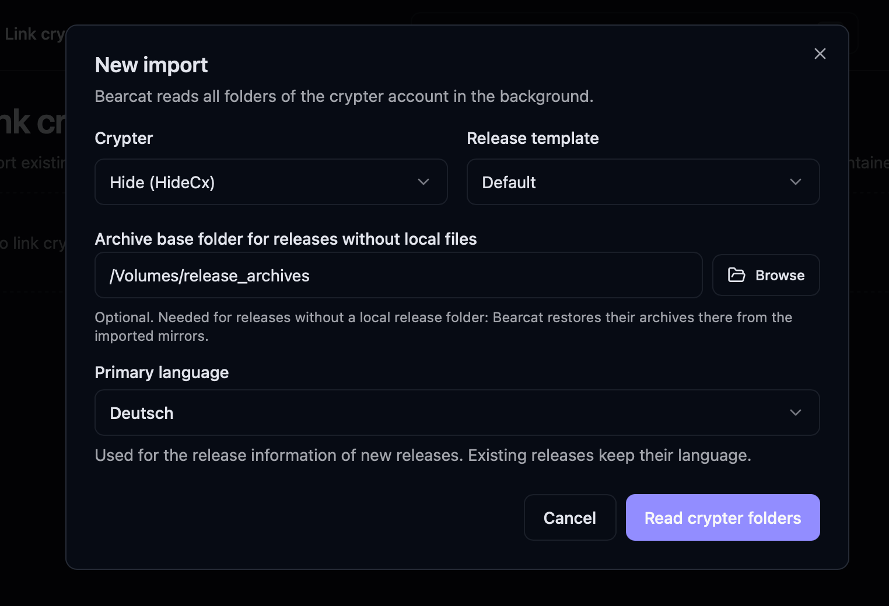
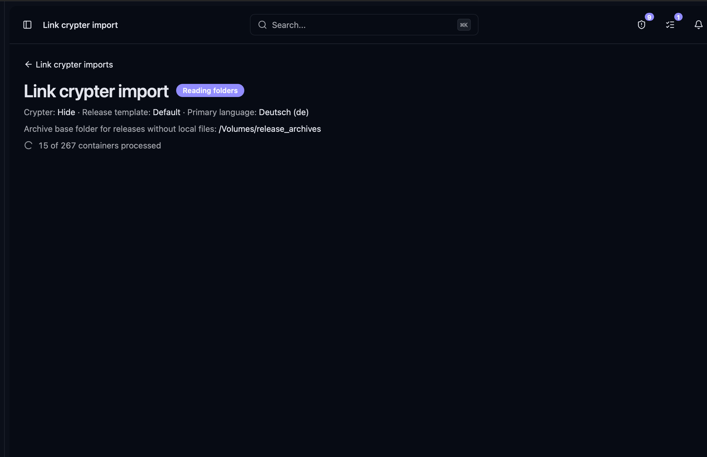

Bearcat reads the folders in your link crypter account and creates a release for each release name.
It imports mirrors with valid archive links as completed uploads, then uploads the files to the remaining hosters in the release template.

## Supported link crypters

- **FileCrypt**: the API key needs the `LIST` permission to list your folders.
- **Hide.cx**
- **ToLink**: a folder lists all links together. Bearcat groups them into one mirror per hoster domain.

## Steps

1. Open **Registrations > Crypters** > **Link crypter imports** and click **New import**.
2. Select the crypter registration, the **Default release template** and optionally a **Series release template**. The templates define the hosters, archive settings and link crypter settings of the new releases. Select a **Default language** if needed. See [Template and language](#template-and-language).
3. Optional: select an **archive base folder for releases without local files**. Bearcat restores archives there from the imported mirrors when there is no local release folder.

   

4. Bearcat reads all folders and their links in the background, skipping folders with URLs it already knows.

   

5. Select one hoster account per hoster and click **Check files**. Bearcat checks the files with this account only.

   

6. Review the releases, select the ones to import and click **Start import**.

## Review

Bearcat groups folders with the same release name into one entry. You select them together.
The release name defaults to the folder name. If it is wrong, correct it with the edit button before importing.
Giving two releases the same name merges them. The renamed release takes over the template and language of the other one.

The search finds releases by release name or folder name, ignoring case. Text without `*` matches anywhere in the name.
`*` matches any characters, for example `Show.S01*-GRP`. The search combines with the status filter.

The checkbox selects a release. After the file check, Bearcat selects the importable folders.
**Start import** imports the importable folders of all checked releases, including those hidden by the filter. Checked folders that are not importable are skipped.
Not importable releases can be checked too, for example to change their template.
The header checkbox and the bulk actions only affect the checked releases of the current result (status filter and search, all pages):

- **Set release template for N release(s)**: default or series release template. Only shown when the import has a series release template. Bearcat recalculates the preview, which takes a while for large imports.
- **Set primary language for N release(s)**

To change a single release, search for it and leave only this release checked.

## Template and language

After the file check, Bearcat assigns a template and a language to each folder. You can change both during review.

| Setting | Rule |
| --- | --- |
| Series release template | The folder contains archives of several releases, its name matches the episode pattern of the series template's collection detection, or its name contains a season (`Show.S01.German.1080p-GRP`). Otherwise the folder gets the default release template. |
| Primary language | The language in the release name (`German` becomes `de`). For a folder with several archives and no language in its name, the language in the first archive name. Otherwise the default language. |

## Which mirrors Bearcat imports

Bearcat matches each mirror to an upload configuration for the same hoster.
New releases use the template's configurations. Existing releases use their own configurations.

| Decision | When |
| --- | --- |
| **Adopted** | All files are online and use a supported archive format (`.rar`, `.r00`, `.7z`, `.7z.001`). Additional mirrors must have the same file names as the first adopted mirror. |
| **Bearcat uploads this hoster itself** | The hoster is configured in the release, but the mirror does not meet all the conditions above. |
| **Unsupported hoster** | Bearcat does not know the hoster of the links. |
| **Hoster not in the release** | The release has no remaining upload configuration for this hoster. |

With a managed template, Bearcat looks for an unused folder with the release name in the working directories and
the base paths of the folder automations. If it finds one, it uses that folder to create a managed release.
Otherwise, it creates an unmanaged release and restores its archive from the mirrors when needed.

Bearcat also looks for an existing archive in the archive storage folders, working directories, archive base folder
and their direct subfolders. Its file names must match those of the first adopted mirror exactly.
If Bearcat finds a matching archive, it uses it unchanged without downloading anything.
Without a release folder, the release remains unmanaged even if an archive is available.

## Folders that cannot be imported

- No mirror belongs to a hoster of the release.
- No mirror can be adopted and there is no release folder.
- There is no release folder, no existing archive and no archive base folder was selected.

The last two conditions only apply when the import creates a new release.

For [season folders](#season-folders), the import also fails in these cases:

- The release template has no collection detection.
- The episodes do not belong to the same collection.

## Existing releases

Bearcat matches existing releases by name, ignoring case. It uses the folder name or the name you entered during review.

- Folders with the same release name belong to one release, so you can import a separate folder for each hoster.
- If the release already exists, Bearcat adds the folder to it, for example a folder from a second crypter.
- A mirror with the same links as an existing upload is linked to this upload.
- If a hoster already has a newer upload, the container gets that upload's links on its next update.
- A folder's import fails if the release already has a container from the same crypter account for one of its hosters.

## Season folders

A folder can contain several episodes, for example a whole season. Bearcat identifies them by their
archive file names, such as `Show.S01E01...part1.rar` and `Show.S01E02...part1.rar`. If a mirror contains
several archives, Bearcat creates a release for each one, using the archive name without the part number.
During review, you can see the episodes below the folder.

- Set up [collection detection](/Bearcat/release-collections/#how-a-collection-is-created) in the release template. All episodes must be assigned to the same collection.
- Bearcat looks for each episode's local files separately. A folder that contains exactly the archive parts of one episode is used as it is.
- If all episodes are in one folder, Bearcat moves each episode's archive parts into a subfolder named after the episode. The review and the notification at the end show this.
- Bearcat adopts the folder as the container for the collection's [upload slot](/Bearcat/release-collections/#upload-slots). All mirrors in the folder must belong to this slot, or the import fails.
- Bearcat skips mirrors with unknown file names or no archive parts because it cannot assign them to an episode.
- The import fails if the upload slot already has another container of the same crypter account, or if a release in the collection uses this crypter account for its own containers.

If you import a folder with just one episode and its upload slot already uses the same crypter account,
Bearcat imports it without its container. The episode's links go into the collection's container.

## Link crypter containers

- A folder with a single mirror for one of the release's hosters becomes a container for the matching upload configuration (**Each release separately**).
- A folder with several mirrors becomes a **Release (all hosters as mirrors)** container. If the import creates a new release, Bearcat adds links from the remaining hosters once their uploads finish.

See [Link crypter containers](/Bearcat/upload-lifecycle/#5-link-crypter-containers).

## After the import

- New releases use the primary language of their folder for their release information. Existing releases keep their language.
- Bearcat fetches release information (xREL, PreDB, NFO) after the import through the release information background task.
- Imported releases count as posted and do not appear in the [post queue](/Bearcat/post-queue/). This also applies to collections created from a season folder.

## Archives not found during the import

If Bearcat cannot find the local archives during import, it marks them as **Deleted**.
Bearcat restores them from the mirrors when needed. If the archive files are already on disk,
you can assign their folders afterwards:

1. Open **Uploads and archives** > **Archives** and select the archives.
2. Click **Change archive folders** and select a base path.

   

3. Bearcat searches the base path and all subfolders. Review the archive folders it found, then click **Change archive folders** to confirm.

   

Bearcat must find a single matching folder for each archive, containing exactly that archive's parts.
It then sets the status to **Created** and uses the folder unchanged.
Bearcat skips the archive in these cases:

- The archive is neither **Deleted** nor **Missing files**.
- A newer archive already exists for the archive configuration.
- No matching folder was found, or more than one folder matches.
- The folder also contains another archive.
- The folder is already used by another archive.
- The same folder was found for several selected archives.
- The release is managed and the archive folder is inside its release folder.
