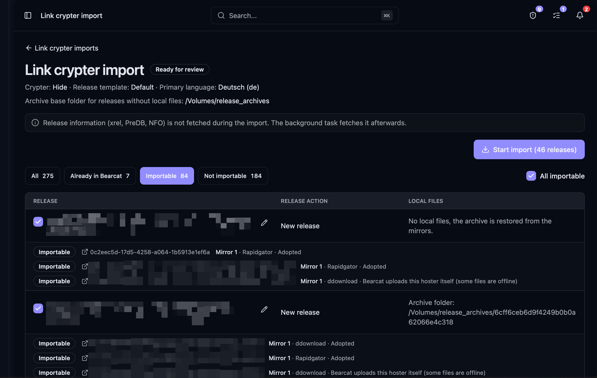
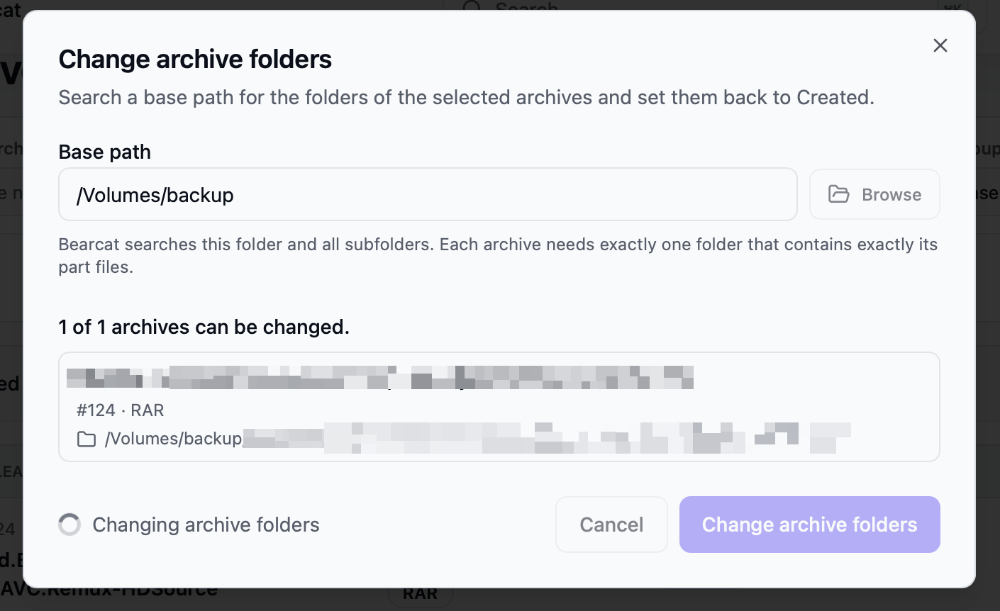

Bearcat imports valid mirrors as completed uploads. If a release already exists, the folders are added to it; for new releases, Bearcat also uploads the files to any remaining hosters in the template.

Supported crypters are **FileCrypt**, **Hide.cx**, and **ToLink**. FileCrypt requires an API key with the `LIST` permission. For ToLink, links are grouped by hoster domain.

## Steps

1. Open **Registrations > Crypters > Link crypter imports** and click **New import**.
2. Choose the crypter registration and **Default release template**. You can also choose a **Series template** and **Default language**.
3. If local files are missing, set the **Archive base folder for releases without local files**. Bearcat can use this folder to restore archives from the mirrors when needed.

   

4. Click **Read crypter folders**. Bearcat skips folders with URLs it already knows.
5. Choose one account per hoster and click **Check files**.
6. Review the selection and click **Start import**.

## Review

Bearcat groups folders by release name. Use **Rename release** to change the name. If you enter a name already in the list, Bearcat merges the folders and uses that entry's template and language.

Search for part of a release or folder name, or use the status filter. Search ignores case. Use `*` to match any part of a name, as in `Show.S01*-GRP`.

After the file check, all importable folders are selected automatically. Checking a release selects all of its folders, and **Select all matches** covers every page of the filtered results. Changing the template or primary language updates all selected matches. **Start import** also includes selected importable folders that are currently hidden by a filter.

### Template and language

By default, imports use the **default release template**. If you set a **series template**, it is used whenever a folder contains multiple releases, the release name includes a season number, or the name matches the template's episode pattern.

The **primary language** is detected from the release name, or from the first archive name in multi-release folders. If neither yields a language, the default language is used. You can change both template and language in the preview.

## Mirrors and local files

Each mirror needs an upload configuration for its hoster (for new releases, this comes from the template). A mirror is valid when all its files are online and use a supported archive format (`.rar`, `.r00`, `.7z`, `.7z.001`). Additional mirrors must have the exact same file names as the first imported mirror.

To be imported, a folder needs at least one hoster that matches the release. A new release also needs either a local release folder or a valid mirror. Without a local release folder, it also needs an existing archive or an archive base folder.

With a managed template, Bearcat searches the working directories and folder automation paths for an unused folder matching the release name. If none is found, it creates an unmanaged release instead. Existing archives are searched in the archive storage folders, working directories, archive base folder, and their direct subfolders, and reused if the file names exactly match the first imported mirror.

## Existing releases

Bearcat matches existing releases by the name shown in the preview (case-insensitive). If a mirror has the same links as an existing upload, they are linked together. If the hoster already has a newer upload, the container picks up its links on the next update.

The import fails if the release already has a container from the same crypter account for one of the folder's hosters.

## Season folders

If a mirror contains several episodes, Bearcat creates one release per episode based on the archive names. The template's [collection detection](/release-collections/#how-a-collection-is-created) must assign all episodes to the same collection.

If archives for several episodes share a local folder, Bearcat moves the archive parts into one subfolder per episode. The preview and completion notification show these moves.

The crypter folder becomes the container for the collection's [upload slot](/release-collections/#upload-slots), and all mirrors must belong to that same slot. Mirrors that cannot be matched to an episode are skipped.

The import fails if the slot already has another container from the same crypter account, or if a release in the collection uses that account for its own containers. When importing a single episode, Bearcat can add its links to the existing collection container for that account.

## After the import

A folder with one mirror becomes the [link crypter container](/upload-lifecycle/#5-link-crypter-containers) for that hoster. A folder with several mirrors becomes the container for all hosters on the release.

Release information is fetched in the background. New releases use the language from the preview, while existing releases keep theirs. Imported releases and collections count as already posted and stay out of the [post queue](/post-queue/).

## Assign archive folders after import

Bearcat marks missing local archives as **Deleted**. It can restore them from the mirrors when needed. If the files are already on disk, you can assign their folders:

1. Select the archives under **Uploads and archives > Archives**.
2. Click **Change archive folders** and choose a base path.
3. Review the folders Bearcat found and click **Change archive folders** to confirm.

   

Bearcat also searches subfolders. It can assign folders to archives marked **Deleted** or **Missing files** if no newer archive exists. Each archive needs exactly one unused folder containing only its archive parts. For a managed release, that folder must be outside the release folder. After assignment, Bearcat marks the archive as **Created**.
