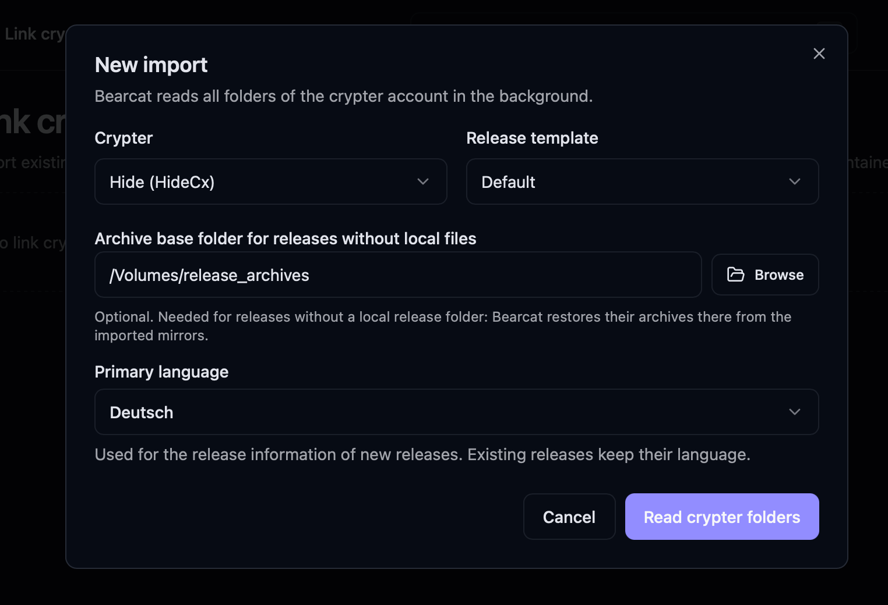
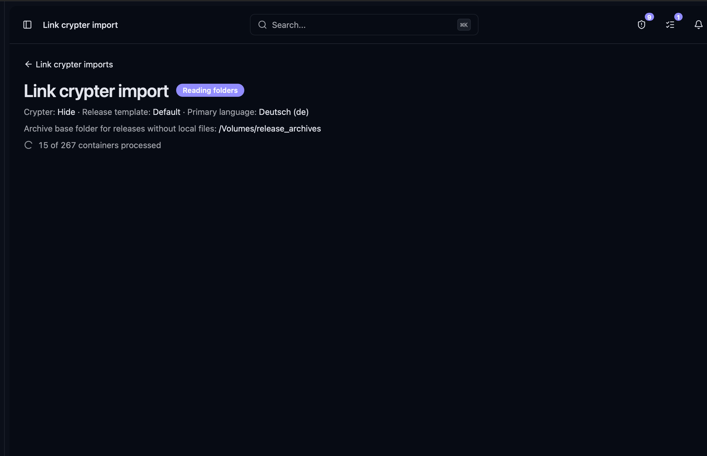
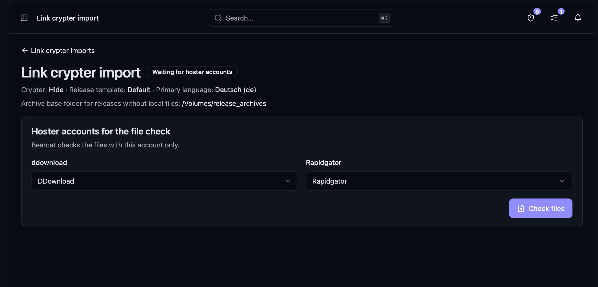
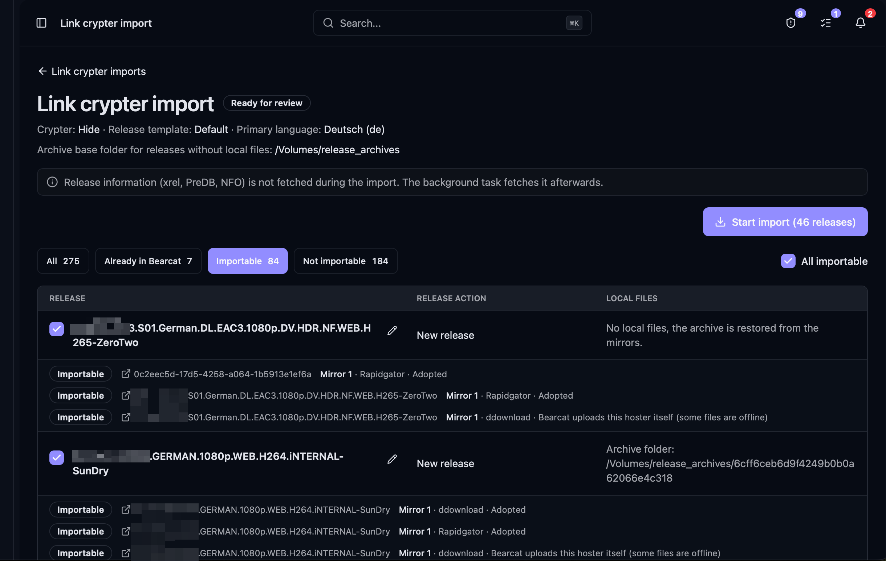

Bearcat reads the folders in your link crypter account and creates a release for each release name.
It imports mirrors with valid archive links as completed uploads, then uploads the files to the remaining hosters in the release template.

## Supported link crypters

- **FileCrypt**: the API key needs the `LIST` permission to list your folders.
- **Hide.cx**

## Steps

1. Open **Crypters** > **Link crypter imports** and click **New import**.
2. Select the crypter registration and the release template. The template defines the hosters, archive settings and link crypter settings of the new releases.
3. Optional: select an **archive base folder for releases without local files**. Bearcat restores archives there from the imported mirrors when there is no local release folder.

   

4. Bearcat reads all folders and their links in the background, skipping folders with URLs it already knows.

   

5. Select one hoster account per hoster and click **Check files**. Bearcat checks the files with this account only.

   

6. Review the releases, select the ones to import and click **Start import**.

## Review

Bearcat groups folders with the same release name into one entry. You select them together.
The release name defaults to the folder name. If it is wrong, correct it with the edit button before importing.
Giving two releases the same name merges them.

## Which mirrors Bearcat imports

Bearcat matches each mirror to an upload configuration for the same hoster.
New releases use the template's configurations. Existing releases use their own configurations.

| Decision | When |
| --- | --- |
| **Adopted** | All files are online and use a supported archive format (`.rar`, `.r00`, `.7z`, `.7z.001`). Additional mirrors must have the same file names as the first adopted mirror. |
| **Bearcat uploads this hoster itself** | The hoster is configured in the release, but the mirror does not meet all the conditions above. |
| **Unsupported hoster** | Bearcat does not know the hoster of the links. |
| **Hoster not in the release** | The release has no remaining upload configuration for this hoster. |

With a managed template, Bearcat looks for an unused folder with the release name in the working directories and
the base paths of the folder automations. If it finds one, it uses that folder to create a managed release.
Otherwise, it creates an unmanaged release and restores its archive from the mirrors when needed.

Bearcat also looks for an existing archive in the archive storage folders, working directories, archive base folder
and their direct subfolders. Its file names must match those of the first adopted mirror exactly.
If Bearcat finds a matching archive, it uses it unchanged without downloading anything.
Without a release folder, the release remains unmanaged even if an archive is available.

## Folders that cannot be imported

- No mirror belongs to a hoster of the release.
- No mirror can be adopted and there is no release folder.
- There is no release folder, no existing archive and no archive base folder was selected.

The last two conditions only apply when the import creates a new release.

## Existing releases

Bearcat matches existing releases by name, ignoring case. It uses the folder name or the name you entered during review.

- Folders with the same release name belong to one release, so you can import a separate folder for each hoster.
- If the release already exists, Bearcat adds the folder to it, for example a folder from a second crypter.
- A mirror with the same links as an existing upload is linked to this upload.
- If a hoster already has a newer upload, the container gets that upload's links on its next update.
- A folder's import fails if the release already has a container from the same crypter account for one of its hosters.

## Link crypter containers

- A folder with a single mirror for one of the release's hosters becomes a container for the matching upload configuration (**Each release separately**).
- A folder with several mirrors becomes a **Release (all hosters as mirrors)** container. If the import creates a new release, Bearcat adds links from the remaining hosters once their uploads finish.

See [Link crypter containers](/Bearcat/upload-lifecycle/#5-link-crypter-containers).

## After the import

- New releases use the import's **primary language** for their release information. Existing releases keep their language.
- Bearcat fetches release information (xrel, PreDB, NFO) after the import through the release information background task.
- Imported releases count as posted and do not appear in the [post queue](/Bearcat/post-queue/).
