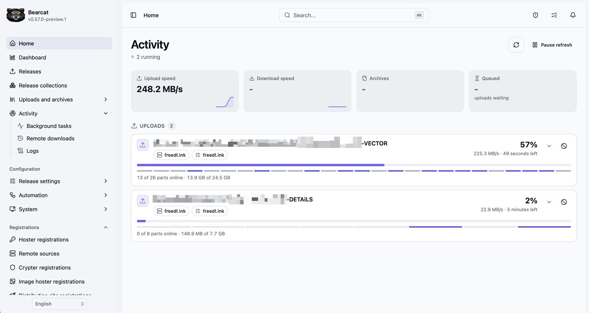

import { CardGrid, LinkCard } from '@astrojs/starlight/components';

## What is Bearcat?

Bearcat runs on your desktop, NAS, or server. Use its web interface to manage releases,
create archives, and upload them to your hosters. Bearcat checks the links and reuploads offline files.

You can:

- [Automatically download releases from FTP/FTPS servers](/remote-downloads/), verify SFV checksums, and optionally extract RAR or 7z archives.
- Pack releases into RAR or 7z archives, or upload archives you already have.
- Upload to Rapidgator, DDownload, Keep2Share, and the other hosters listed below.
- Free local disk space and [restore archives from a mirror hoster](/mirror-downloads/) when a reupload needs them.
- Look up release information and NFOs through xREL and SRRDB, movie or TV metadata through TMDB and TheTVDB, and game metadata through Steam.
- Read resolution, codecs, and audio and subtitle tracks from your video files with MediaInfo.
- Upload cover images and [create video screenshots or screenshot grids](/release-templates-and-automations/#screenshots). Use the images alongside download links and NFOs in [post templates](/forum-post-templates/).
- [Prepare drafts on forums and WordPress blogs](/posting-to-forums/) and submit them yourself, or use [posting rules to post automatically](/automatic-forum-posting/).
- Find releases ready to post in the [post queue](/post-queue/).

## Supported services

### File hosters

- Rapidgator
- DDownload
- GoFile
- [Keep2Share](/keep2share/)
- Alfafile
- NitroFlare
- 1fichier
- Uploady.io
- Katfile
- Krakenfiles
- FileQ
- UploadG.com
- FileServe.com
- Clicknupload.click
- HxFile.co
- file-upload.org
- datavaults.co (maximum file size: 100 MB)
- Fast2Share.com
- CloudFam.io
- freedl.ink (minimum file size: 1 MB)
- mega4upload.net
- filer.net (free accounts: maximum file size 2 GB)
- [FileFactory](/filefactory/) (free accounts: maximum file size 2 GB)
- turbobit.net (API key from cabinet.costaction.com)
- hitfile.net (API key from cabinet.costaction.com)
- Zippyshare.day

### Video hosters

- DoodStream
- MixDrop
- Playmate
- Streamtape
- Vidara
- Videro
- Vixeo

### Linkcrypters

- Hide.cx
- Keeplinks
- tolink.to
- [filecrypt.cc](/filecrypt/)

### Image hosters

- ImgBB
- pixhost.to (no API key needed)
- pixelfox.cc
- loepic.me
- directupload.eu (no API key needed)

### Forums

The XenForo plugin should work with most XenForo forums without a captcha at login
(tested with data-load.me and myboerse.bz). There are also dedicated plugins for data-load.me and boerse.cx.

### Blogs

[WordPress](/wordpress/) 5.6 or later, with an application password.

## Get started

Install Bearcat using one of the options below. Setup starts automatically the first time you open it.
See [Your first upload](/post-installation/) for the steps.

<CardGrid>
	<LinkCard
		title="Desktop app"
		description="Run Bearcat on Windows, macOS with Apple Silicon, or Linux."
		href="/use-the-desktop-launcher/"
	/>
	<LinkCard
		title="Windows service"
		description="Run Bearcat in the background, even when you are not logged in."
		href="/use-the-windows-service/"
	/>
	<LinkCard
		title="Docker container"
		description="Run Bearcat on Linux, a NAS, or a server with Docker."
		href="/use-the-docker-image/"
	/>
	<LinkCard
		title="Your first upload"
		description="Add a hoster account, create a template, and add a source."
		href="/post-installation/"
	/>
</CardGrid>

## After setup

| You want to … | Guide |
| --- | --- |
| Upload new folders automatically | [Release templates and folder automations](/release-templates-and-automations/) |
| Download releases from a server | [FTP/FTPS downloads](/remote-downloads/) |
| Free disk space | [Mirror downloads](/mirror-downloads/) or [archive storage folders](/archive-storage-folders/) |
| Post completed uploads to forums or blogs | [Posting to sites](/posting-to-forums/) or [automatic posting](/automatic-forum-posting/) |

## Common questions

### Can I use PostgreSQL?

Yes. New installations use SQLite, but you can [set up PostgreSQL](/install-postgresql-for-desktop/) or use the [Docker option](/use-the-docker-image/#database). Existing PostgreSQL installations keep their settings.

### Can I upload existing archives?

Yes. Use an unmanaged release for existing archives, or a managed release to let Bearcat create them.
See [release types](/release-types/).

### Do I have to keep every archive on disk?

No. Enable a hoster as a mirror so Bearcat can download archives when needed for a reupload.
Delete local copies yourself or set a retention period for automatic cleanup.

The hoster must support downloads through its API, and some hosters require a premium account.
See [mirror downloads](/mirror-downloads/) for supported hosters and setup instructions.

## Learn more

<CardGrid>
	<LinkCard
		title="Upload lifecycle"
		description="How Bearcat creates archives, checks upload links, and schedules reuploads."
		href="/upload-lifecycle/"
	/>
	<LinkCard
		title="Release collections"
		description="Share upload settings and container links across related releases."
		href="/release-collections/"
	/>
	<LinkCard
		title="Release information and metadata"
		description="Set up metadata sources, fetch NFOs, and correct release information."
		href="/release-information-and-metadata/"
	/>
	<LinkCard
		title="Post templates"
		description="Build forum and blog posts with release details, cover images, screenshots, NFOs, and download links."
		href="/forum-post-templates/"
	/>
	<LinkCard
		title="Advanced configuration"
		description="Configure upload limits, automatic cleanup, and background tasks."
		href="/advanced-configuration/"
	/>
</CardGrid>
