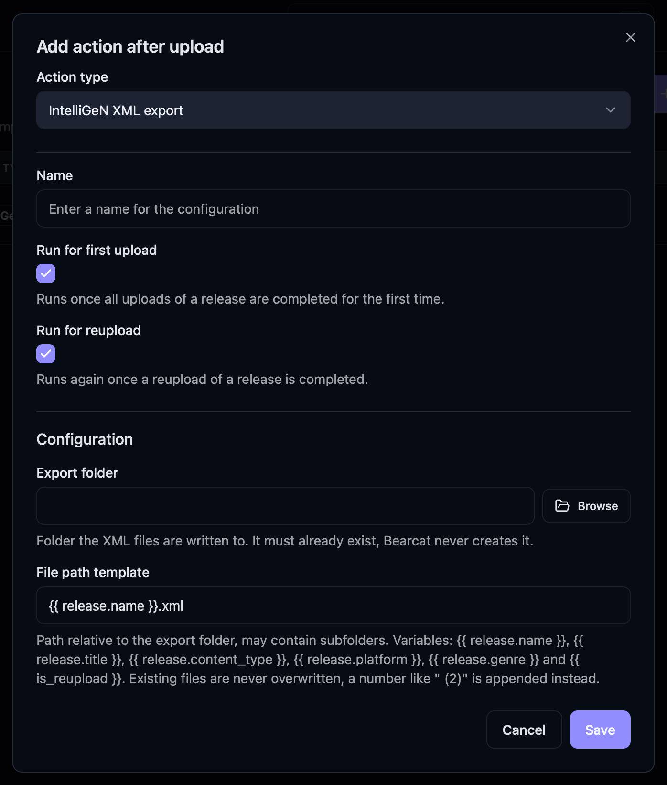
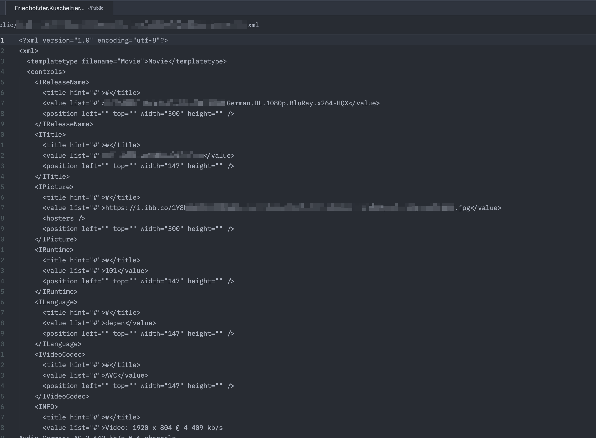

After upload, Bearcat writes a release's download links and metadata to an XML file for IntelligeN.
For a collection, the file contains links for all episodes. Within each upload slot, Bearcat groups links from the same hoster into one mirror.

## Set up the export

1. Open **Automation > Actions after upload** and click **New action**.
2. Under **Action type**, choose **IntelligeN XML export** and give the export a name.
3. Choose **After the first upload**, **After a reupload**, or both.
4. Choose an existing **Export folder**. Use the **File path template** to set the filename and any subfolders.
5. Click **Save**.



Each export creates a new file. If the filename is already in use, Bearcat adds a number, as in `Release.Name (2).xml`.
To check the result, open the release or collection detail page and look under [Actions after upload](/upload-completion-actions/).



## Import into IntelligeN

Select the export folder in IntelligeN's **DirWatch**. IntelligeN automatically imports new files from that folder.

IntelligeN only imports crypters it recognizes. For fields such as genre, language, and codecs, the value must appear in the corresponding dropdown list.

## File path template

The file path template uses [Scriban](https://github.com/scriban/scriban). The default template, `{{ release.name }}.xml`, uses the release or collection name as the filename.

| Variable | Value |
| --- | --- |
| `{{ release.name }}` | Release or collection name |
| `{{ release.title }}` | Title from the metadata |
| `{{ release.content_type }}` | Content type |
| `{{ release.platform }}` | Game platform |
| `{{ release.genre }}` | Genre |
| `{{ release.runtime_minutes }}` | Runtime in minutes |
| `{{ release.video_codec }}` | Main video codec |
| `{{ release.audio_codec }}` | Codec of the main audio track |
| `{{ is_reupload }}` | `true` for a reupload, otherwise `false` |

This template saves reuploads in the `Reuploads` subfolder.

```text
{{ if is_reupload }}Reuploads/{{ end }}{{ release.name }}.xml
```
