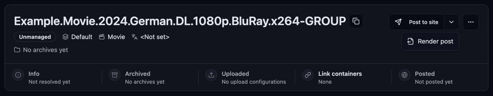
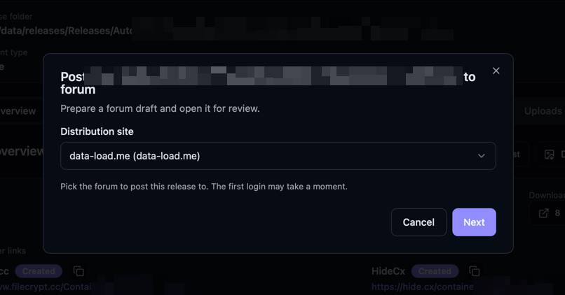
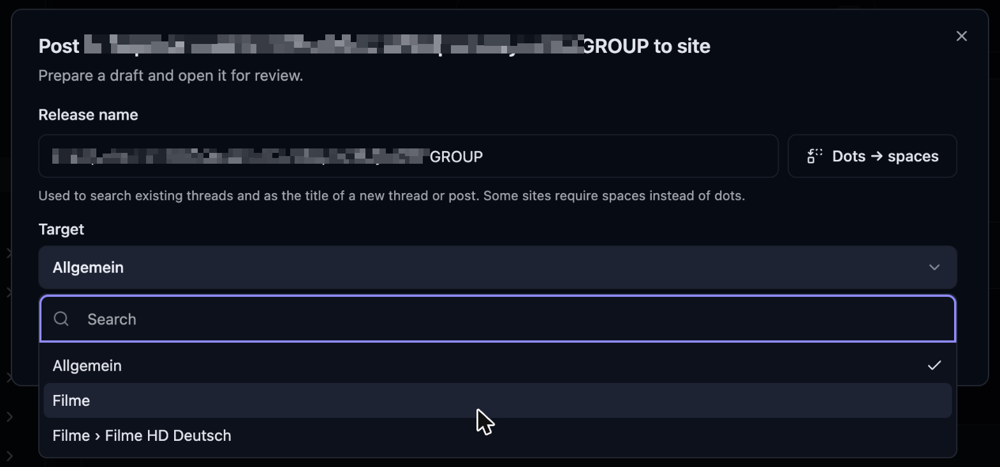
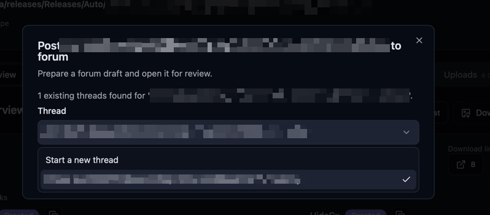
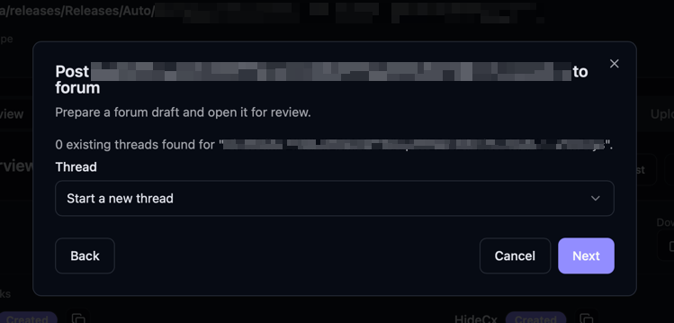
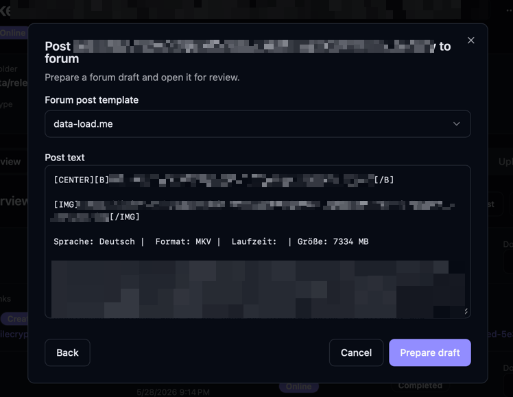
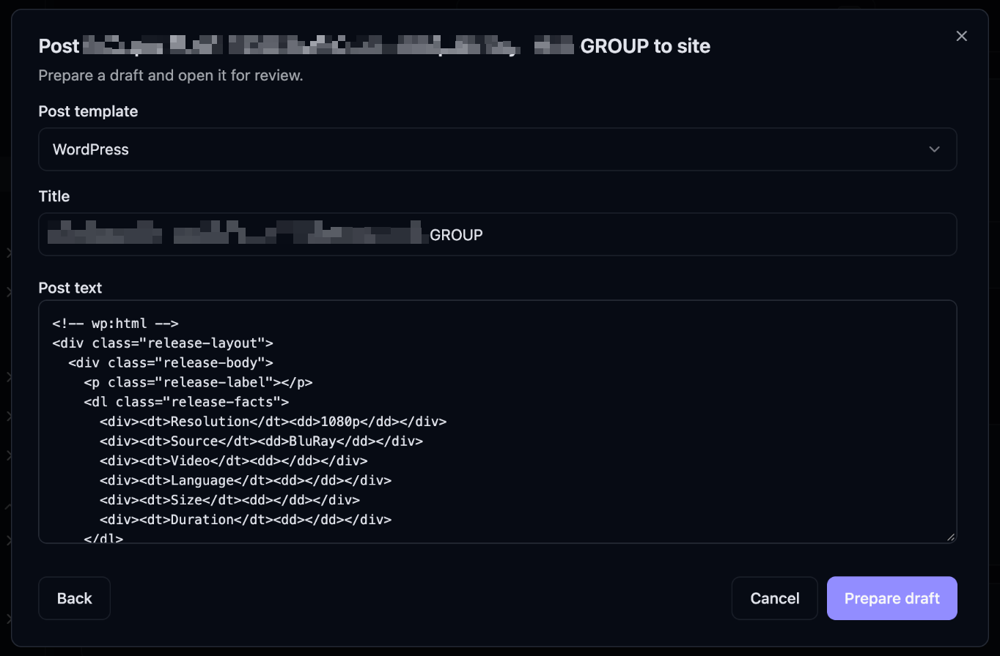
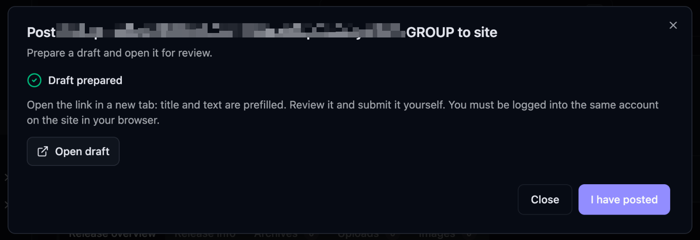
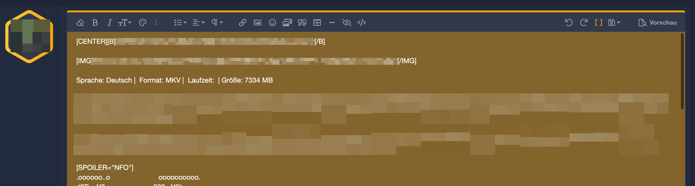
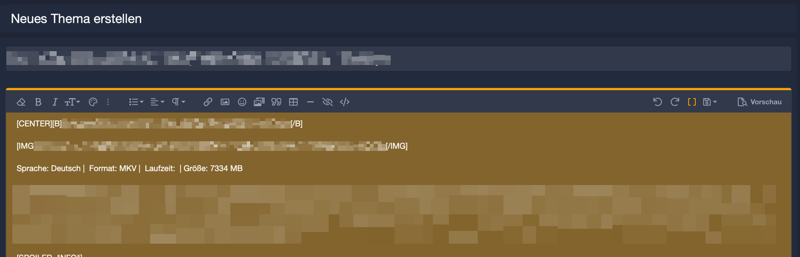

Bearcat creates a draft on a forum or blog from your template and release data. Open it in your browser, check
the title and body, and submit it. You must be logged into the same account on the site.

To let Bearcat submit posts for you, use [posting rules](/Bearcat/automatic-forum-posting/).

## What you need first

- A distribution site, which is a forum or [WordPress](/Bearcat/wordpress/) account you added to Bearcat.
- A [post template](/Bearcat/forum-post-templates/) in the output format of the site: BBCode for forums, HTML for WordPress.
- A release with completed uploads and download links.

## Setting up a distribution site

Open **Registrations > Distribution site registrations** in the sidebar and add one. Pick the site, enter your username and
password, and save. Your password is stored encrypted. Activate the site and use **Try login**
to check the connection.

For boerse.cx and data-load.me, select the matching forum entry.

For other XenForo forums, pick **XenForo**. Enter your username, password and the forum start page
under **Address**, including any installation folder, for example `https://example.org/community/`. Use the
address shown in your browser after redirects. Add each forum separately.

The XenForo entry needs friendly URLs and the standard XenForo login, post and draft forms.
Routing through `index.php`, SSO, CAPTCHA and two-factor login are not supported. Custom themes,
required thread fields or add-ons can prevent posting. Test the login and prepare a draft
before enabling automatic posting.

See [WordPress](/Bearcat/wordpress/) for setup instructions.

## Posting a release

Open a release and click **Post to site** in the header. **Render post** is in the arrow
menu of the same button.

In the dialog:

1. Pick the distribution site you want to post to.
   
2. Choose a subforum or blog category as the target. You can also edit the release name,
   which Bearcat uses to search for existing threads and as the title of new threads and posts. **Dots → spaces** replaces dots with spaces
   and adds spaces around the final hyphen before the release group.
   
3. Forums only: Bearcat searches the subforum for threads whose titles match the release name, using the same
   [matching rules as automatic posting](/Bearcat/automatic-forum-posting/#finding-an-existing-thread).
   If exactly one thread matches, Bearcat suggests a reply. Otherwise, it suggests a new thread.
   You can also choose a thread from the search results yourself. For blogs, the dialog skips this step.

   <figure>

   

   <figcaption>Existing thread found</figcaption>
   </figure>

   <figure>

   

   <figcaption>No existing thread found</figcaption>
   </figure>

4. Pick a post template. Only templates in the site's output format are available.
   Bearcat fills it with the release data; you can edit the result.
   For a new thread or blog post, also set the title. On forums, you can also set an optional prefix such as 1080p or x265.

   <figure>

   

   <figcaption>Prepare a reply to an existing thread</figcaption>
   </figure>

   <figure>

   

   <figcaption>Prepare a new thread</figcaption>
   </figure>

5. Click **Prepare draft**. Bearcat saves the draft on the site and shows an **Open draft** link.

   

## Sending the post

1. Log into the same account on the site in your browser, then click **Open draft**. Otherwise,
   the editor will not show the draft.
2. Review the title and body and use the preview if needed. Submit the post or publish it on the blog.
3. Back in Bearcat, click **I have posted** to save the post URL under **Posted locations**.
   On forums, if Bearcat cannot find the post yet, paste its URL. The forum search may take a few seconds to catch up.
   On WordPress, Bearcat saves the post URL without searching.

<figure>

<figcaption>Reply draft in an existing thread</figcaption>
</figure>

<figure>

<figcaption>New thread draft</figcaption>
</figure>

**I have posted** saves the URL but does not remove the release from the
[post queue](/Bearcat/post-queue/). Use **Mark as posted** there when you have finished posting.

## Posted locations

**Posted locations** lists the URLs where a release or collection has been published,
such as forum threads or WordPress posts. Confirming a post adds its URL here.
Find the list on the **Overview** tab of the release or collection.
You can also add or remove links there by hand.
