Open **Releases** and click a release name. For a walkthrough, see [Your first upload](/post-installation/).

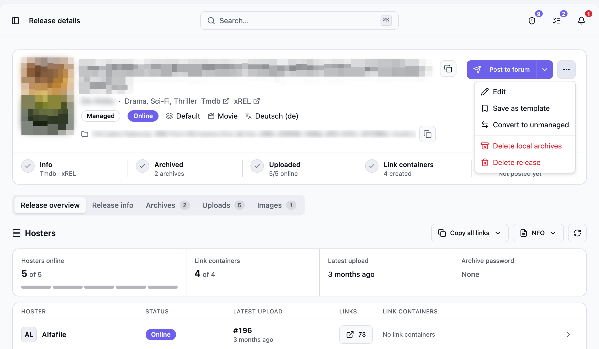

## Header

**Post to site** opens the [posting dialog](/posting-to-forums/). The button is highlighted
when the release has at least one online hoster and has not been posted yet. Without an active
distribution site, you see **Render post** instead.

Click **Start uploads now** to skip the [initial upload cooldown](/upload-lifecycle/#2-the-first-upload)
for this release. The button appears if at least one upload configuration has no upload yet.

Use the `...` menu to convert between [release types](/release-types/#converting-between-types).

The status display below the header shows progress. Red marks a problem or an unfinished step.
Click a step to open its tab.

## Overview

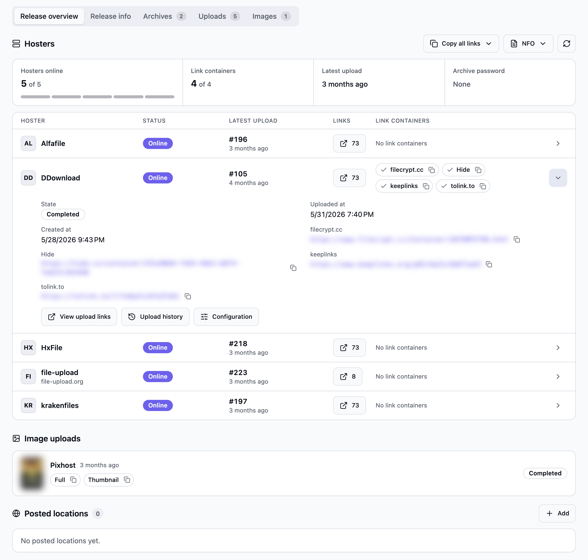

**Copy all links** copies one link crypter's container links for all hosters.
[Posted locations](/posting-to-forums/#posted-locations) are listed at the bottom.

Under **Image uploads**, each image upload configuration shows its cover and screenshot previews.
Use the copy buttons to copy the image links.

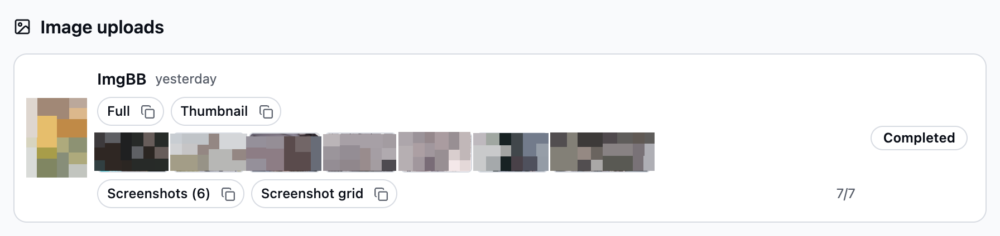

## Release info

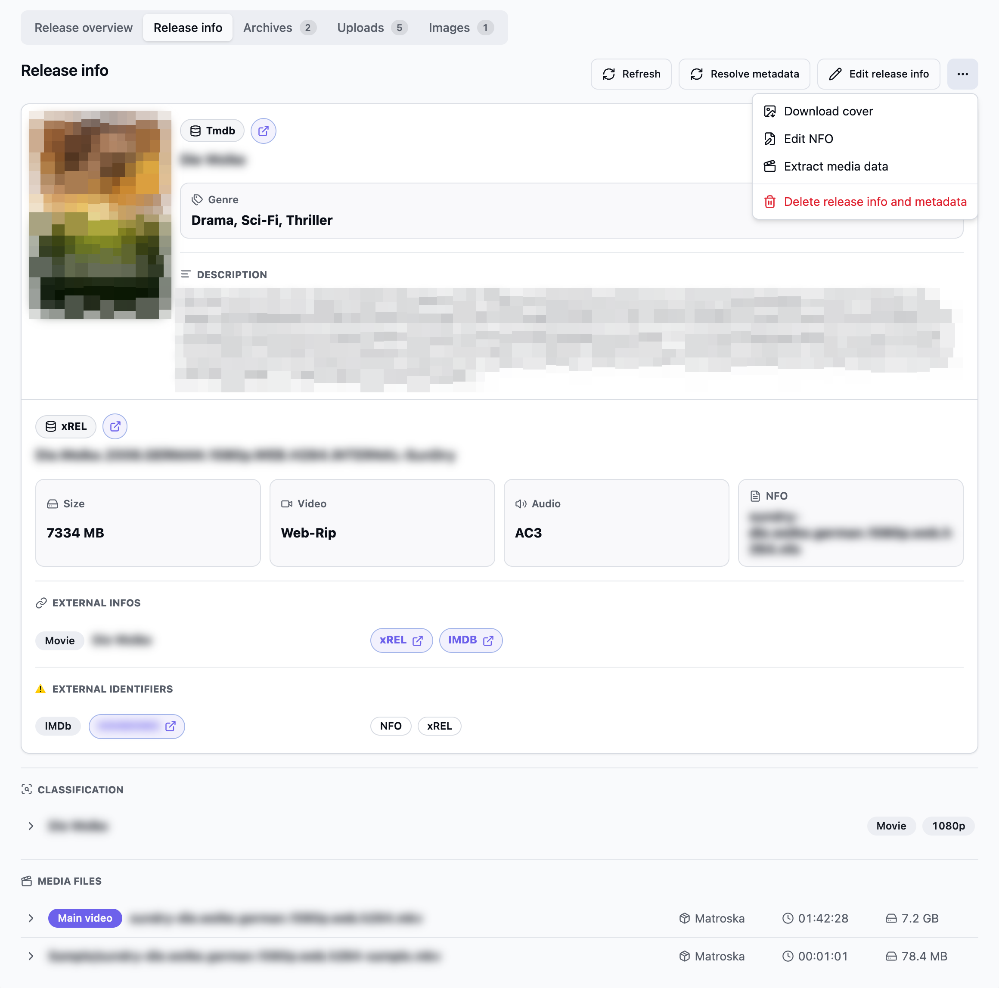

View and edit the title, description, cover, NFO, and media data here.
Use **Resolve metadata** to search the configured providers again.
See [Release Information and Metadata](/release-information-and-metadata/)
to set up sources or correct a wrong match.

## Archives

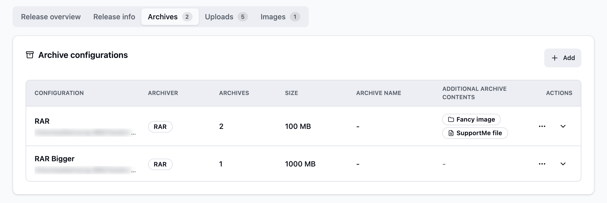

To upload a managed release as an archive, add an archive configuration here. See
[Creating the archive](/upload-lifecycle/#3-creating-the-archive) for the packing options.

Archives in a [storage folder](/archive-storage-folders/) show the storage folder name next to
their state. While a reupload uses a [local working copy](/archive-storage-folders/#reuploads),
the name is followed by **local working copy**.

## Uploads

**Configuration** connects an archive configuration to a hoster account and optional link crypters.

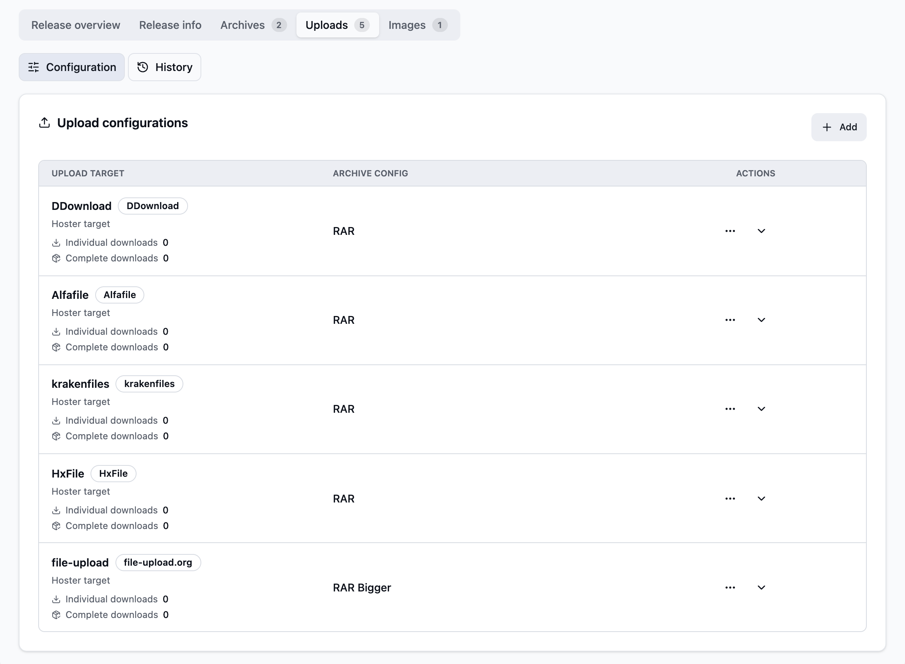

**History** lists all upload runs, with per-run actions such as starting a manual reupload.

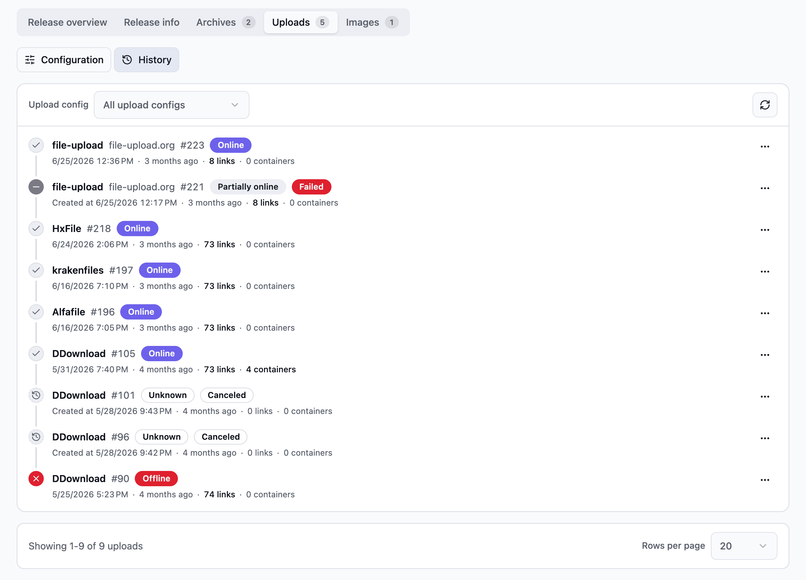
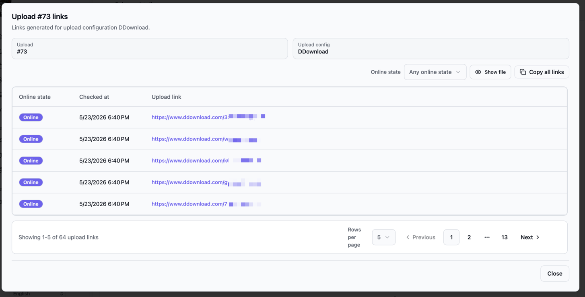
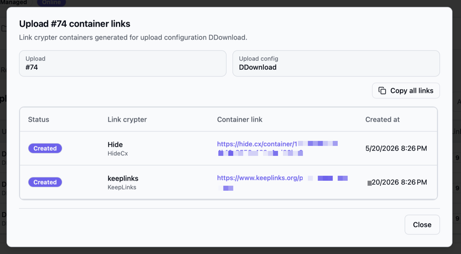

## Images

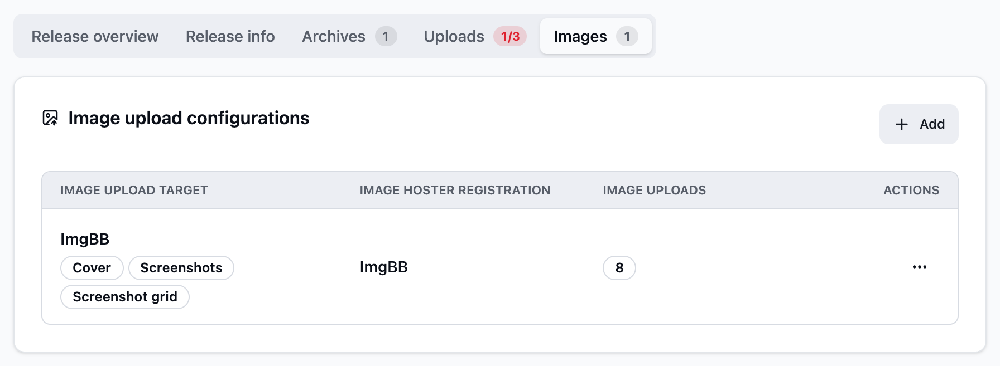

Cover uploads need a cover URL, for example from TMDB or xREL.
An [image upload configuration](/account-settings/#image-upload-configuration) can also upload
screenshots and the screenshot grid. The **Image uploads** list shows each upload's image type:
cover, screenshot, or screenshot grid.

The **Screenshots** card shows the generated [screenshots](/release-templates-and-automations/#screenshots).
Click an image to open it at full size.

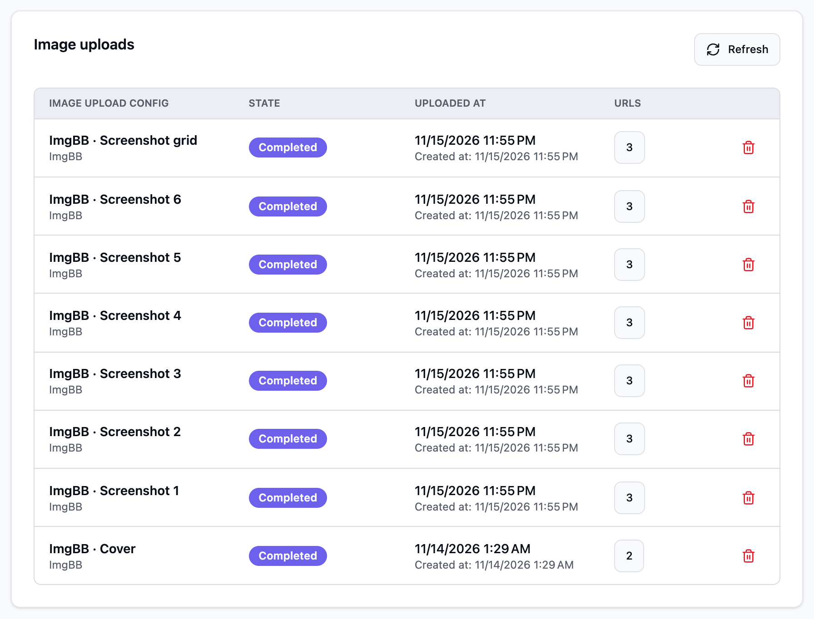
