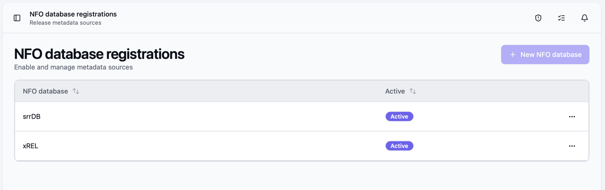
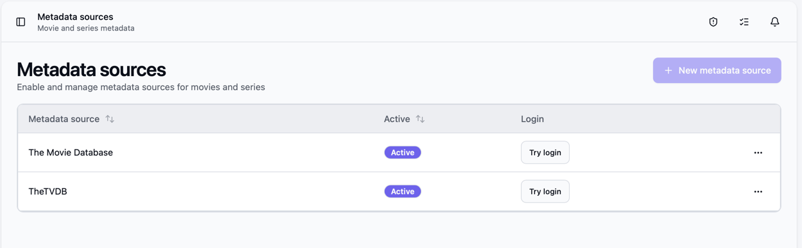
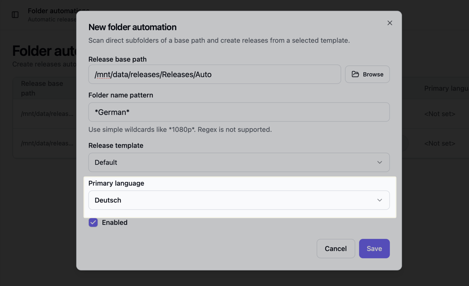
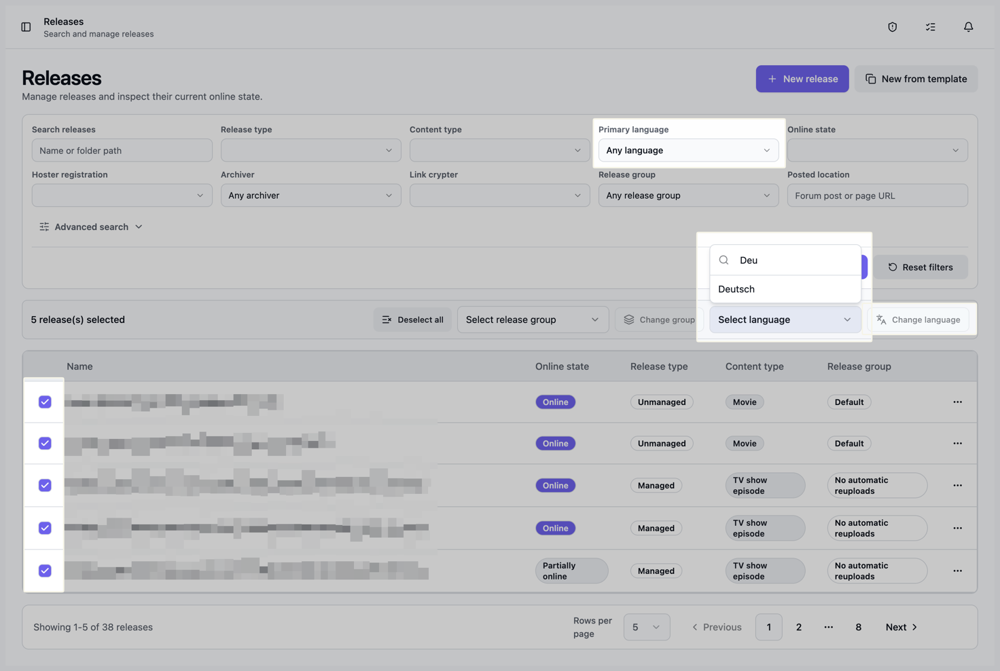
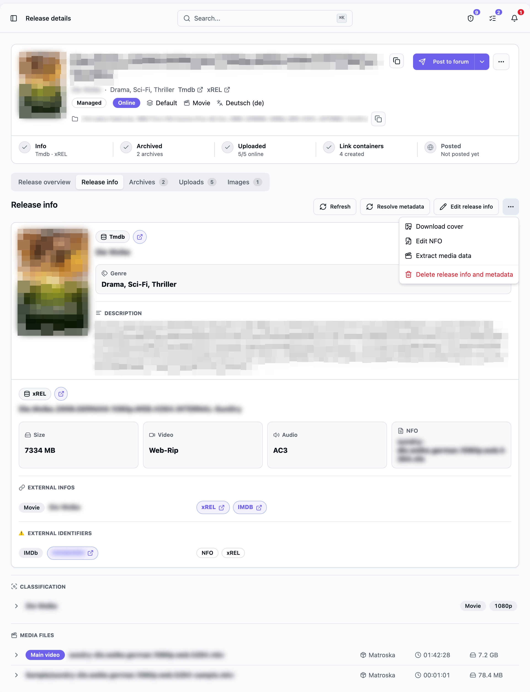

Bearcat stores three kinds of information for a release:

- **Release information** comes from scene databases: release name, size, video and audio type,
  database links, and other release details.
- **Metadata** describes the movie or TV show: title, genre, description, cover image, and provider link.
- **Media data** is read from the local video files with MediaInfo. It contains codecs,
  resolution, duration, audio tracks, and subtitle tracks.

For example, Bearcat combines scene information from xREL with the title, description, and
higher-resolution cover from TMDB.

## Configure the sources

Open **NFO database registrations** in the sidebar to enable sources for scene release
information and NFO files:

- **xREL** has good coverage for German scene releases.
- **SRRDB** also covers many English and international scene releases and can provide NFO files
  and IMDb IDs.
- **PreDB** has similar coverage to SRRDB, but stricter API limits. When both are enabled,
  Bearcat tries SRRDB first for NFO files.

xREL, SRRDB and PreDB do not require account credentials.

Open **Metadata sources** to register providers for movie, TV and game metadata:

| Provider | Metadata | Credentials |
| --- | --- | --- |
| **The Movie Database (TMDB)** | Movies, TV series, and episodes | API key |
| **TheTVDB** | TV series | API key |
| **Steam** | Games | None |

After saving, use **Try login** to check the connection.

Bearcat checks active providers in a fixed order and uses the first match. It prefers the metadata
provider's cover and uses scene database values for missing details.

## Primary language

Set a primary language on a release or collection to request translated titles and descriptions
from metadata providers.

Choose the language when creating or editing a release or collection. A folder automation can set it
for all new releases, for example German for the pattern `*.GERMAN.*`.

Bearcat does not infer a language from release names. If none is set, the metadata provider uses
its default language.

The folder automation list shows each automation's language. On **Releases**, filter by language
or choose **Not set** to find releases without one. You can also select several releases to set
or clear their language together.

## How resolution works

1. Read the NFO from the release folder or fetch one from an active NFO database.
2. Fetch scene information from active NFO databases.
3. Extract IMDb IDs from the NFO and the xREL or SRRDB results.
4. Look up metadata using an IMDb ID. Without a suitable ID, use the title and other details from the release name.
5. Pass the primary language to the metadata provider.

For collections, Bearcat looks up a TV series using a manual TMDB or TVDB ID or an IMDb ID from an included release, or the collection name.

The **Release info resolution** background task handles missing data automatically. You can also
trigger the relevant actions from the **Release Info** tab.

## The Release Info tab

The tab shows metadata and scene information separately. Available actions:

- **Refresh** reloads the current data from Bearcat's database.
- **Resolve metadata** asks the active metadata sources again.
- **Edit release info** opens the manual editor.
- **Resolve now** is shown when no scene release information exists.
- **Add NFO** is shown when no NFO is stored.

Use the `...` menu to download the cover, edit an existing NFO, extract media data, or delete
the resolved release information and metadata.

Each external IMDb ID appears once, with all sources that found it.

## Correct a wrong match

If Bearcat matched the wrong movie, series or game, select **Correct metadata match** and enter a
reference to the correct entry. Bearcat shows a preview. **Apply** replaces the metadata with the
selected entry.

| Where | Button | Accepted input |
| --- | --- | --- |
| Release | **Release Info** tab | IMDb ID or URL, TMDB URL, Steam or SteamDB URL |
| Collection | `...` menu on the collection page | IMDb ID or URL, TMDB series URL, TVDB series URL |

The reference must fit the content type: movies take TMDB movie URLs, episodes and collections take
TMDB TV URLs, games take Steam or SteamDB URLs.

Bearcat stores the reference and the IMDb ID reported by the provider as manual IDs. Manual IDs take
precedence over IDs from the NFO, xREL, SRRDB, or a provider.

A collection correction is stored as manual IDs on all releases of the collection and replaces their
previous manual IMDb, TMDB, and TVDB IDs. A collection needs at least one release.

To undo a correction, open the dialog again and select **Remove correction**. Bearcat deletes the
manual IDs (for a collection: the manual IMDb, TMDB, and TVDB IDs of all its releases) and looks up
the metadata again.

## Manual fallback

If no provider finds a match, use **Edit release info** to enter the values manually. You can also
enter an IMDb ID or URL. Bearcat stores this ID separately from those found in the NFO, xREL, or SRRDB.

Use **Add NFO** or **Edit NFO** to enter NFO content manually. Bearcat scans the saved content for
IMDb IDs every time it changes. For managed releases, the edited NFO is also written to the release
folder.

Metadata entered manually is not overwritten by an automatic metadata refresh. To start a new lookup,
use **Delete release info and metadata**, then fetch the data again. The stored NFO
and extracted external IDs remain available for the next lookup.
