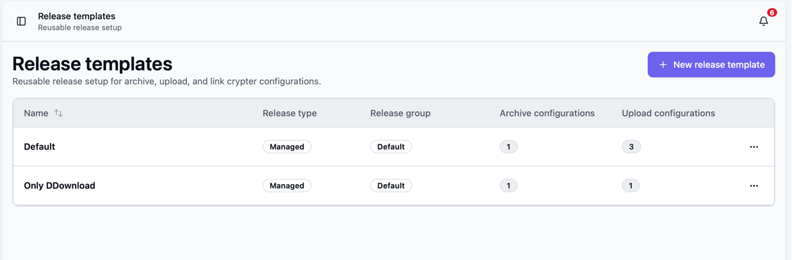
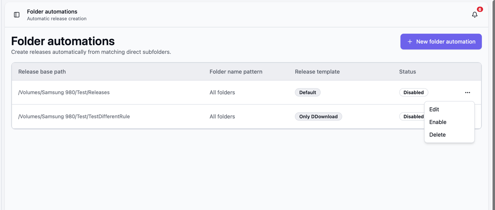

Save your [first upload](/Bearcat/post-installation/) settings as a template.
Use it to create more releases manually or automatically from new folders.

## Setting up release templates

A release template contains the release group and settings for archives, uploads, images, and link crypters.

Use **Create container for** in the link crypter configuration to give each hoster its own container
or group all hosters of a release as mirrors in one container.
See [link crypter containers](/Bearcat/upload-lifecycle/#5-link-crypter-containers).

- Open **Release templates**, click **New release template**, and add the configurations.
- Open a configured release and choose **Save as template** from its action menu.
- Choose **Duplicate** from the action menu of a template to create a variant of it.



On **Releases**, choose **New from template**. The new release normally takes the folder name,
as do archive configurations set to use the release name.

Enable **One release per subfolder** to create a release for every direct subfolder of the selected
folder. Deselect the subfolders you do not want. Subfolders already in use cannot be selected.

Enable **Collection detection** in the template to group related releases, such as episodes of a TV
season. See [Release Collections](/Bearcat/release-collections/).

### Screenshots

The **Screenshots** group in the template and in the release settings has two options:

| Option | Default | Result |
| --- | --- | --- |
| **Create screenshots** | Off, 6 screenshots | Single screenshots (1 to 20) at even intervals. |
| **Create screenshot grid** | Off, 4 columns x 4 rows | One 1920 pixel wide image with up to 8 columns and 10 rows and a header with file, video, and audio details. |

- Only managed releases with their release folder get screenshots.
- Bearcat uses the largest video file in the release folder.
- HDR10 and HLG videos are tonemapped to SDR. Dolby Vision without an HDR10 or HLG base layer is not supported.
- The **Screenshot creation** background task creates them. ffmpeg is [downloaded on demand](/Bearcat/advanced-configuration/#ffmpeg).
- The **Images** tab of a release shows the result or the error. **Regenerate** creates them again, for example after changing the options.
- To upload them to an image hoster, turn on **Screenshots** or **Screenshot grid** in an [image upload configuration](/Bearcat/account-settings/#image-upload-configuration). Regenerating replaces their image uploads.
- Screenshot files are temporary. Bearcat deletes them once every matching image upload configuration has uploaded them, or right away when no configuration uploads them. After that the **Images** tab shows the hosted images. **Regenerate** needs a managed release whose release folder still exists.

## Setting up folder automations

1. Create a release template, then open **Folder automations** and click **New folder automation**.
2. Set **Release base path** to the folder Bearcat should scan. Only direct subfolders are checked.
3. Optionally set a **Folder name pattern**, such as `*1080p*` or `*.GERMAN.*`. Matching ignores case
   and supports wildcards, but not regular expressions. Leave it empty to include all direct subfolders.
4. Leave **Ignore existing folders** on to process only new folders.
   Turn it off to import existing folders. See [Existing folders](#existing-folders).
5. Select the template and optionally a primary language for translated metadata. An empty language
   uses the metadata provider's default.
6. Save with **Enabled** checked. You can disable or re-enable the automation from its action menu.



For this base folder:

```text
/data/releases/incoming/
  Movie.One.2026.1080p/
  Movie.Two.2026.2160p/
  Some.Other.Folder/
```

The pattern `*1080p*` selects only `Movie.One.2026.1080p`. An empty pattern includes all three folders.

Bearcat scans about every two minutes and skips folders that already have a release. Once a folder
meets the [stability and minimum size requirements](/Bearcat/advanced-configuration/#folder-automation),
Bearcat creates the release, looks up its metadata, and packs and uploads it using the template.

### Existing folders

**Ignore existing folders** is on by default. On its first scan, Bearcat records all matching folders
and permanently ignores them for this automation. Only new folders become releases. Turn the option off
to also import existing folders that do not have a release yet.

If you change **Release base path** or **Folder name pattern**, this setting applies again to the folders
Bearcat finds with the new settings.

The **Folder preview** lists folders that match the base path and pattern. Folders with a release and
archive output folders are marked **Already in use**.

When you create an automation or change its base path or pattern, the preview also shows what will happen
to the remaining folders: Bearcat ignores them or shows a warning with the number of folders that will be
imported and uploaded. Use the refresh button to reload the preview.

### Extract archives before release creation

For managed templates, turn on **Extract archives before release creation** in the folder automation
if the folders contain RAR or 7z archives and you want Bearcat to pack the release itself. The option
is off by default and does not apply to unmanaged templates.

Before the release is created, Bearcat checks the folder against its `.sfv` files, if there are any,
and extracts every RAR and 7z archive in the folder and its subfolders. After a successful extraction,
it deletes the archive volumes and `.sfv` files that only list those volumes. The extraction rules are
the same as for [remote downloads](/Bearcat/remote-downloads/#extract-archives-before-release-creation).

Running checks and extractions appear on the **Activity** page under **Folder automations**.

If verification or extraction fails, Bearcat keeps the files and creates no release. Find the error
under **Failed extractions** on **Folder automations**. Fix the cause, then click **Retry** to process
the folder on the next scan. Bearcat also retries when the folder's files change.

### Download releases from FTP or FTPS

Use **Remote sources** and **Remote automations** to download new folders from a server and create
releases from a template. See [FTP / FTPS Downloads](/Bearcat/remote-downloads/) for setup and examples.
