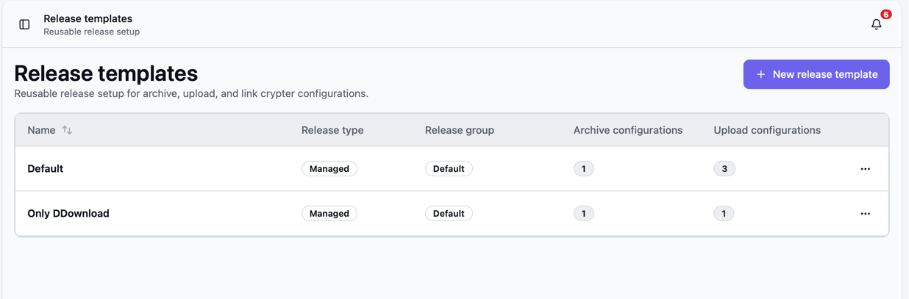
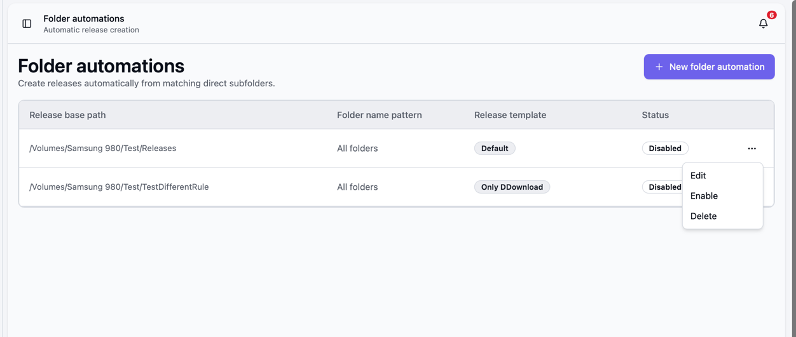

Save your [first upload](/Bearcat/post-installation/) settings as a template.
Use it to create more releases manually or automatically from new folders.

## Setting up release templates

A release template contains the release group and settings for archives, uploads, images, and link crypters.

- Open **Release templates**, click **New release template**, and add the configurations.
- Open a configured release and choose **Save as template** from its action menu.



On **Releases**, choose **New from template**. The new release normally takes the folder name,
as do archive configurations set to use the release name.

Enable **Collection detection** in the template to group related releases, such as episodes of a TV
season. See [Release Collections](/Bearcat/release-collections/).

## Setting up folder automations

1. Create a release template, then open **Folder automations** and click **New folder automation**.
2. Set **Release base path** to the folder Bearcat should scan. Only direct subfolders are checked.
3. Optionally set a **Folder name pattern**, such as `*1080p*` or `*.GERMAN.*`. Matching ignores case
   and supports wildcards, but not regular expressions. Leave it empty to include all direct subfolders.
4. Decide with **Ignore existing folders** whether folders that already exist become releases.
   See [Existing folders](#existing-folders).
5. Select the template and optionally a primary language for translated metadata. An empty language
   uses the metadata provider's default.
6. Save with **Enabled** checked. You can disable or re-enable the automation from its action menu.



For this base folder:

```text
/data/releases/incoming/
  Movie.One.2026.1080p/
  Movie.Two.2026.2160p/
  Some.Other.Folder/
```

The pattern `*1080p*` selects only `Movie.One.2026.1080p`. An empty pattern includes all three folders.

Bearcat scans about every two minutes and skips folders that already have a release. Once a folder
meets the [stability and minimum size requirements](/Bearcat/advanced-configuration/#folder-automation),
Bearcat creates the release, looks up its metadata, and packs and uploads it using the template.

### Existing folders

**Ignore existing folders** is on by default. The first scan of the automation skips every matching
folder that already exists. Only folders that appear afterwards become releases. Skipped folders stay
ignored for this automation. Turn the option off to create a release for every existing folder that
has no release yet.

Changing **Release base path** or **Folder name pattern** of an automation starts a new first scan.
**Ignore existing folders** then applies to the folders found with the new settings.

The **Folder preview** in the dialog lists the folders that match the current base path and pattern
and marks folders that already have a release or are an archive output folder with **Already in use**. If the save starts a first scan,
the preview also shows what happens with the remaining folders: the first scan ignores them, or a
warning shows how many folders will become releases and be uploaded. The refresh button reloads the
preview.

### Extract archives before release creation

For managed templates, turn on **Extract archives before release creation** in the folder automation
if the folders contain RAR or 7z archives and you want Bearcat to pack the release itself. The option
is off by default and does not apply to unmanaged templates.

Before the release is created, Bearcat checks the folder against its `.sfv` files, if there are any,
and extracts every RAR and 7z archive in the folder and its subfolders. After a successful extraction,
it deletes the archive volumes and `.sfv` files that only list those volumes. The extraction rules are
the same as for [remote downloads](/Bearcat/remote-downloads/#extract-archives-before-release-creation).

Running checks and extractions appear on the **Activity** page under **Folder automations**.

If verification or extraction fails, Bearcat keeps the files and creates no release. Find the error
under **Failed extractions** on **Folder automations**. Fix the cause, then click **Retry** to process
the folder on the next scan. Bearcat also retries when the folder's files change.

### Download releases from FTP or FTPS

Use **Remote sources** and **Remote automations** to download new folders from a server and create
releases from a template. See [FTP / FTPS Downloads](/Bearcat/remote-downloads/) for setup and examples.
