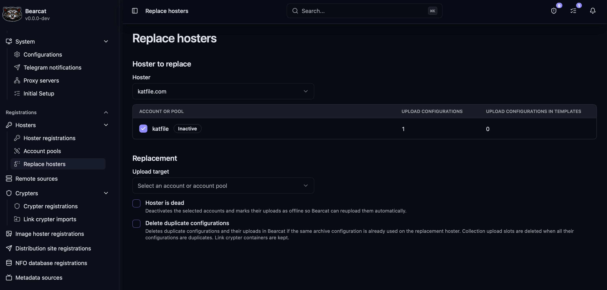
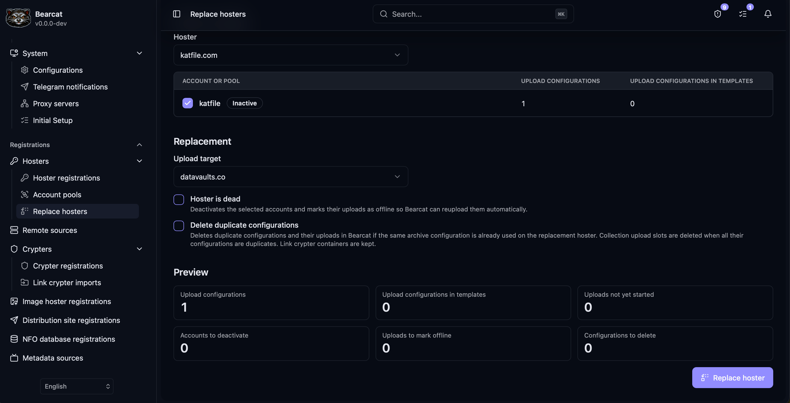
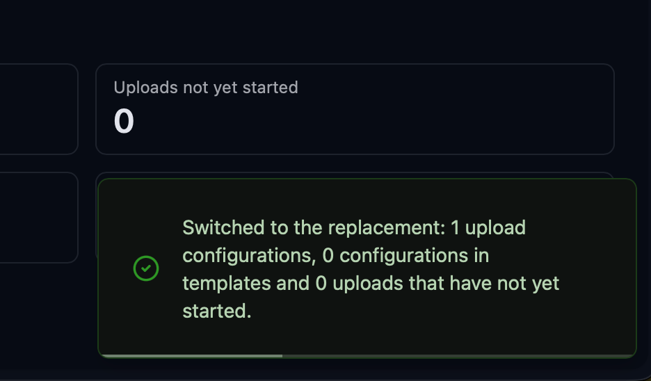
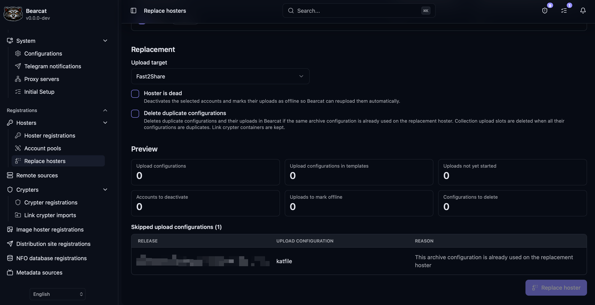

Open **Registrations > Hosters** > **Replace hosters**. Choose the hoster, the accounts and pools to replace, and one
replacement account or pool of the same kind (video or archive).

The preview updates with every change. Click **Replace hoster** to apply your selection. This cannot
be undone automatically.

After the replacement, a message shows how many configurations and uploads were switched.

## What gets replaced

- Upload configurations in releases and release templates are switched to the selected account or pool.
- If a configuration has the same name as the old account or pool, it is renamed to match the
  replacement. Custom names stay unchanged.
- **Premium only** is turned off if the replacement hoster does not support it.
- Uploads that have not started yet and have no files are moved to the replacement.

The pools themselves stay unchanged. You can delete unused pools on the
[account pools](/account-pools/) page.

Existing uploads stay on the old hoster. The next reupload uses the selected account or pool.

## Skipped configurations

| Case | Result |
|---|---|
| The release or template already has the same archive configuration on the replacement hoster | The configuration stays on the old hoster |
| Several selected accounts use the same archive configuration in a release or template | Only the first upload configuration is switched to the replacement |
| One configuration of a collection upload slot is skipped | The entire upload slot stays unchanged |

The preview lists skipped configurations with a link to the release or template.

## Delete duplicate configurations

Enable **Delete duplicate configurations** to remove duplicates instead of skipping them. A configuration
counts as a duplicate if the same release or template already has an upload configuration for that archive
configuration on the replacement hoster. When several selected accounts share the same archive configuration,
Bearcat switches the first one to the replacement and deletes the rest.

- Their uploads and links are deleted.
- Link crypter containers stay unchanged. Delete them at the link crypter if needed.
- A collection upload slot is deleted only if all its configurations are duplicates and none has a running
  upload. Otherwise, the entire slot stays unchanged.
- Configurations with a running upload are not deleted.
- Duplicate configurations in templates are always deleted.

The preview shows which configurations and collection upload slots will be deleted. Anything that cannot be
deleted stays in the list of skipped configurations. Deletion cannot be undone.

## Hoster is dead

A dead hoster usually stops reporting files as offline, and Bearcat does not check inactive accounts either.
Without this option, Bearcat still considers existing uploads online and no reupload starts.

With **Hoster is dead**, Bearcat takes two additional steps:

- It deactivates the selected accounts and every account in the selected pools, including accounts
  you did not select individually or that also belong to other pools.
- It marks completed uploads of these accounts and their files as offline, including uploads from skipped
  configurations.

This option is not available if the replacement is on the same hoster.

[Automatic reuploads](/upload-lifecycle/#7-automatic-reuploads) start on the new account or pool
after the usual waiting time, provided **Automatic reuploads** is enabled in the release group. Skipped
configurations still use the deactivated account and cannot reupload until you change them.

## What does not change

- Running uploads and uploads that already have files stay on the old hoster. Cancel them if they do
  not finish.
- Links in existing posts do not change.
- Change any hoster names typed directly into post templates by hand. `upload.hoster_name` shows
  the hoster name of the latest upload.
