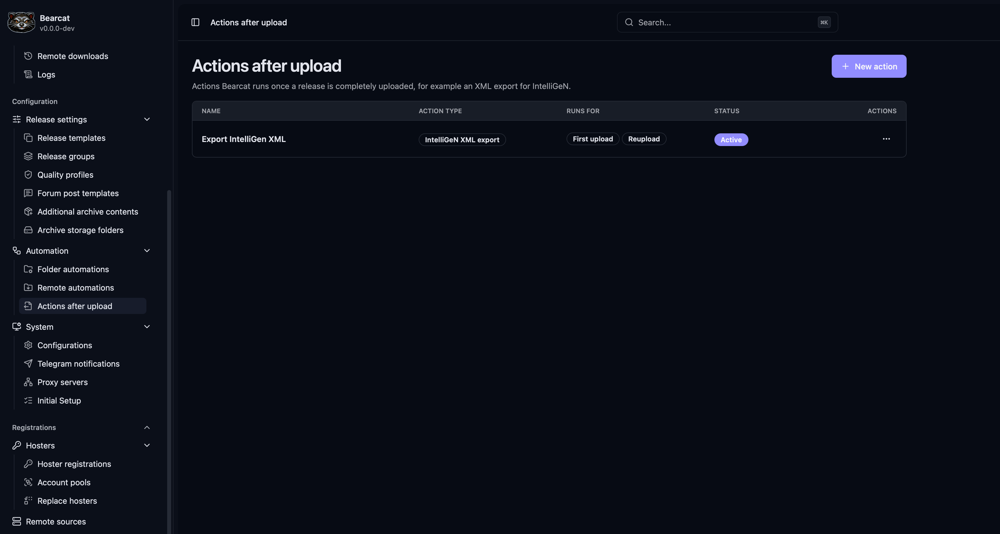
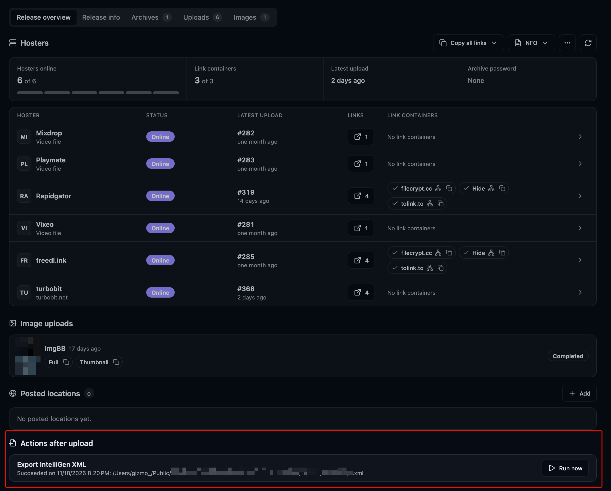

Bearcat can run an action automatically after uploading a release or a release collection.
One available action is the [IntelligeN XML export](/Bearcat/intelligen-xml-export/).

## Set up an action

1. Open **Automation > Actions after upload** and click **New action**.
2. Choose an **Action type** and give the action a name.
3. Choose **After the first upload**, **After a reupload**, or both.
4. Fill in the fields for the selected action type and click **Save**.

New actions are active immediately. To pause one, choose **Disable** from its menu.

## When an action runs

By default, Bearcat checks every five minutes whether a release's uploads, link containers, and images are ready.
A new action only runs for uploads that finish after you set it up. Once the action succeeds, it waits for another matching upload to finish.

If the action fails, Bearcat notifies you on the first failure and retries on the next check.

## Actions for release collections

If a [release collection](/Bearcat/release-collections/) uses [upload slots](/Bearcat/release-collections/#upload-slots),
the action runs for the whole collection. Bearcat waits until all uploads in the slots are complete and the collection's link containers and images are ready.
Every release must also pass the [quality gate](/Bearcat/quality-gates/) or have manual approval.

Uploading a new episode triggers **After the first upload**. **After a reupload** applies only if all new uploads in the slots are reuploads.
Uploads outside the slots trigger the action for the individual release.

## Check the result or run an action manually

On the [release detail page](/Bearcat/release-detail-page/), open the **Overview** tab.
Under **Actions after upload**, you can see the latest result for each active action. The collection detail page has the same section.

Once the uploads, link containers, and images are ready, you can choose **Run now** even if the action has already run or the matching trigger is off.
If a manual run fails, Bearcat shows the error in the overview without sending a notification.

