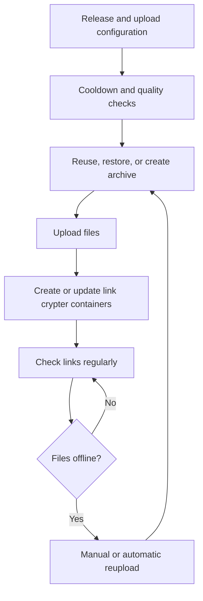
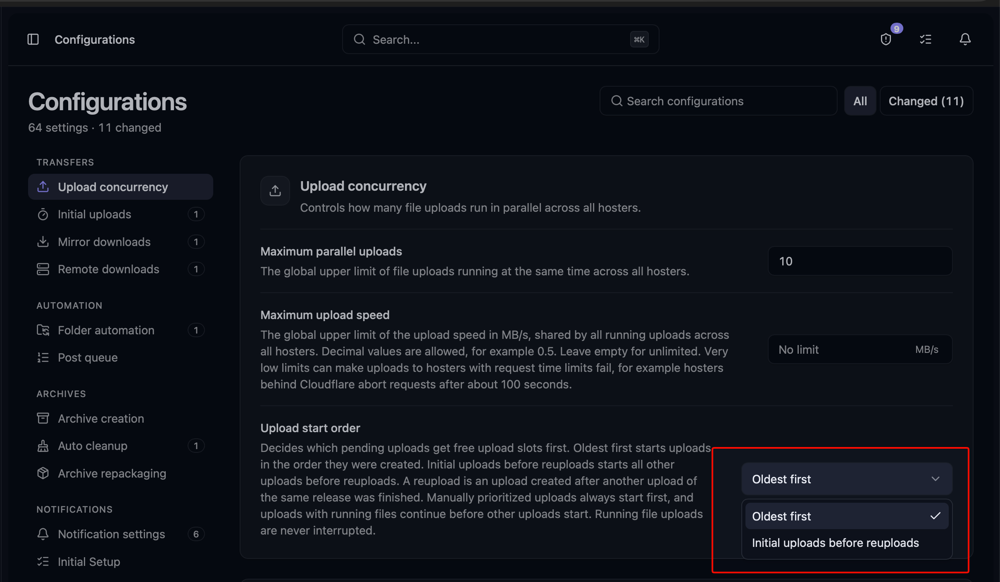
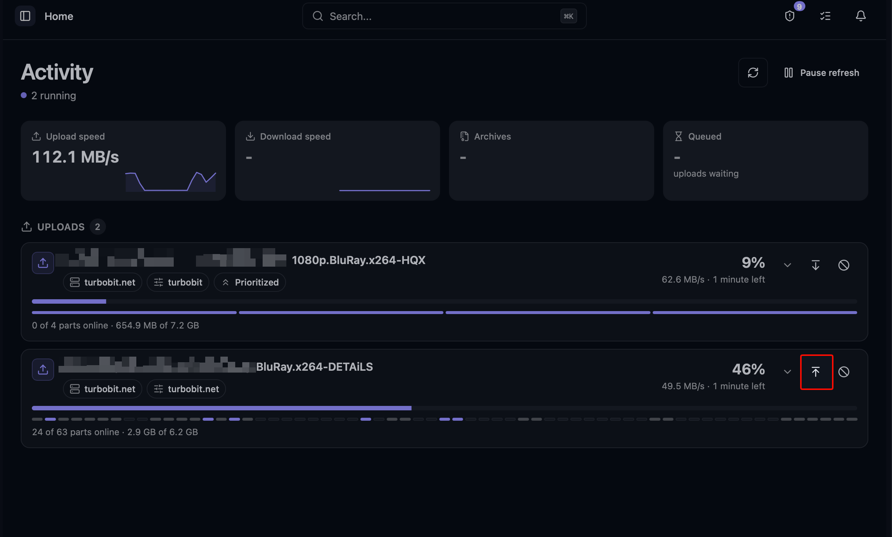
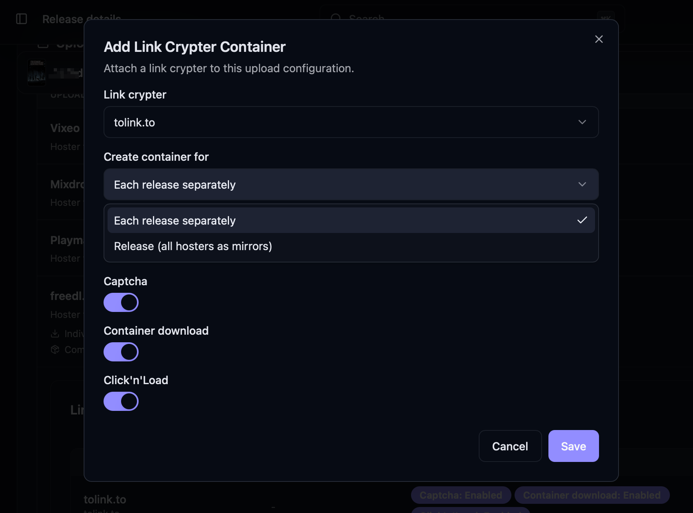
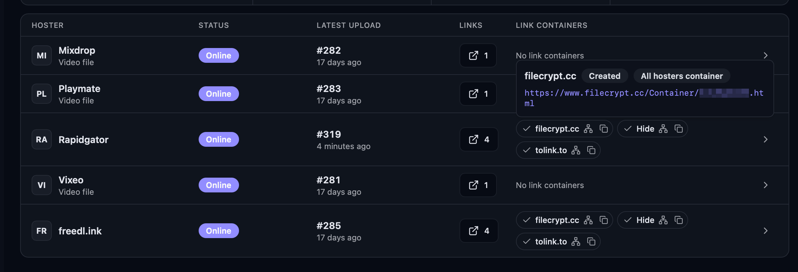
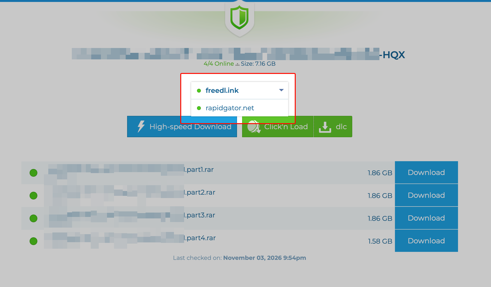
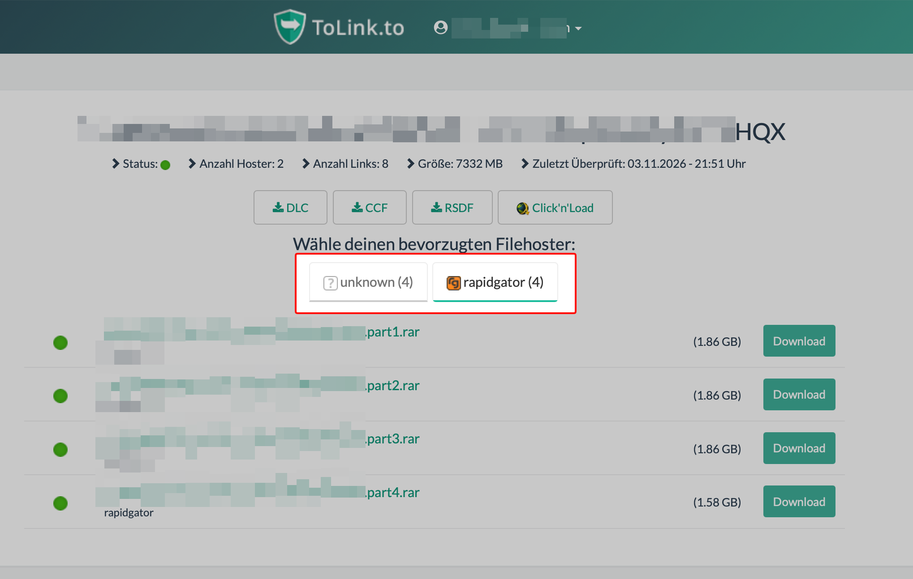

After you add an upload configuration, Bearcat prepares the archive, uploads it, and checks its links.
Enable automatic reuploads in the release group if you want Bearcat to replace files that go offline.

<details>
<summary>Show the upload flow</summary>



</details>

## 1. Release and upload configuration

Open a release and go to **Uploads > Configuration**. Click **Add** to create an upload
configuration, then choose its archive configuration and upload target:
a single hoster registration or an [account pool](/account-pools/).
You can also choose link crypter configurations.

Create an upload configuration for each hoster. Several configurations for the same hoster are
possible, for example with different part sizes.

With the upload source **Video file**, Bearcat uploads the main video directly to a
[video hoster](/video-hosters/). These uploads start as `Pending` and skip `WaitingForArchive`
and archive creation.

## 2. The first upload

The **Initial upload cooldown** starts when the release is created.
Set it under **System > Configurations > Initial uploads** (default: `5` minutes).

Once the cooldown has passed and an upload configuration exists, Bearcat schedules the first upload
on its next check. Set `0` minutes to skip the wait.
The release must also pass [quality checks](/quality-gates/) or be manually approved.

To skip the wait for a release, click **Start uploads now** at the top of its detail page. The button
appears if at least one upload configuration has no upload yet. Bearcat creates the missing uploads
right away and packs the files on the next archive creation run. Quality checks still apply.
You can also start these uploads through the [REST API](/rest-api/).

## 3. Creating the archive

For each waiting upload, Bearcat prepares an archive:

1. Reuse a finished archive for the same archive configuration, if possible. If the archive lies in a
   [storage folder](/archive-storage-folders/#reuploads), the upload reads it there, or Bearcat
   first copies the files to upload into a temporary local working copy, depending on the storage folder.
2. Restore missing local files from a configured [mirror hoster](/mirror-downloads/).
3. If neither is possible, create a new archive from the release folder.

If a storage folder is unreachable, the restore fails. Check the connection to the drive or share.
See [Reuploads from storage folders](/archive-storage-folders/#reuploads).

Bearcat can only repack [managed releases](/release-types/). Unmanaged releases need local
archive files or an available mirror.

The archive configuration sets the archiver, output folder, filename prefix, password, and part size.
It also has two packing options:

- **Pack release folder as root folder** (default: on): the archive contains one folder named
  after the release folder on disk. When off, the contents of the release folder are packed
  directly at the top level of the archive.
- **Create nonce file** (default: on): Bearcat packs a random `__nonce.txt`. See
  [The nonce file and repackaging](#the-nonce-file-and-repackaging).

Changing either option only affects archives created afterwards.
You can also assign [additional archive contents](/additional-archive-contents/), such as
a text file with a referral link, to include whenever Bearcat creates a new archive.

After packing succeeds, the archive becomes `Created` and the upload moves to `Pending`.

If packing fails, the archive becomes `CreationFailed` and the upload moves to `Failed`.
Bearcat deletes the partial archive files and saves the error on the upload.
You can then create a manual reupload or delete the failed upload.

To remove the archive entry, select **Delete failed archive** in the archive details.

For reuploads, Bearcat may need to change the archive hashes or repack the files. See
[Archive reuse and repackaging](#archive-reuse-and-repackaging) for the details.

### Cancel a running archive creation

Cancel a running archive creation in the **Archives** section on **Home**. This also works during
MD5 calculation or hash changes to a reused archive.

- **New archive:** Bearcat deletes the archive and its files.
- **Reused archive:** the archive is kept. Files whose hash change did not finish get new hashes
  before the archive is assigned to the next upload.

In both cases the uploads waiting for that archive become `Canceled`. Create a manual reupload when
you want to try again. If you stop Bearcat, an interrupted archive creation
continues or the archive is repacked on the next start.

## 4. Uploading to the hoster

The **Archive upload** background task starts `Pending` uploads and changes their state to `Uploading`.

| Result | Upload state | Online state |
| --- | --- | --- |
| All files uploaded | `Completed` | `Online` |
| Some files failed | `Failed` | `PartiallyOnline` |

Bearcat records a timestamp for successful uploads. Follow progress on the release detail page
under **Uploads** > **History**. **Overview** shows the latest upload for each upload configuration.

### Start order

When an upload slot becomes free, Bearcat uploads the next file in this order:

1. Manually prioritized uploads, the most recently prioritized first.
2. Uploads already transferring files.
3. The remaining uploads, based on **Configurations > Upload start order**:
   - **Oldest first** (default): uploads start in the order they were created.
   - **Initial uploads before reuploads**: initial uploads start first, then reuploads. Within each group, the oldest uploads start first.

An upload counts as a reupload if another upload of the same release had already finished when it was created.



On **Home**, click **Prioritize upload** next to an upload in the **Uploads** section to give it priority.
On the release detail page, the same action is in the `...` menu under **Uploads > History**.
You can prioritize uploads in the `Pending` or `Uploading` state. The change takes effect within seconds.
Running file uploads are not interrupted. **Remove prioritization** returns the upload to the normal order.



## 5. Link crypter containers

After a successful upload, Bearcat creates a container with the download links for each active link
crypter configuration. If this fails, the error appears on the container and in a notification.

A [release collection](/release-collections/) gathers links from several releases in a shared
container, for example for a TV season.

In the link crypter configuration, use **Create container for** to choose which links the container holds:

| Create container for | Container content |
| --- | --- |
| **Each release separately** | One container per upload configuration with the links of its latest upload. |
| **Release (all hosters as mirrors)** | One container per release and link crypter. Each upload configuration with this setting adds its latest completed upload as a mirror. |
| **The whole release collection** | One container per collection upload slot, see [release collections](/release-collections/). |



To create releases from existing FileCrypt, Hide.cx or ToLink folders, see
[Import existing link crypter folders](/import-link-crypter-folders/).

For **Release (all hosters as mirrors)**, the password, captcha, container download and Click'n'Load settings
must be the same in all upload configurations of the release. Otherwise Bearcat marks the container as failed
and sends a notification. FileCrypt and Hide.cx support mirrors. ToLink groups the links by the hosters it recognizes
and shows other hosters as `unknown`. KeepLinks lists all links together.







## 6. Online checks

Bearcat checks uploaded files regularly, at intervals of at least 30 minutes.
Each run checks up to 100 uploads per hoster registration, starting with the uploads checked longest ago.
With many uploads on one hoster registration, a full round can take longer than 30 minutes.

| Online state | Meaning |
| --- | --- |
| `Online` | All files are online. |
| `PartiallyOnline` | Some files are offline. |
| `Offline` | All files are offline. |

If a check fails, the previous online state is kept.
Persistent errors cause one notification per hoster registration.
Further notifications wait until you resolve it.

Bearcat notifies you if a captcha is required. Invalid credentials disable the hoster registration.
Correct them and enable the registration again. This also applies to errors during uploading.

## 7. Automatic reuploads

Bearcat creates an automatic reupload when all of these conditions are met:

- its release group has automatic reuploads enabled
- the upload is offline according to the hoster's reupload trigger, see below
- every uploaded file has been checked at least once
- the **Hours until reupload** waiting time has passed
- no replacement upload blocks a reupload for the same upload configuration
- the release has passed [quality checks](/quality-gates/) or was manually approved

A replacement upload blocks another reupload if it is `Online` or has the state `Pending`,
`Uploading`, `WaitingForArchive`, `Failed`, or `CancellationRequested`.

Each run creates up to 100 automatic reuploads. Further due reuploads follow in the next runs.

When a reupload is due, Bearcat creates a new upload record for the same upload configuration:

```text
WaitingForArchive -> Pending -> Uploading -> Completed
```

When reusing an archive, Bearcat keeps the links still online and uploads only the missing files.
A newly packed archive must be uploaded in full because its parts cannot be mixed with those from older archives.

### Per-hoster overrides

Set [reupload overrides](/account-settings/#reupload-overrides-per-hoster) in the hoster registration:

| Setting | Effect |
| --- | --- |
| **Hours until reupload** | Overrides the release group's waiting time for this hoster. |
| **Reupload trigger: Partially or fully offline** (default) | Starts the wait when the first file goes offline. |
| **Reupload trigger: Only when fully offline** | Waits until all files are offline. If one comes back online, the period starts again the next time all files are offline. |
| **Always reupload all files** | Reuploads parts that are still online as well. |

**Only when fully offline** avoids repeated reuploads when a hoster deletes parts one at a time.
**Always reupload all files** resets the upload date for every part.

## 8. Manual reuploads

Open the release and go to **Uploads > History**. Choose **Create manual reupload**
from the affected upload's `...` menu.
This is available for `Offline`, `PartiallyOnline`, `Canceled`, or `Failed` uploads.

The same [replacement upload rules](#7-automatic-reuploads) apply.

## 9. Link crypter containers after a reupload

Bearcat updates the existing container for the same upload configuration and link crypter
configuration. This also applies to release collection containers and **Release (all hosters as mirrors)**.
In shared containers, the reupload replaces the mirror for its upload configuration.
If it succeeds, the URL stays the same and links in existing posts remain valid.

If the update fails, the container keeps its URL and gets the state `Update failed`.
Bearcat retries the update after 15 minutes. Until then, the container still holds the old links.

If the provider reports that the container no longer exists, Bearcat creates a new container with a
new URL and sends a notification. The release or release collection goes back into the [post queue](/post-queue/),
so existing posts can be updated with the new URL.

You can also update or recreate a container manually:

- **Update now** (`Created` or `Update failed`): updates the container immediately with the current links and
  settings, skipping the retry delay. Bearcat also checks whether the container still exists and recreates it
  if needed.
- **Recreate** (`Update failed` only): creates a new container with a new URL and puts the release or
  release collection back into the post queue. The old container stays with the link crypter.
  If creation fails, Bearcat keeps using the old container and its URL.

## 10. Cleanup after a successful upload

Under [Auto cleanup](/advanced-configuration/#auto-cleanup), you can convert managed releases
to unmanaged after a set period and optionally delete their release folders.
You can keep local archives, delete them, or move them to a [storage folder](/archive-storage-folders/).
Both cleanup rules are off by default.

If a later reupload needs missing archives, Bearcat restores them from a [mirror](/mirror-downloads/)
or repacks them for managed releases. Cleanup never deletes files from the hoster.

## Archive reuse and repackaging

Hosters often recognise files by their MD5 hash. If an archive was previously uploaded to the same
type of hoster, Bearcat needs new hashes before uploading it again.

Only files that are uploaded again need new hashes. The other parts keep their hash.

- **RAR:** Bearcat appends zero bytes until each file to upload has a hash not yet used for this
  archive configuration. The archive still extracts normally. Bearcat keeps the hash history even
  after local files are deleted.
- **7-Zip:** split volumes cannot be changed this way without corrupting the archive, so Bearcat
  creates a new archive instead. If no files need uploading again, it can reuse the archive.

Before changing a reused archive, Bearcat checks whether another active upload is using it.
If so, it waits until a later run. If a file to upload is missing locally, Bearcat first restores
it from a [mirror hoster](/mirror-downloads/) and changes the hashes afterwards.
For an archive in a storage folder with **Local working copy for reuploads** enabled, Bearcat
changes the hashes of the local working copy. Otherwise it changes them in the storage folder.

### The nonce file and repackaging

**Create nonce file** adds a random `__nonce.txt` to newly packed archives.
Bearcat removes it from the release folder after packing, even if packing fails.

RAR gets new hashes from appended zero bytes, with or without the nonce file.
These bytes count towards the hoster's file size limit.

7-Zip relies on repacking with a changed nonce, compression, or a larger part size.
See [Archive repackaging](/advanced-configuration/#archive-repackaging) for the strategies
and the exception for older RAR archives with missing hashes.
